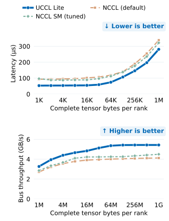
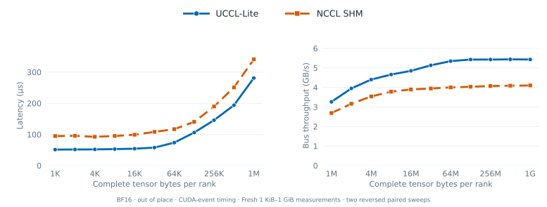
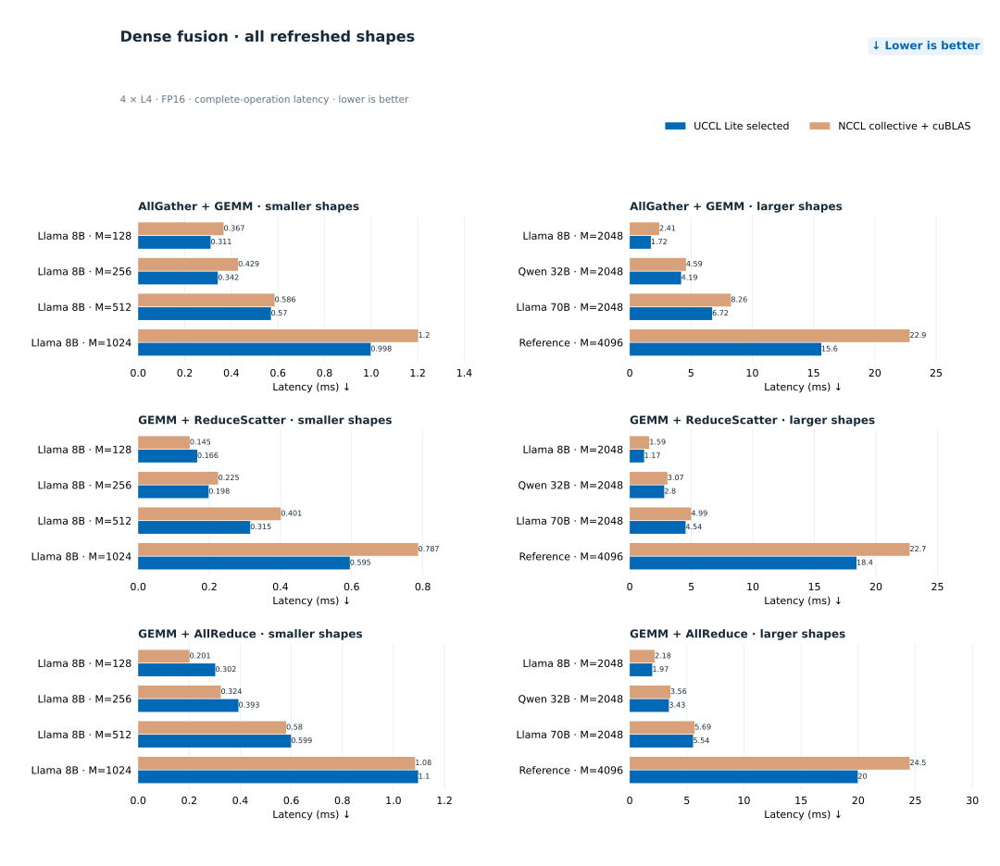
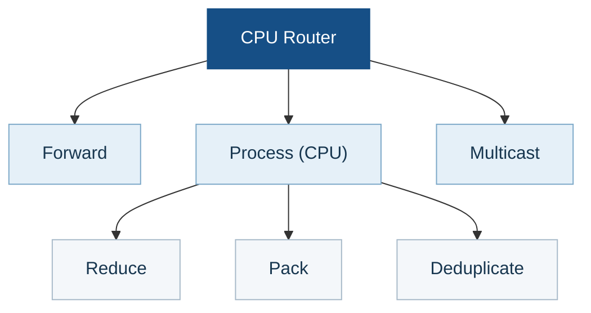

<div align="center">

# UCCL Lite

**Collectives and communication–GEMM fusion for PCIe GPU nodes.**

[Get started](#get-started) · [Results](#measured-results) · [CPU router](#optional-cpu-router) · [Documentation](#documentation)

</div>

UCCL Lite is an experimental collection of CUDA collective kernels, an
optional CPU router, fusion kernels, and hardware probes. The direct peer paths
target **four NVIDIA L4 GPUs on a PCIe Gen4 dual-socket node**; the network
paths target **two such nodes**, with two NIC rails per node. The CPU router is
a separate module for 1–32 local GPUs. Most collective and fusion paths
use MSCCL++; standalone peer AG/RS uses CUDA peer access.

The eight-L4 results were measured on a separate host with four GPUs per
NUMA node. A third, **8xL4 SHM**, testbed disables GPU peer transport on
that host by policy. Fresh four-L4, two-node, and eight-L4 dense fusion
measurements appear below with their own timing scopes. Small messages
and small GEMMs can lose to NCCL; negative results are retained.

## What is included

| Component | Purpose |
| --- | --- |
| [Profiler](docs/hardware-profiler.md) | Inspect GPU, PCIe, and NUMA topology and measure transfer bandwidth. |
| [Single-node collectives](docs/collectives.md) | AllReduce, AllGather, and ReduceScatter on one node. |
| [Multi-node collectives](docs/multinode.md) | Collective implementations across nodes using local GPU access and network rails. |
| [CPU router](docs/cpu-router.md) | Optional NUMA-aware path for local collectives, selected from measured benefit. |
| [Fusion kernels](docs/fusion.md) | Combine collective communication with GEMM and MoE stages. |

## Get started

From the UCCL repository root on the 8xL4 GPU host:

```bash
cd experimental/lite
make -j2 adaptive-collectives \
  CUDA_HOME=/usr/local/cuda-12.9 \
  CUTLASS_HOME=/data/zhongjie/cutlass-v4.5.0 \
  NCCL_HOME=build/nccl-2.28.9
./build/uccl_lite_collectives --gpus 8 --fallback nccl \
  --backend force --op allreduce --begin 1048576 --end 1048576 \
  --warmup 1 --iterations 1 --repeats 3
```

The eight-GPU benchmark checks every invocation. Verify the device order with
`nvidia-smi topo -m` before running them. The 2+2 four-GPU programs need their
own machine. [Build details](docs/build.md) cover NCCL, CUTLASS, MSCCL++, and
the two-node launcher.

## Measured results

### SGLang end-to-end (8×L4)

Experimental BF16 AG/RS/AR drop-in on 8×NVIDIA L4 with GLM-4.5-Air-FP8
and SGLang TP8/DP8/EP8. For 64 requests of 256 input and 32 output tokens
(32 running maximum), three-run median whole-batch latency was **14.72 s
with UCCL Lite vs 15.84 s with NCCL: 7.1% lower**. This fixed packet
configuration includes queueing in the measured time.


[Full measurements](integration/nccl_lite/README.md) include a real
112-request trace whose final completion was 3.3% slower with UCCL Lite.
An [opt-in SGLang MoE epilogue plus RS experiment](integration/nccl_lite/fusion_rs_8l4_20261112.md)
also shows small end-to-end gains against the packet proxy on two separate
workloads. Its effective running-request limit was four, so those timings
should not be combined with the 32-running-request result above.
The subsequent [AG+gate GEMM and RS SGLang experiment](integration/nccl_lite/fusion_ag_rs_8l4_20261112.md)
reports a 3.0% whole-batch gain for one short workload with a numerically
matching AG/cuBLAS path. A separate 256-output-token decode-heavy batch
showed a 2.9%–3.9% gain against before/after packet controls; the measured
32- and 64-request workloads were tied or slower.
An [opt-in row-ready MoE combine plus RS integration](integration/nccl_lite/fusion_ready_rs_8l4_20261112.md)
reduced a separate 8-request, 256-output-token whole batch by 4.7%–5.6%
versus before/after packet controls on its initial source revision. A later
current-source comparison showed only a 1.0% reduction, so the larger gain
remains historical. In a further same-source retest, the long-output batch
was 2.4% lower than packet, while a short-output batch was tied. It schedules
RS on a separate stream
against per-row combine readiness; the FP8 down GEMM still completes before
combine begins. A direct GPU overlap timeline was not captured.
The subsequent [FP8 down GEMM readiness prototype](integration/nccl_lite/fusion_down_gemm_rs_8l4_20261112.md)
passed decode-shape checks but showed no incremental end-to-end gain; it
remains opt-in.
The [safe AG+gate and ready RS combined run](integration/nccl_lite/fusion_ag_rs_8l4_20261112.md#safe-aggate-with-row-ready-rs)
reached 2.543/36.349 s versus 2.694/37.354 s for packet on 8-request
16/256-output-token batches (5.6%/2.7% lower). Its gain over ready RS alone
on the longer batch was only 0.3% in this sequential test.

### Single-node collectives

The latest four-L4 FP32 study covers **1 KiB–1 GiB for native AllReduce**,
**16 B–1 GiB for AllGather/ReduceScatter**, and **16 B–1 MiB for all three in
prepared resident mode**. Each ordinary collective has two panels: **1 KiB–1 MiB
latency** and **1 MiB–1 GiB bus throughput**, matching the 8×L4 overview format.
Sizes are full AR/RS input or AG output bytes per GPU.

Ordinary AR uses four processes, in-place buffers and the maximum-rank host
call timer (5 warmups, 3 alternating rounds × 10 calls). AG/RS use one process,
out-of-place buffers and maximum-GPU eager CUDA events (20 warmups,
3 rotated rounds × 10 calls). Each curve selects the lowest checked UCCL median
per size; these are benchmark envelopes, not a portable runtime routing policy.
NCCL 2.28.7 uses the same timing and placement as its paired candidate.
The 1-MiB point appears in both panels. Bus throughput is `1.5 × bytes / time`
for four-rank AR and `0.75 × bytes / time` for AG/RS, in decimal GB/s.
[Methods, all candidates, correctness and negative results](benchmarks/data/small_medium_4l4_20261113/README.md).

#### AllReduce on single 4xL4 GPU


The native hierarchy now has explicit 1-/8-CTA candidates. At 1 MiB the
8-CTA path takes **122.96 µs** versus paired NCCL **140.73 µs**. The benchmark's
pageable-H2D input-readiness race was fixed before accepting these results.
The separate large-message experimental hybrid still has its
[own timing contract and measurements](benchmarks/data/optimization_4l4_20261113/EXPERIMENTS.md).

#### AllGather on single 4xL4 GPU


The new fused `mini-host` candidate improves **1–16 MiB**. At 1 / 4 MiB it
takes **66.43 / 188.79 µs**, versus prior UCCL candidates **72.82 / 241.38 µs**
in the same sweep. The 4-MiB NCCL loss is closed. Larger sizes retain the
per-source packet pipeline.

#### ReduceScatter on single 4xL4 GPU


The phased LL hierarchy improves the small-message region: **32 KiB takes
19.47 µs**, versus paired NCCL **30.43 µs**. The fused single-CTA path remains
useful in the medium range, and the pipelined ring handles larger messages.

#### Complete ordinary-call table

Each cell is **UCCL / paired NCCL, in µs**; † marks a slower UCCL median.
Do not compare AR and AG/RS timers directly. Run ranges are retained in the
[AR](benchmarks/data/small_medium_4l4_20261113/ar_selected.csv),
[AG](benchmarks/data/small_medium_4l4_20261113/ag_selected.csv) and
[RS](benchmarks/data/small_medium_4l4_20261113/rs_selected.csv) CSVs; AG/RS also
include the 16–512 B points. Small differences are not significance claims.

| Full bytes/GPU | AllReduce | AllGather | ReduceScatter |
| ---: | ---: | ---: | ---: |
| 1 KiB | 13.81 / 20.22 | 14.28 / 27.24 | 14.86 / 27.71 |
| 2 KiB | 14.38 / 19.65 | 14.39 / 27.59 | 15.16 / 27.60 |
| 4 KiB | 14.13 / 20.49 | 14.28 / 27.71 | 15.16 / 27.58 |
| 8 KiB | 15.72 / 21.07 | 14.53 / 28.10 | 16.75 / 28.36 |
| 16 KiB | 21.26 / 22.61 | 14.72 / 29.75 | 19.08 / 29.32 |
| 32 KiB | 24.20 / 23.61 † | 15.42 / 30.49 | 19.47 / 30.43 |
| 64 KiB | 27.52 / 29.92 | 16.02 / 33.99 | 23.15 / 33.54 |
| 128 KiB | 34.46 / 42.01 | 23.75 / 39.80 | 28.71 / 39.91 |
| 256 KiB | 47.21 / 67.95 | 29.79 / 52.76 | 36.86 / 53.02 |
| 512 KiB | 72.36 / 94.30 | 42.79 / 77.57 | 51.88 / 69.29 |
| 1 MiB | 122.96 / 140.73 | 66.43 / 99.86 | 84.82 / 91.68 |
| 2 MiB | 229.83 / 232.07 | 106.68 / 142.01 | 141.08 / 144.38 |
| 4 MiB | 428.38 / 414.29 † | 188.79 / 233.67 | 228.54 / 242.47 |
| 8 MiB | 743.33 / 774.34 | 351.89 / 414.38 | 388.56 / 441.72 |
| 16 MiB | 1,432.76 / 1,555.88 | 677.11 / 778.43 | 729.42 / 841.96 |
| 32 MiB | 2,735.49 / 3,310.81 | 1,283.04 / 1,522.86 | 1,423.72 / 1,547.16 |
| 64 MiB | 5,261.33 / 5,806.67 | 2,414.68 / 3,003.25 | 2,559.09 / 3,045.14 |
| 128 MiB | 10,313.91 / 11,488.01 | 4,691.23 / 5,971.41 | 5,030.72 / 5,995.80 |
| 256 MiB | 20,438.83 / 22,882.68 | 9,246.39 / 11,885.43 | 9,964.19 / 11,856.81 |
| 512 MiB | 40,694.23 / 45,496.36 | 18,351.97 / 23,686.68 | 19,841.98 / 23,457.39 |
| 1 GiB | 80,299.75 / 90,727.92 | 36,502.68 / 47,856.71 | 39,608.75 / 47,395.80 |

#### Prepared resident mode for small and medium messages

The resident-only [1 KiB–1 MiB plot](docs/assets/collectives-4l4-resident-1k-1m.svg)
and [16 B–1 MiB plot](docs/assets/collectives-4l4-resident-small-medium.svg) are
kept separately; this study has no 1 MiB–1 GiB throughput series.

This explicit experiment reserves one CTA per GPU and uses a packed command
word instead of per-call kernel launches. It is **input-ready and host-blocking**,
with preparation excluded; it is not a drop-in stream-enqueued API. AR is in
place, AG/RS out of place. Both sides use one process, changed signed-random
inputs, 20 warmups and 3 alternating rounds × 20 checked calls. Workers are
stopped during NCCL controls. The resident curve uses one fixed protocol rule,
not a per-size best-of envelope. Do not use device-wide synchronization while
resident workers are active; concurrent model compute is not validated.

Representative **resident / paired eager NCCL µs** (all 17 sizes are in the
[complete CSV](benchmarks/data/small_medium_4l4_20261113/resident_selected.csv)):

| Full bytes/GPU | Resident AR / NCCL | Resident AG / NCCL | Resident RS / NCCL |
| ---: | ---: | ---: | ---: |
| 16 B | 7.71 / 34.64 | 6.05 / 53.50 | 7.64 / 36.59 |
| 1 KiB | 7.65 / 33.80 | 6.03 / 30.15 | 7.42 / 29.95 |
| 16 KiB | 13.34 / 36.50 | 6.25 / 32.19 | 11.89 / 31.54 |
| 64 KiB | 18.44 / 44.21 | 8.75 / 36.11 | 15.29 / 36.19 |
| 256 KiB | 37.87 / 79.33 | 18.73 / 54.99 | 26.87 / 55.14 |
| 1 MiB | 116.76 / 150.97 | 61.80 / 103.17 | 72.49 / 95.00 |

Separate [paired NCCL graph controls](benchmarks/data/small_medium_4l4_20261113/resident_graph_selected.csv)
and the graph limitations are documented in the study. Native AR retains
nominal losses at 32 KiB and 4 MiB; none are omitted from the table above.

#### 8xL4 GPU

BF16; AllReduce in place, AllGather and ReduceScatter out of place. Updated
ordinary-call measurements now cover **every power of two from 1 KiB to 1 GiB**
for all three operations. Every point is freshly measured, with no historical
tail. Input-ready, slowest-GPU CUDA events include submission gaps: five
warmups, three rotated repetitions of ten checked calls, and two reversed
sweeps, with paired NCCL controls. AR/AG retain the full-refresh measurements;
RS uses the subsequent ring-recovery rerun at every size.
[Data and settings](benchmarks/data/overview_8l4_20261114/README.md).

AR uses compact CPU crews through 4 MiB and the regular crew/grid above it;
RS uses an opt-in mapped-host BF16 ring at 1–8 MiB and retains the earlier
implementations elsewhere. AG uses the tuned router
through 128 KiB, the new mini-host kernel at 256 KiB–1 MiB, and the existing
full GPU-progress router at 2 MiB–1 GiB. Each point retains its paired NCCL control.
This measured size-range schedule is not an automatic dispatch policy. Parallel
submission helps these dense calls but regresses after 5 ms of idle.
[Full refresh, controls and regressions](benchmarks/data/full_refresh_8l4_20261114/README.md).
[RS recovery, paired previous-code controls and validation](benchmarks/data/rs_recovery_8l4_20261114/README.md).

##### AllReduce on single 8xL4 GPU


##### AllGather on single 8xL4 GPU


##### ReduceScatter on single 8xL4 GPU



##### Prepared resident collectives on 8xL4 GPU


This separate **input-ready, host-blocking** experiment reserves one CTA per
GPU and excludes preparation from both timings. NCCL uses one eight-device
fork/join graph; resident workers stop during NCCL controls. At 1 KiB,
resident AR / AG / RS take **17.46 / 21.69 / 14.90 µs**, versus graph NCCL
**83.19 / 72.26 / 71.65 µs**. Resident AR loses at 64 KiB, as plotted.
This is not the stream-enqueued API used in the ordinary-call figures above;
concurrent model-compute performance is not established.
[Matched tables and validation](benchmarks/data/transfer_4to8_20261114/results.md).

#### 8xL4 SHM

Same eight L4s, BF16, with P2P explicitly disabled and NCCL SHM verified.
All **1 KiB–1 GiB** points are freshly and independently measured using the
same UCCL schedule and paired protocol as GPU mode. The default GPU-mode NCCL
initialization also selects SHM on this host; these are default-policy versus
explicitly disabled-P2P testbeds, not a measured P2P-versus-SHM comparison.
[Complete GPU/SHM measurements and transport evidence](benchmarks/data/full_refresh_8l4_20261114/README.md).

##### AllReduce on single 8xL4 SHM


##### AllGather on single 8xL4 SHM


##### ReduceScatter on single 8xL4 SHM



### Multi-node collectives

#### AllReduce on two 4xL4 GPU nodes


#### AllGather on two 4xL4 GPU nodes


#### ReduceScatter on two 4xL4 GPU nodes


[Two-node AllGather selected data](benchmarks/data/host_multicast_selected_2x4l4_20261111/README.md) ·
[AllReduce and ReduceScatter data](benchmarks/data/nccl_tuned_2x4l4_20261111/README.md)

### Fusion on single 4xL4 GPU

#### Dense AG+GEMM, GEMM+RS, GEMM+AR



#### Expert-parallel MoE


[Fusion data and limits](docs/fusion.md)

### Fusion on single 8xL4 GPU

The eight L4s span two NUMA groups. Figures compare cuBLAS + NCCL, cuBLAS +
CPU router, and fused GEMM + CPU router. Values are slowest-GPU CUDA-event
latencies, aggregated across two runs. Data: [AR](benchmarks/data/fusion_8l4_models_20261111/README.md),
[AG](benchmarks/data/fusion_8l4_models_ag_rs_20261111/README.md),
[optimized RS](benchmarks/data/fusion_rs_8l4_optimized_20261111/README.md).

#### GEMM + AllReduce on single 8xL4 GPU

BF16 TP=8 FFN down projection: decode `M=1,32,64`; prefill
`M=2048,4096,8192`. Each model's `N` and per-GPU `K` appear in the figures.


Fused has the lowest median at all 24 shapes in both runs. The 12 prefill
points show 1.17–1.44× speedup over NCCL. These are isolated
GEMM + AR timings. [Full results](benchmarks/data/fusion_8l4_models_20261111/README.md)
and the [older five-shape figure](docs/assets/fusion-8l4-gemm-ar.svg) are
available separately.

#### AllGather + GEMM on single 8xL4 GPU

Decode uses `M=8,32,64`; the eight-rank AllGather cannot split `M=1`
into input shards. Prefill uses `M=2048,4096,8192`.


Sequential CPU router is fastest at all 12 decode shapes; fused is fastest
at all 12 prefill shapes. [Data](benchmarks/data/fusion_8l4_models_ag_rs_20261111/README.md)
and the [older figure](docs/assets/fusion-8l4-ag-gemm.svg).

#### GEMM + ReduceScatter on single 8xL4 GPU

Decode uses `M=1,32,64`; prefill uses `M=2048,4096,8192`.


In this sweep after the prefill scheduling fix, fused is faster than sequential
CPU router at all 12 prefill shapes (1.008×–1.101×) and all 12 decode shapes.
NCCL wins some decode points. [Optimized data](benchmarks/data/fusion_rs_8l4_optimized_20261111/README.md)
and [historical data](benchmarks/data/fusion_8l4_models_ag_rs_20261111/README.md).

#### Other fusion workloads

The four-GPU expert-parallel MoE results above use CUDA IPC peer links.
MoE has not been ported across this host's two four-GPU NUMA groups.

## Optional CPU router

### Motivation

When GPU Direct P2P is unavailable between GPU groups, their data already
needs a host-mediated path. The CPU router uses that host-memory stop to do
useful work with otherwise idle CPU cores: reduce packets before forwarding
them and share a packet with multiple destinations. Reusable packet operators
also support packing and deduplication. Routing is most promising when PCIe
transfers constrain the collective while NUMA-local host
memory and spare CPU cores can keep up with the packet flow. Fast direct P2P
or contention for host memory can erase that advantage.

### High-level design

The optional CPU router exchanges packets through NUMA-local pinned host
memory. **Forward** moves a packet, **Multicast** sends one packet to multiple
destinations, and **Process (CPU)** transforms packet contents with Reduce,
Pack, and Deduplicate operators. Collectives compose these operations, with
packet slots and reader credits preventing reuse until consumers finish.



The `Process (CPU)` operators can be used in different collectives:

- **Reduce** combines contributions for AllReduce and ReduceScatter.
- **Pack** assembles fragments for AllGather and token buffers for
  dispatch/combine.
- **Deduplicate** removes repeated token records in dispatch/combine. The
  included fixed-width operator is intended for small routing metadata.

### 8xL4 collective packet flows

Each animation shows all eight GPUs and one packet stage at a time. Larger
tensors pipeline many packets.

#### AllReduce


#### AllGather


#### ReduceScatter


Regenerate all three GIFs with `python3 scripts/animate_cpu_router.py` from
`experimental/lite` (requires Pillow).

## Documentation

- [Build targets and correctness commands](docs/build.md)
- [Hardware profiler methods and measurements](docs/hardware-profiler.md)
- [Collective algorithms](docs/collectives.md) and [two-node design](docs/multinode.md)
- [Fusion design and workloads](docs/fusion.md)
- [NCCL drop-in and SGLang integration](integration/nccl_lite/README.md)
- [Full measurement files](benchmarks/README.md) and [validation limits](docs/validation.md)

UCCL Lite provides specialized research kernels and benchmarks, with an
experimental NCCL compatibility layer and SGLang hooks under `integration/`.
The project follows the repository [license](../../LICENSE); the adapted CUTLASS wrapper retains
its [upstream notice](NOTICE.md).
