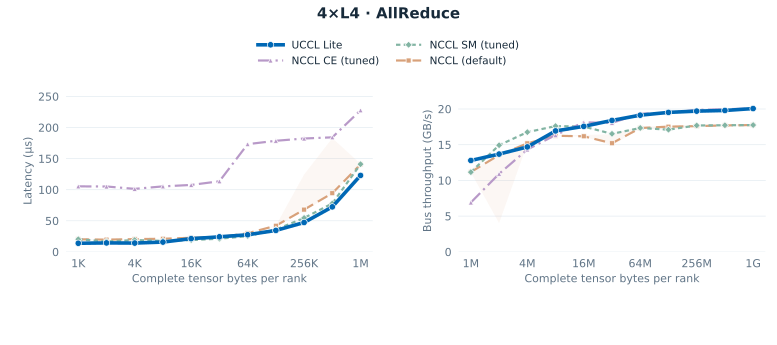
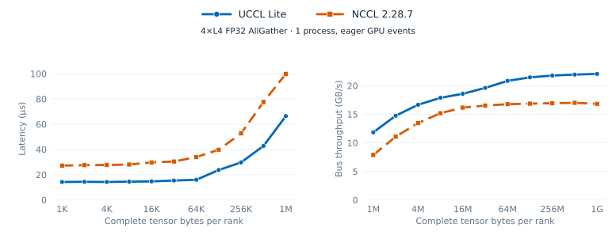
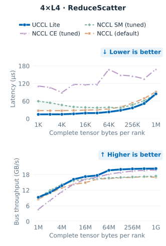
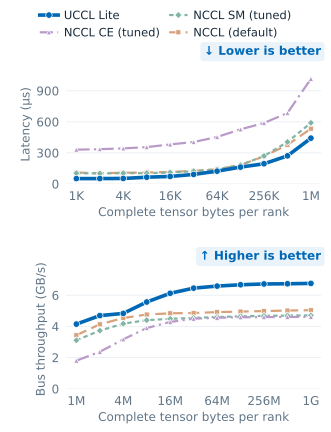
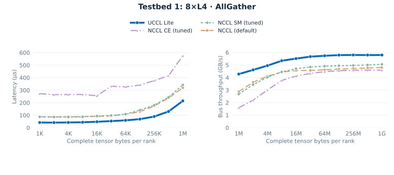
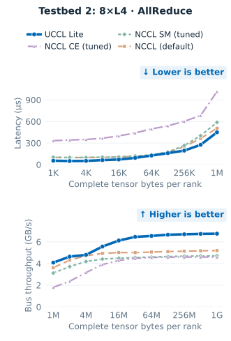
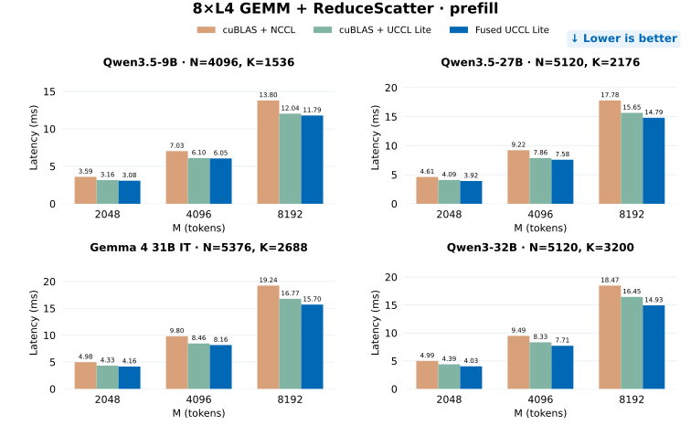
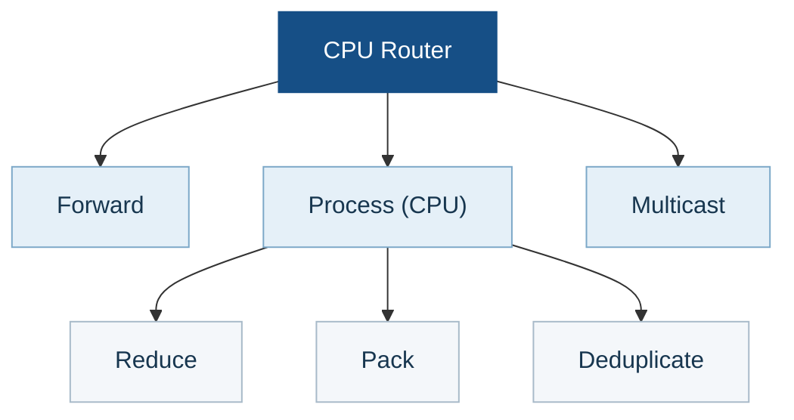

<div align="center">

# UCCL Lite

**Collectives and communication–GEMM fusion for PCIe GPU nodes.**

[Get started](#get-started) · [Results](#measured-results) · [CPU router](#optional-cpu-router) · [Documentation](#documentation)

</div>

UCCL Lite is an experimental collection of CUDA collective kernels, an
optional CPU router, fusion kernels, and hardware probes. The direct peer paths
target **four NVIDIA L4 GPUs on a PCIe Gen4 dual-socket node**; the network
paths target **two such nodes**, with two NIC rails per node. The CPU router is
a separate module for 1–32 local GPUs. Most collective and fusion paths
use MSCCL++; standalone peer AG/RS uses CUDA peer access.

The eight-L4 results were measured on a separate host with four GPUs per
NUMA node. A third, **8xL4 SHM**, testbed disables GPU peer transport on
that host by policy. Fresh four-L4, two-node, and eight-L4 dense fusion
measurements appear below with their own timing scopes. Small messages
and small GEMMs can lose to NCCL; negative results are retained.

## What is included

| Component | Purpose |
| --- | --- |
| [Profiler](docs/hardware-profiler.md) | Inspect GPU, PCIe, and NUMA topology and measure transfer bandwidth. |
| [Single-node collectives](docs/collectives.md) | AllReduce, AllGather, and ReduceScatter on one node. |
| [Multi-node collectives](docs/multinode.md) | Collective implementations across nodes using local GPU access and network rails. |
| [CPU router](docs/cpu-router.md) | Optional NUMA-aware path for local collectives, selected from measured benefit. |
| [Retained router / peer optimizations](docs/retained-optimizations.md) | Optional BF16 joint interface, retained CPU/packet improvements, measured limitations and reproduction. |
| [Fusion kernels](docs/fusion.md) | Combine collective communication with GEMM and MoE stages. |

The RTX PRO 6000 BF16 peer path shares inline copy/reduction primitives with
four-L4 FP32 peer collectives and the eight-L4 BF16 local fallback. One prepared
peer executor owns the two/four-rank CUDA schedule; the joint layer owns
validation and calibrated backend selection. See the
[shared implementation and refactor checks](docs/retained-optimizations.md#shared-collective-components).

## Get started

From the UCCL repository root on the 8xL4 GPU host:

```bash
cd experimental/lite
make -j2 adaptive-collectives \
  CUDA_HOME=/usr/local/cuda-12.9 \
  CUTLASS_HOME=/data/zhongjie/cutlass-v4.5.0 \
  NCCL_HOME=build/nccl-2.28.9
./build/uccl_lite_collectives --gpus 8 --fallback nccl \
  --backend force --op allreduce --begin 1048576 --end 1048576 \
  --warmup 1 --iterations 1 --repeats 3
```

The eight-GPU benchmark checks every invocation. Verify the device order with
`nvidia-smi topo -m` before running them. The 2+2 four-GPU programs need their
own machine. [Build details](docs/build.md) cover NCCL, CUTLASS, MSCCL++, and
the two-node launcher.

## Measured results

Recorded measurements; linked studies document hardware, dtype, baselines,
timing scope, repetitions, variant selection and limitations.

### SGLang end-to-end (8×L4)

[Experimental setup and measurements](integration/nccl_lite/README.md).


### Single-node collectives

[Four-L4 FP32 methods and data](benchmarks/data/small_medium_4l4_20261113/README.md).

#### AllReduce on single 4xL4 GPU



#### AllGather on single 4xL4 GPU



#### ReduceScatter on single 4xL4 GPU



#### Prepared resident mode for small and medium messages


#### RTX PRO 6000 ×2

[BF16 methods and data](benchmarks/data/pro6000_b0ac7b4a_validation/README.md) · [Tuned NCCL](benchmarks/data/nccl_tuned_pro6000_20261115/README.md) · [Ascending-only NCCL](benchmarks/data/nccl_ascending_pro6000_20261115/README.md).

##### AllReduce on RTX PRO 6000 ×2


##### AllGather on RTX PRO 6000 ×2


##### ReduceScatter on RTX PRO 6000 ×2


#### 8xL4 GPU

[BF16 methods and data](benchmarks/data/overview_8l4_20261114/README.md) · [Full refresh](benchmarks/data/full_refresh_8l4_20261114/README.md) · [RS recovery](benchmarks/data/rs_recovery_8l4_20261114/README.md).

##### AllReduce on single 8xL4 GPU



##### AllGather on single 8xL4 GPU



##### ReduceScatter on single 8xL4 GPU


##### Prepared resident collectives on 8xL4 GPU

[Experimental resident timing and validation](benchmarks/data/transfer_4to8_20261114/results.md).


#### 8xL4 SHM

[BF16 methods, data and transport policy](benchmarks/data/full_refresh_8l4_20261114/README.md).

##### AllReduce on single 8xL4 SHM



##### AllGather on single 8xL4 SHM


##### ReduceScatter on single 8xL4 SHM


### Multi-node collectives

[FP32 AllGather methods and data](benchmarks/data/host_multicast_selected_2x4l4_20261111/README.md) · [AllReduce and ReduceScatter](benchmarks/data/nccl_tuned_2x4l4_20261111/README.md).

#### AllReduce on two 4xL4 GPU nodes


#### AllGather on two 4xL4 GPU nodes


#### ReduceScatter on two 4xL4 GPU nodes


### Fusion on single 4xL4 GPU

[Fusion methods, data and limitations](docs/fusion.md).

#### Dense AG+GEMM, GEMM+RS, GEMM+AR


#### Expert-parallel MoE


### Fusion on single 8xL4 GPU

[BF16 AR methods and data](benchmarks/data/fusion_8l4_models_20261111/README.md) · [AG](benchmarks/data/fusion_8l4_models_ag_rs_20261111/README.md) · [RS](benchmarks/data/fusion_rs_8l4_optimized_20261111/README.md).

#### GEMM + AllReduce on single 8xL4 GPU


#### AllGather + GEMM on single 8xL4 GPU


#### GEMM + ReduceScatter on single 8xL4 GPU




## Optional CPU router

### Motivation

When GPU Direct P2P is unavailable between GPU groups, their data already
needs a host-mediated path. The CPU router uses that host-memory stop to do
useful work with otherwise idle CPU cores: reduce packets before forwarding
them and share a packet with multiple destinations. Reusable packet operators
also support packing and deduplication. Routing is most promising when PCIe
transfers constrain the collective while NUMA-local host
memory and spare CPU cores can keep up with the packet flow. Fast direct P2P
or contention for host memory can erase that advantage.

### High-level design

The optional CPU router exchanges packets through NUMA-local pinned host
memory. **Forward** moves a packet, **Multicast** sends one packet to multiple
destinations, and **Process (CPU)** transforms packet contents with Reduce,
Pack, and Deduplicate operators. Collectives compose these operations, with
packet slots and reader credits preventing reuse until consumers finish.



The `Process (CPU)` operators can be used in different collectives:

- **Reduce** combines contributions for AllReduce and ReduceScatter.
- **Pack** assembles fragments for AllGather and token buffers for
  dispatch/combine.
- **Deduplicate** removes repeated token records in dispatch/combine. The
  included fixed-width operator is intended for small routing metadata.

### 8xL4 collective packet flows

Each animation shows all eight GPUs and one packet stage at a time. Larger
tensors pipeline many packets.

#### AllReduce


#### AllGather


#### ReduceScatter


Regenerate all three GIFs with `python3 scripts/animate_cpu_router.py` from
`experimental/lite` (requires Pillow).

## Documentation

- [Build targets and correctness commands](docs/build.md)
- [Hardware profiler methods and measurements](docs/hardware-profiler.md)
- [Collective algorithms](docs/collectives.md) and [two-node design](docs/multinode.md)
- [Fusion design and workloads](docs/fusion.md)
- [NCCL drop-in and SGLang integration](integration/nccl_lite/README.md)
- [Full measurement files](benchmarks/README.md) and [validation limits](docs/validation.md)

UCCL Lite provides specialized research kernels and benchmarks, with an
experimental NCCL compatibility layer and SGLang hooks under `integration/`.
The project follows the repository [license](../../LICENSE); the adapted CUTLASS wrapper retains
its [upstream notice](NOTICE.md).
