

   
  <strong>Efficient Communication Library for PCIe GPU nodes.</strong>

## Design principles

The topology-driven runtime's organization and current limits are described in
[the current capability audit](docs/topology-runtime-status.md), with detailed
evidence in [the migration record](docs/topology-runtime-refactor.md). The common
`nccl-runtime` entry point now offers
[collective prepared peer/host selection](docs/prepared-local-runtime.md)
for BF16/FP32 single-host workloads. The core also supports
[independently qualified owned graphs](docs/prepared-graphs.md). Historical testbed results below retain their
original configurations and do not qualify changed implementations.
The explicit core API additionally supports
[distributed network selection against a caller baseline](docs/prepared-network-runtime.md).
The [unified preparation entry point](docs/prepared-runtime.md) discovers
participants and selects the local or distributed preparation flow automatically.
The [native communicator C extension](docs/nccl-prepared-api.md) exposes that
preparation flow to C/FFI callers while retaining caller-owned NCCL fallback.
Eligible preparation now [measures missing network resource profiles](docs/automatic-network-calibration.md)
automatically before comparing the exact collective against NCCL.
Local selection additionally considers [source-ordered peer trees](docs/peer-tree-runtime.md)
derived from actual access edges, GPU-memory bandwidth and measured peer paths.
An optional [distributed plan cache](docs/network-plan-cache.md) reuses matching
resource/decision evidence across processes with fresh correctness and timing checks.
The [dependency cost model](docs/overlap-model.md) accounts for pipeline overlap
and contention on declared resources when choosing a peer-tree prior.
The [prepared NCCL ABI](docs/prepared-nccl-abi.md) uses those plans from ordinary
host NCCL calls after explicit preparation, with separately timed dispatch and
native group/capture handoff.
A [general direct-exchange executor](docs/direct-exchange.md) now supports variable
host layouts and participates in [measured distributed candidate selection](docs/network-candidate-selection.md).
Its [operation cost model](docs/direct-model-calibration.md) is calibrated during
prepare from actual copy, reduction, transport and control timings, with unknown
shared resources reported explicitly.
The [strict distributed provider](docs/strict-distributed-selection.md) uses it
as a validated reference when native NCCL is excluded.
Its opt-in [initialization adapter](docs/automatic-nccl-init.md) prepares a workload
manifest from standard communicator initialization; algorithms and paths are
selected from discovered topology and measured evidence.

- **Provide a drop-in NCCL replacement.** Preserve NCCL's API and ABI so
  supported workloads can use UCCL Lite without application code changes.
- **Exploit PCIe hierarchy.** Map collective stages to PCIe and NUMA groups.
  Reduce within groups before exchanging across them, then distribute results
  locally to limit cross-socket traffic.
- **Specialize by size.** Cut launches and handshakes for small messages, where
  fixed overhead dominates. Pipeline large transfers to sustain bandwidth and
  amortize coordination costs.
- **Put CPUs to work.** When P2P is limited, our CPU router uses spare cores and
  NUMA-local memory to combine contributions before forwarding and serve
  multiple destinations from one staged copy, reducing redundant transfers.
- **Overlap communication and compute.** Start GEMM on arriving inputs and
  communication on ready outputs. Choose chunk sizes that expose overlap
  without fragmenting GEMM into inefficient small operations.

## Testbeds

<table align="center">
  <tr><th>#</th><th>GPUs</th><th>GPU P2P</th><th>PCIe switch P2P</th><th>PCIe root complex P2P</th></tr>
  <tr><td>1</td><td>8 × NVIDIA L4</td><td>Partial support</td><td align="center">✓</td><td align="center">✗</td></tr>
  <tr><td>2</td><td>8 × NVIDIA L4</td><td>Not supported</td><td align="center">✗</td><td align="center">✗</td></tr>
  <tr><td>3</td><td>4 × NVIDIA L4</td><td>Full support</td><td align="center">✗</td><td align="center">✓</td></tr>
  <tr><td>4</td><td>2 × NVIDIA RTX PRO 6000</td><td>Full support</td><td align="center">✓</td><td align="center">✗</td></tr>
  <tr><td>5</td><td>8 × NVIDIA RTX PRO 6000</td><td>Full support</td><td align="center">✓</td><td align="center">✓</td></tr>
</table>

## What is included

<table align="center">
  <tr><th>Component</th><th>Purpose</th></tr>
  <tr><td><a href="docs/hardware-profiler.md">Profiler</a></td><td>Inspect GPU, PCIe, and NUMA topology and measure transfer bandwidth.</td></tr>
  <tr><td><a href="docs/collectives.md">Single-node collectives</a></td><td>AllReduce, AllGather, and ReduceScatter on one node.</td></tr>
  <tr><td><a href="docs/multinode.md">Multi-node collectives</a></td><td>Collective implementations across nodes using local GPU access and network rails.</td></tr>
  <tr><td><a href="docs/cpu-router.md">CPU router</a></td><td>Optional NUMA-aware path for local collectives, selected from measured benefit.</td></tr>
  <tr><td><a href="docs/fusion.md">Fusion kernels</a></td><td>Combine collective communication with GEMM and MoE stages.</td></tr>
</table>

## Measured results

### End-to-end serving and training

#### Testbed 1

<table>
  <tr><th>Serving</th><th>Training</th></tr>
  <tr>
    <td width="50%" valign="top"></td>
    <td width="50%" valign="top">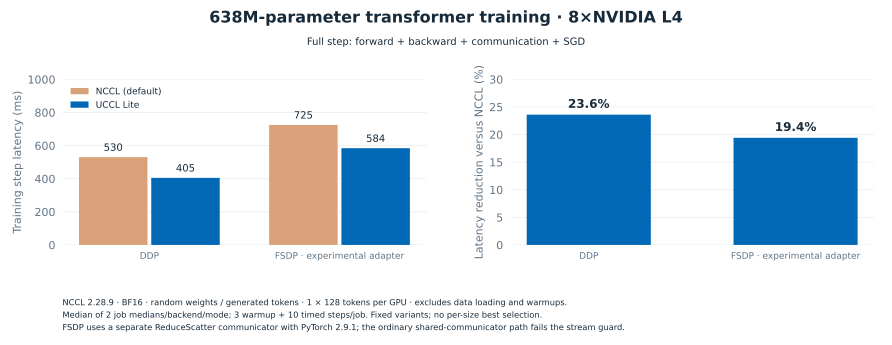</td>
  </tr>
</table>

#### Testbed 3: four L4 GPUs

GPT-2-XL BF16 · experimental parameter-sharded serving and checkpointed training.

<table>
  <tr><th>Serving</th><th>Training</th></tr>
  <tr>
    <td width="50%" valign="top">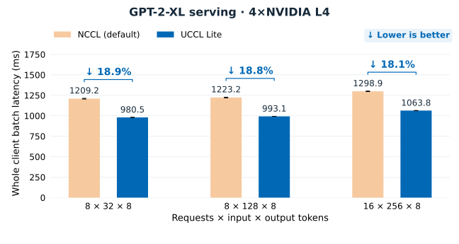</td>
    <td width="50%" valign="top">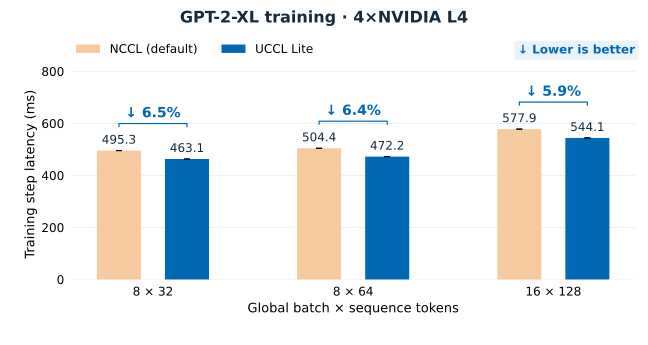</td>
  </tr>
</table>

#### Testbed 3 × 2 nodes

DP2 × shard4; global batch doubles with GPU count (weak scaling).

<table>
  <tr><th>Serving</th><th>Training</th></tr>
  <tr>
    <td width="50%" valign="top">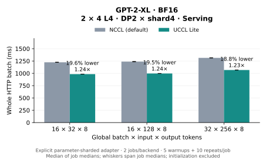</td>
    <td width="50%" valign="top">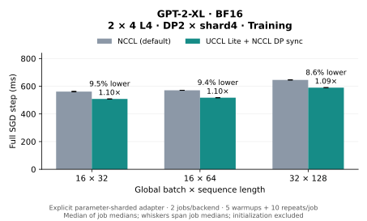</td>
  </tr>
</table>

[Experiment setup, numerical checks and raw data](integration/l4_e2e/README.md).

#### Testbed 4

Both workloads below use an explicit parameter-sharded application adapter,
not a drop-in NCCL replacement.

<table>
  <tr><th>Serving</th><th>Training</th></tr>
  <tr>
    <td width="50%" valign="top"></td>
    <td width="50%" valign="top"></td>
  </tr>
</table>

The [PRO 6000 experiment](integration/peer_e2e/README.md) records communication
fractions, numerical checks, raw repetitions and the parameter-sharded adapter's
scope. Its per-layer BF16 AG/RS messages are 37.53 MiB; this is a separate
workload from Testbed 1's SGLang serving and DDP/FSDP training.

### Single-node collectives

#### Testbed 1

<table>
  <tr><th>AllReduce</th><th>AllGather</th><th>ReduceScatter</th></tr>
  <tr>
    <td width="33%"></td>
    <td width="33%"><a href="benchmarks/data/nccl_local8_strict_20261119/README.md">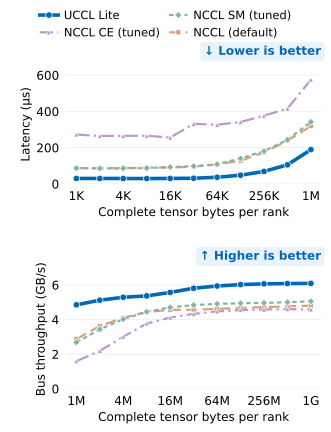</a></td>
    <td width="33%"><a href="benchmarks/data/nccl_local8_strict_20261119/README.md">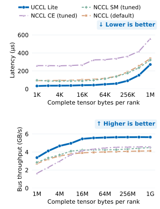</a></td>
  </tr>
</table>

#### Testbed 2

<table>
  <tr><th>AllReduce</th><th>AllGather</th><th>ReduceScatter</th></tr>
  <tr>
    <td width="33%"><a href="benchmarks/data/nccl_local8_strict_20261119/README.md">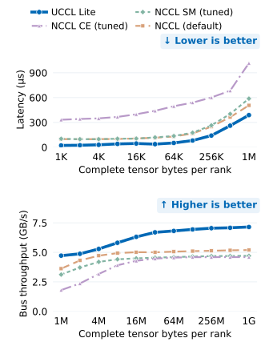</a></td>
    <td width="33%"><a href="benchmarks/data/nccl_local8_strict_20261119/README.md">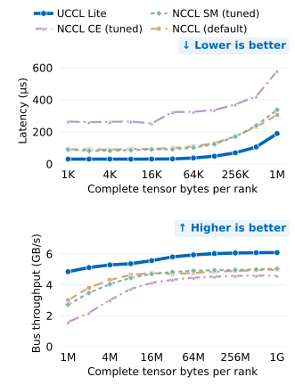</a></td>
    <td width="33%"></td>
  </tr>
</table>

#### Testbed 3

<table>
  <tr><th>AllReduce</th><th>AllGather</th><th>ReduceScatter</th></tr>
  <tr>
    <td width="33%"></td>
    <td width="33%"></td>
    <td width="33%"></td>
  </tr>
</table>

#### Testbed 4

<table>
  <tr><th>AllReduce</th><th>AllGather</th><th>ReduceScatter</th></tr>
  <tr>
    <td width="33%"></td>
    <td width="33%"></td>
    <td width="33%">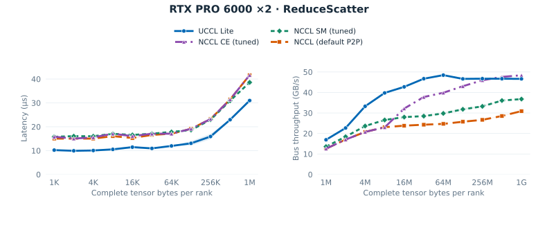</td>
  </tr>
</table>

#### Testbed 5

<table>
  <tr><th>AllReduce</th><th>AllGather</th><th>ReduceScatter</th></tr>
  <tr>
    <td width="33%"><a href="benchmarks/data/pro6000_nccl_baselines_cpp_20261116/README.md">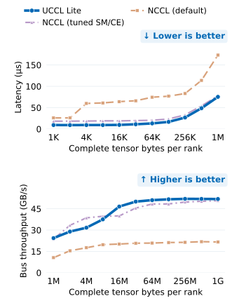</a></td>
    <td width="33%"><a href="benchmarks/data/pro6000_nccl_baselines_cpp_20261116/README.md">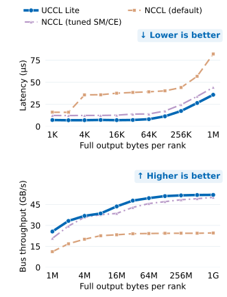</a></td>
    <td width="33%"><a href="benchmarks/data/pro6000_nccl_baselines_cpp_20261116/README.md">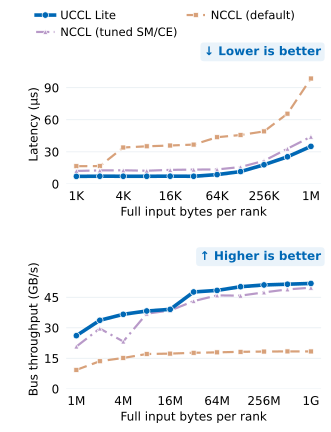</a></td>
  </tr>
</table>

### Multi-node collectives

#### Testbed 3 × 2 nodes

<table>
  <tr><th>AllReduce</th><th>AllGather</th><th>ReduceScatter</th></tr>
  <tr>
    <td width="33%">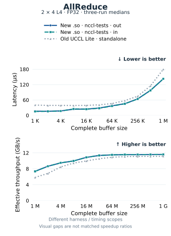</td>
    <td width="33%">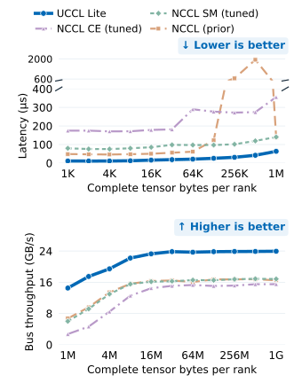</td>
    <td width="33%">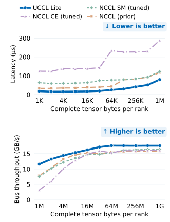</td>
  </tr>
</table>

### Fusion

#### Testbed 3

##### Dense AG+GEMM, GEMM+RS, GEMM+AR

##### Expert-parallel MoE

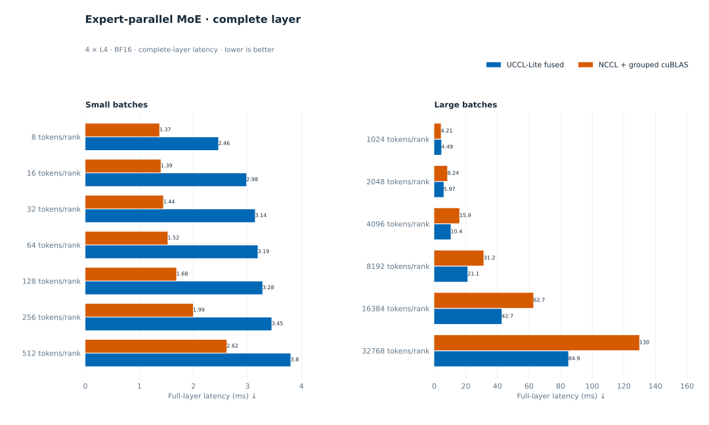

#### Testbed 1

##### GEMM + AllReduce

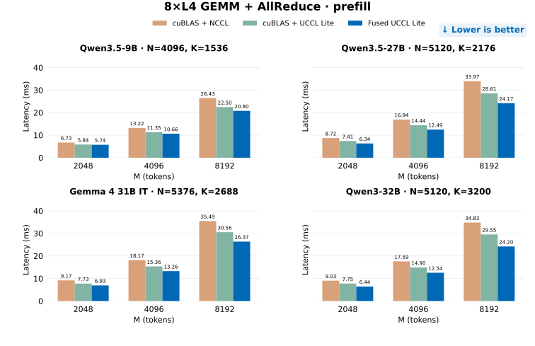

##### AllGather + GEMM

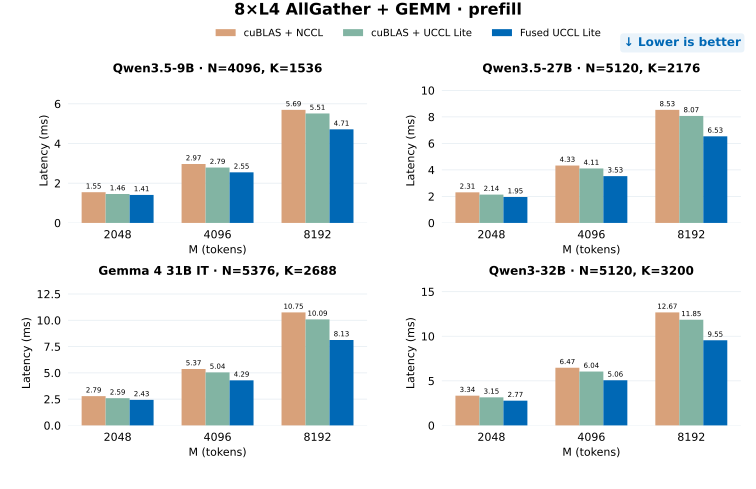

##### GEMM + ReduceScatter

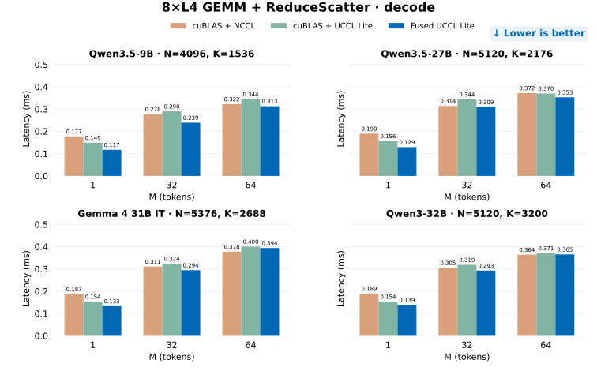

## Optional CPU router

### Motivation

When GPU Direct P2P is unavailable between GPU groups, their data already
needs a host-mediated path. The CPU router uses that host-memory stop to do
useful work with otherwise idle CPU cores: reduce packets before forwarding
them and share a packet with multiple destinations. Reusable packet operators
also support packing and deduplication. Routing is most promising when PCIe
transfers constrain the collective while NUMA-local host
memory and spare CPU cores can keep up with the packet flow. Fast direct P2P
or contention for host memory can erase that advantage.

### High-level design

The optional CPU router exchanges packets through NUMA-local pinned host
memory. **Forward** moves a packet, **Multicast** sends one packet to multiple
destinations, and **Process (CPU)** transforms packet contents with Reduce,
Pack, and Deduplicate operators. Collectives compose these operations, with
packet slots and reader credits preventing reuse until consumers finish.

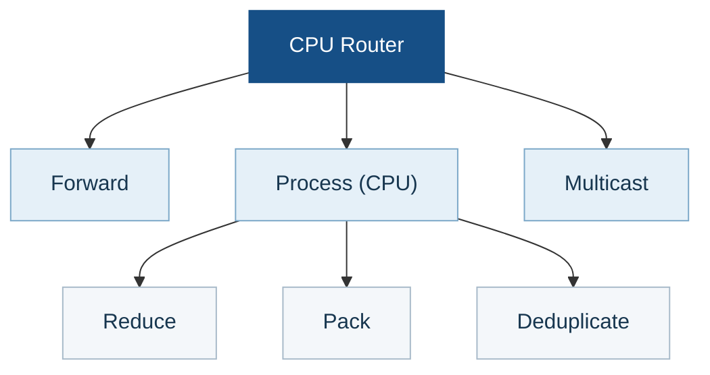

The `Process (CPU)` operators can be used in different collectives:

- **Reduce** combines contributions for AllReduce and ReduceScatter.
- **Pack** assembles fragments for AllGather and token buffers for
  dispatch/combine.
- **Deduplicate** removes repeated token records in dispatch/combine. The
  included fixed-width operator is intended for small routing metadata.

## Documentation

- [Build targets and correctness commands](docs/build.md)
- [Hardware profiler methods and measurements](docs/hardware-profiler.md)
- [Collective algorithms](docs/collectives.md) and [two-node design](docs/multinode.md)
- [Fusion design and workloads](docs/fusion.md)
- [NCCL drop-in and SGLang integration](integration/nccl_lite/README.md)
- [Strict eight-L4 NCCL `.so` replacement and nccl-tests validation](integration/nccl_lite/LOCAL8.md)
- [Full measurement files](benchmarks/README.md) and [validation limits](docs/validation.md)

UCCL Lite provides specialized research kernels and benchmarks, with an
experimental NCCL compatibility layer and SGLang hooks under `integration/`.
The project follows the repository [license](../../LICENSE); the adapted CUTLASS wrapper retains
its [upstream notice](NOTICE.md).
