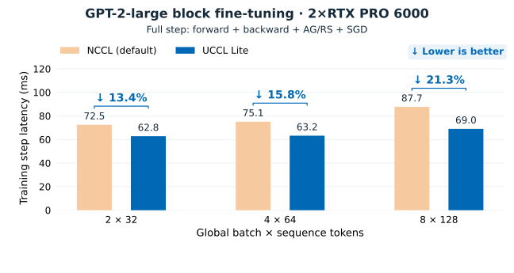
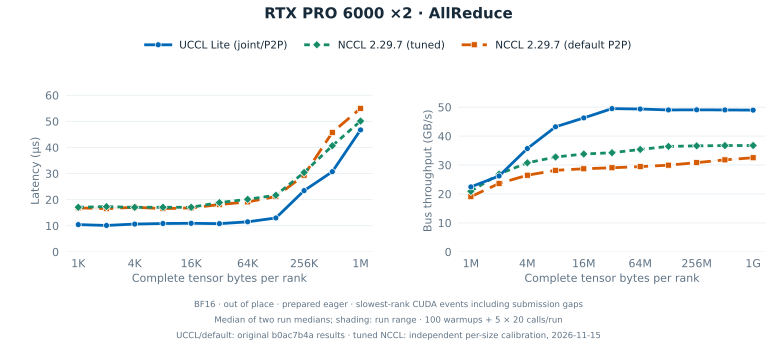
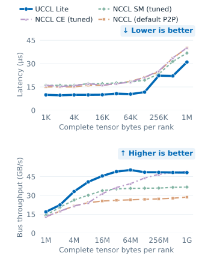
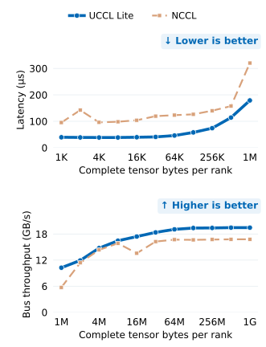
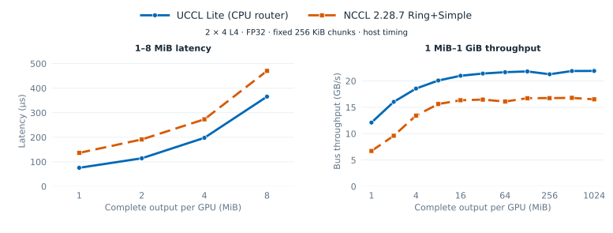
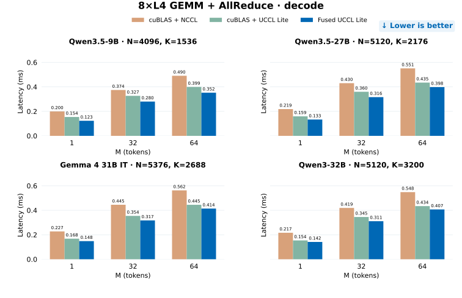
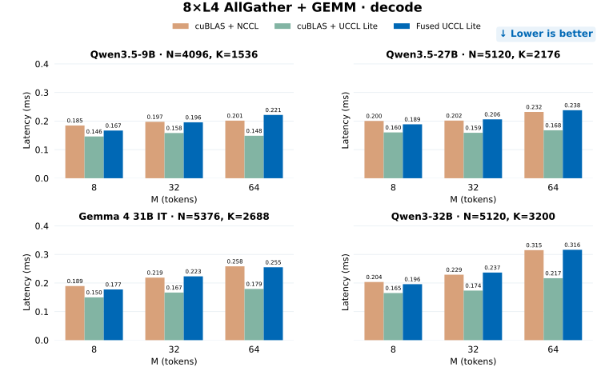
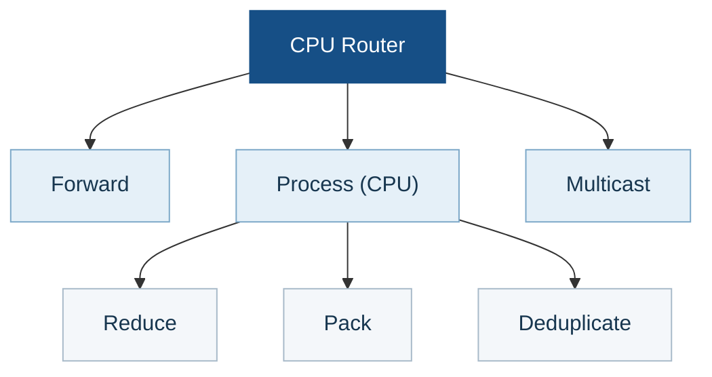

# UCCL Lite

**Collectives and communication–GEMM fusion for PCIe GPU nodes.**

[Results](#measured-results) · [CPU router](#optional-cpu-router) · [Documentation](#documentation)

## Testbeds

| # | GPUs | GPU P2P |
| --- | --- | --- |
| 1 | 8 × NVIDIA L4 | Partial P2P |
| 2 | 8 × NVIDIA L4 | Without P2P |
| 3 | 4 × NVIDIA L4 | With P2P |
| 4 | 2 × NVIDIA RTX PRO 6000 | With P2P |

UCCL Lite is an experimental collection of CUDA collective kernels, an
optional CPU router, fusion kernels, and hardware probes. The direct peer paths
target **four NVIDIA L4 GPUs on a PCIe Gen4 dual-socket node**; the network
paths target **two such nodes**, with two NIC rails per node. The CPU router is
a separate module for 1–32 local GPUs. Most collective and fusion paths
use MSCCL++; standalone peer AG/RS uses CUDA peer access.

The eight-L4 results were measured on a separate host with four GPUs per
NUMA node. A third, **8xL4 SHM**, testbed disables GPU peer transport on
that host by policy. Fresh four-L4, two-node, and eight-L4 dense fusion
measurements appear below with their own timing scopes. Small messages
and small GEMMs can lose to NCCL; negative results are retained.

## What is included

| Component | Purpose |
| --- | --- |
| [Profiler](docs/hardware-profiler.md) | Inspect GPU, PCIe, and NUMA topology and measure transfer bandwidth. |
| [Single-node collectives](docs/collectives.md) | AllReduce, AllGather, and ReduceScatter on one node. |
| [Multi-node collectives](docs/multinode.md) | Collective implementations across nodes using local GPU access and network rails. |
| [CPU router](docs/cpu-router.md) | Optional NUMA-aware path for local collectives, selected from measured benefit. |
| [Fusion kernels](docs/fusion.md) | Combine collective communication with GEMM and MoE stages. |

The RTX PRO 6000 BF16 peer path shares inline copy/reduction primitives with
four-L4 FP32 peer collectives and the eight-L4 BF16 local fallback. One prepared
peer executor owns the two/four-rank CUDA schedule; the joint layer owns
validation and calibrated backend selection. See the
[shared implementation and refactor checks](docs/retained-optimizations.md#shared-collective-components).

## Measured results

### End-to-end serving and training

#### Testbed 1

These historical figures are **not all stock NCCL drop-in results**: serving
and DDP use the experimental NCCL proxy; FSDP uses a separate RS communicator
and an application communication hook. See the
[original FSDP boundary](integration/nccl_lite/e2e_large_messages_8l4_20261115.md#fsdp-compatibility-boundary).
The [calibrated eight-L4 drop-in](integration/nccl_lite/DROPIN.md) has its own
stock-FSDP validation and fresh performance records; it does not inherit these
figures.

<table>
  <tr><th>Serving</th><th>Training</th></tr>
  <tr>
    <td width="50%" valign="top"></td>
    <td width="50%" valign="top"></td>
  </tr>
</table>

#### Testbed 4

Both workloads below use an explicit parameter-sharded application adapter,
not a drop-in NCCL replacement.

<table>
  <tr><th>Serving</th><th>Training</th></tr>
  <tr>
    <td width="50%" valign="top"></td>
    <td width="50%" valign="top"></td>
  </tr>
</table>

The [PRO 6000 experiment](integration/peer_e2e/README.md) records communication
fractions, numerical checks, raw repetitions and the parameter-sharded adapter's
scope. Its per-layer BF16 AG/RS messages are 37.53 MiB; this is a separate
workload from Testbed 1's SGLang serving and DDP/FSDP training.

### Single-node collectives

#### Testbed 1

<table>
  <tr><th>AllReduce</th><th>AllGather</th><th>ReduceScatter</th></tr>
  <tr>
    <td width="33%"></td>
    <td width="33%"></td>
    <td width="33%"></td>
  </tr>
</table>

#### Testbed 2

<table>
  <tr><th>AllReduce</th><th>AllGather</th><th>ReduceScatter</th></tr>
  <tr>
    <td width="33%"></td>
    <td width="33%"></td>
    <td width="33%"></td>
  </tr>
</table>

#### Testbed 3

<table>
  <tr><th>AllReduce</th><th>AllGather</th><th>ReduceScatter</th></tr>
  <tr>
    <td width="33%"></td>
    <td width="33%"></td>
    <td width="33%"></td>
  </tr>
</table>

#### Testbed 4

<table>
  <tr><th>AllReduce</th><th>AllGather</th><th>ReduceScatter</th></tr>
  <tr>
    <td width="33%"></td>
    <td width="33%"></td>
    <td width="33%"></td>
  </tr>
</table>

### Multi-node collectives

#### Testbed 3 × 2 nodes

<table>
  <tr><th>AllReduce</th><th>AllGather</th><th>ReduceScatter</th></tr>
  <tr>
    <td width="33%"></td>
    <td width="33%"></td>
    <td width="33%"></td>
  </tr>
</table>

AllReduce uses the [small-message fix and fresh full-range measurements](benchmarks/data/ar_small_fix_2x4l4_20261115/README.md):
**1 KiB–1 MiB latency** and **1 MiB–1 GiB bus throughput**. The explicit path
uses single-CTA GPU AllReduce through 256 KiB and GPU ReduceScatter + shared-host
packet AllGather above it; **all reduction arithmetic stays on GPUs**. Eight
MPI ranks, FP32 input/output bytes per GPU, slowest-rank host enqueue-to-completion
timing, and three rounds of twenty warmups plus ten checked calls. Host pieces
remain fixed at 256 KiB. NCCL reuses the recorded Ring+Simple control without
new measurements. The cutoff is fixed, not a best-variant-per-size envelope.
This is an explicit eager path; no automatic serving dispatch policy changes.

AllGather uses the [November 15 CPU-router measurements](benchmarks/data/ag_host_router_2x4l4_20261115/README.md):
eight L4 GPUs, FP32, complete output bytes per GPU, slowest-process host
enqueue-to-completion timing, and three rounds of ten warmups plus ten checked
calls. UCCL Lite and its NCCL 2.28.7 Ring+Simple control both use four MPI
processes, two GPUs per NUMA group; NCCL is primed before comparison.
The CPU-router curve uses one fixed 256 KiB chunk configuration throughout,
reaching **12.1/16.0/18.6/20.1 GB/s at 1/2/4/8 MiB** and **21.9 GB/s at 1 GiB**.
This path remains explicitly selected. ReduceScatter retains its
[November 11 measurements](benchmarks/data/multinode_serial_20261111/README.md).

Implementation and in-place handoff details are in
[hybrid AllReduce](docs/multinode-hybrid-allreduce.md).

#### Optimization notes (temporary)

##### AllReduce

The successful path is **GPU ReduceScatter followed by host-packet AllGather**.
Here `N` is the full input/output size per GPU. The GPU phase produces one
fully reduced `N/8`-byte shard on each of the eight GPUs; the host phase only
moves and assembles those shards. No CPU reduction is involved.

- **Reduce before host staging.** Reuse the tuned GPU ReduceScatter instead of
  uploading full inputs for CPU summation. Staging already-reduced shards keeps
  the host phase small enough to benefit from the AllGather pipeline.
- **Reuse the AllGather movement and progress rules.** Retain the GPU's own
  shard, upload adjacent pieces into NUMA-local paired packets, share local
  packets through mapped memory, and advance ready work across three slots.
  Reuse waits for GPU readers, network sends, and local consumption ACKs.
- **Protect the in-place input at the phase boundary.** The packed GPU path
  reads the current AllReduce input before peer receives overwrite its scratch
  region. Complete packing and synchronize ranks before those writes; include
  this barrier and the GPU-to-host handoff in the measured operation.
- **Measure the composition end to end.** Separate ReduceScatter and AllGather
  timings suggest a hypothesis, but do not prove the combined latency. Compare
  the actual combined call with the exact previous tuned configuration and a
  matched NCCL control, including every completion wait.
- **Keep the tradeoff explicit.** This path sends `1.5N` bytes per node across
  its two phases, versus `N` for the previous hierarchy. More host-network
  traffic can still be worthwhile when it replaces slower GPU peer copying
  on this PCIe topology.

The [checked comparison](benchmarks/data/hybrid_ar_2x4l4_20261115/README.md)
uses two four-L4 hosts, FP32, eight MPI ranks, slowest-rank host
enqueue-to-completion timing, and three rounds of twenty warmups plus ten timed
calls. Preparation, fill and validation are outside timing. Host pieces stay
fixed at 256 KiB; the GPU phase retains the existing ReduceScatter selection.
There is no best-host-variant-per-size envelope. Latencies below are milliseconds,
reported as medians of the three round means.

| Input/output per GPU | Previous UCCL Lite | GPU RS + host AG | NCCL Ring+Simple |
| --- | ---: | ---: | ---: |
| 1 MiB | 0.212 | **0.180** | 0.205 |
| 8 MiB | 0.956 | **0.892** | 0.920 |
| 64 MiB | 7.065 | **6.143** | 6.944 |
| 1 GiB | 106.021 | **96.325** | 110.204 |

Across the eleven tested power-of-two sizes from 1 MiB to 1 GiB, median latency
falls 5.8–15.0% versus previous UCCL Lite and 3.1–13.2% versus NCCL 2.28.7
Ring+Simple. These results do not establish a ReduceScatter speedup or a gain
at unmeasured sizes. The path is eager-only and explicitly selected; automatic
routing remains unchanged. See [the implementation and run command](docs/multinode-hybrid-allreduce.md).

##### AllGather

The main gains came from organizing data movement and progress around the NUMA
layout. Each group's two GPUs upload adjacent pieces into a pinned host packet;
the local HCA sends that packet to the remote groups. AllGather only copies and
assembles shards here; no CPU reduction is involved. Here `N` denotes complete
output bytes per GPU.

- **Keep the GPU's own shard on the GPU.** Copy it from the original input to
  its output position. This reduces host-to-GPU reads from `N` to `7N/8` per
  GPU, while retaining the D2H upload needed by other consumers.
- **Share local host packets.** GPUs in the other local NUMA group read the
  source packet through a shared mapping, removing an intermediate CPU/MPI
  payload copy and its completion wait. Cross-NUMA reads still occur.
- **Advance ready work promptly.** With three slots, a completed upload can be
  sent and an arrived packet can be consumed without waiting for a future
  upload. Local output shards can be consumed while remote data is in flight.
- **Make reuse depend on all readers.** A slot is released only after GPU
  consumers, network sends and the peer's consumption ACK complete. Sharing
  memory requires these credits to prevent a fast producer overwriting data.

The checked 1-GiB AllGather comparison shows the cumulative effect:

| Host configuration | Latency |
| --- | ---: |
| Original host pipeline | 66.26 ms |
| 256 KiB chunks + own-shard retention + early consumption | 64.10 ms |
| Add shared local packets | 51.21 ms |
| Add readiness-driven progress | **42.92 ms** |

The first transition bundles three changes; its gain cannot be assigned to any
one of them. Sharing packets and improving progress account for the largest
subsequent reductions. The final path has **35.2% lower latency than the
original host pipeline** and **20.6% lower latency than the original GPU
policy**. Host and GPU paths use four and eight MPI processes respectively;
the host harness also retains its own four-process NCCL control.

More network copies, smaller chunks, more workers, or matched P2P exchanges do
not automatically improve end-to-end latency. Keep the negative measurements,
use the same timing scope, and select a route only for validated placement,
dtype, size and software identity. See the
[detailed optimization lessons](docs/multinode-host-router.md#optimization-lessons)
for the tradeoffs and validation boundaries.

### Fusion

#### Testbed 3

##### Dense AG+GEMM, GEMM+RS, GEMM+AR

##### Expert-parallel MoE

#### Testbed 1

##### GEMM + AllReduce

##### AllGather + GEMM

##### GEMM + ReduceScatter

## Optional CPU router

### Motivation

When GPU Direct P2P is unavailable between GPU groups, their data already
needs a host-mediated path. The CPU router uses that host-memory stop to do
useful work with otherwise idle CPU cores: reduce packets before forwarding
them and share a packet with multiple destinations. Reusable packet operators
also support packing and deduplication. Routing is most promising when PCIe
transfers constrain the collective while NUMA-local host
memory and spare CPU cores can keep up with the packet flow. Fast direct P2P
or contention for host memory can erase that advantage.

### High-level design

The optional CPU router exchanges packets through NUMA-local pinned host
memory. **Forward** moves a packet, **Multicast** sends one packet to multiple
destinations, and **Process (CPU)** transforms packet contents with Reduce,
Pack, and Deduplicate operators. Collectives compose these operations, with
packet slots and reader credits preventing reuse until consumers finish.

The `Process (CPU)` operators can be used in different collectives:

- **Reduce** combines contributions for AllReduce and ReduceScatter.
- **Pack** assembles fragments for AllGather and token buffers for
  dispatch/combine.
- **Deduplicate** removes repeated token records in dispatch/combine. The
  included fixed-width operator is intended for small routing metadata.

## Documentation

- [Build targets and correctness commands](docs/build.md)
- [Hardware profiler methods and measurements](docs/hardware-profiler.md)
- [Collective algorithms](docs/collectives.md) and [two-node design](docs/multinode.md)
- [Fusion design and workloads](docs/fusion.md)
- [NCCL drop-in and SGLang integration](integration/nccl_lite/README.md)
- [Full measurement files](benchmarks/README.md) and [validation limits](docs/validation.md)

UCCL Lite provides specialized research kernels and benchmarks, with an
experimental NCCL compatibility layer and SGLang hooks under `integration/`.
The project follows the repository [license](../../LICENSE); the adapted CUTLASS wrapper retains
its [upstream notice](NOTICE.md).
