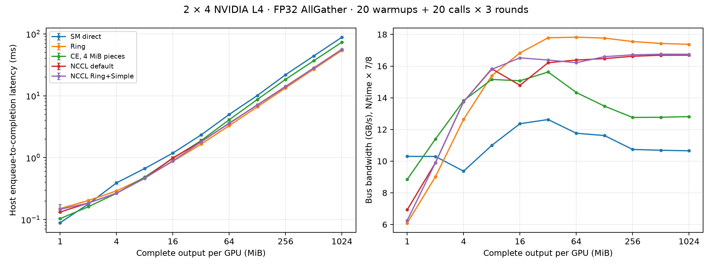

# AllGather, 1 MiB–1 GiB, two four-L4 hosts

This is a fresh full-range sweep of the same implementation as the
[copy-engine/pipeline experiment](../ag_pipeline_2x4l4_20261115/README.md).
No collective code or automatic selection policy changed for this report.

## Method

Two hosts, `mibura-sky-test-02` and `mibura-sky-test-01` (`l40`), each with four
NVIDIA L4 GPUs and two IB HCAs. GPU 0/1 + mlx5_0 are NUMA 0; GPU 2/3 + mlx5_1
are NUMA 1. Eight MPI processes, one per GPU. FP32 out-of-place AllGather.
Sizes are **complete output bytes per GPU**, measured at powers of two from
1 MiB to 1 GiB; each GPU's input is one eighth of the reported size.
The 1 GiB point therefore has 128 MiB input per GPU.

All five configurations use slowest-rank host enqueue-to-completion timing,
20 warmups and 20 timed calls per size, in three rounds. Every warmup and timed
call checks the complete output with generation-dependent data; input fill and
checking are outside the timed interval. Summary values are medians of three
per-round arithmetic means, with minimum/maximum round means in the CSV.
The full range is rerun with the same maximum allocation on both hosts, rather
than appended to the previous small-size sweep.

| Label | Fixed configuration |
| --- | --- |
| serial | Existing direct SM multicast, one CTA / 256 threads |
| ring | Existing local ring, default 24 CTAs / 512 threads |
| ce4096 | New CE multicast, 4 MiB per-rank pieces, lookahead 4, one CTA / 256 threads |
| nccl_default | NCCL 2.28.7 algorithm/protocol defaults |
| nccl_simple | NCCL 2.28.7 Ring+Simple |

The CE setting has one network chunk through 32 MiB complete output, then
2/4/8/16/32 chunks at 64/128/256/512/1024 MiB. The 1 MiB-piece CE experiment
is not part of this sweep: it would exceed the kernel's 64-chunk limit at 1 GiB.
No variant is selected per size to construct a best-case curve.

Order in rounds 1/3 is serial → ring → CE → NCCL default → NCCL Ring+Simple;
round 2 reverses that order. No concurrent benchmark was launched by this task.
The existing automatic UCCL policy corresponds to serial at 1/2 MiB and ring
above 2 MiB; the table also exposes what happens if direct or CE is extended
across the entire range.

CUDA 12.9, Open MPI 4.1.7rc1, NCCL 2.28.7. Fresh topology/software records and
matching local/remote executable and library SHA256s are stored alongside this
file. The full raw samples and per-size method markers are in `paired/`.

## Results

All latencies are **milliseconds**, median of three round means.

| Output/GPU (MiB) | Direct SM | Ring | CE (4 MiB pieces) | NCCL default | NCCL Ring+Simple |
| ---: | ---: | ---: | ---: | ---: | ---: |
| 1 | 0.089 | 0.151 | 0.104 | 0.132 | 0.147 |
| 2 | 0.178 | 0.204 | 0.161 | 0.185 | 0.185 |
| 4 | 0.392 | 0.290 | 0.266 | 0.267 | 0.267 |
| 8 | 0.668 | 0.477 | 0.484 | 0.464 | 0.465 |
| 16 | 1.187 | 0.872 | 0.974 | 0.993 | 0.889 |
| 32 | 2.325 | 1.651 | 1.879 | 1.811 | 1.792 |
| 64 | 4.992 | 3.294 | 4.097 | 3.584 | 3.621 |
| 128 | 10.111 | 6.609 | 8.717 | 7.130 | 7.077 |
| 256 | 21.873 | 13.382 | 18.411 | 14.133 | 14.055 |
| 512 | 43.959 | 26.949 | 36.785 | 28.152 | 28.043 |
| 1024 | 88.187 | 54.077 | 73.335 | 56.300 | 56.100 |

All 3,300 timed collective invocations passed complete-output checks. The source
and binaries are the pre-dual-RDMA/pre-matched version identified by the saved
hashes; these measurements do not validate later source changes.



Regenerate the table and figure with `report.py` and `plot.py` in this directory
after generating `paired/summary.csv`.

## Reproduce

The already-built binaries are staged identically in
`build/ag_pipeline_20261115` on both hosts. To rebuild, use the Makefile command
in the preceding experiment. From `experimental/lite`, choose a new directory:

```bash
HOSTS=10.10.55.2:4,10.10.55.1:4 SOCKET_IFNAME=ibp55s0f0 \
MPIRUN=/usr/mpi/gcc/openmpi-4.1.7rc1/bin/mpirun \
BUILD_DIR="$PWD/build/ag_pipeline_20261115" \
OUTPUT_DIR="$PWD/build/ag-1m-1g-recheck" \
MODES='serial ring ce4096 nccl_default nccl_simple' \
MIN_BYTES=1048576 MAX_BYTES=1073741824 TIMEOUT_SECONDS=900 \
  bash scripts/run_multinode_ag_pipeline.sh
python3 scripts/summarize_multinode_ag_pipeline.py build/ag-1m-1g-recheck \
  --modes serial ring ce4096 nccl_default nccl_simple \
  --min-bytes 1048576 --max-bytes 1073741824
```

This is eager benchmark validation, not CUDA graph replay or a CPU-router
calibration. Timing ranges are observed variation across three rounds, not
confidence intervals.
