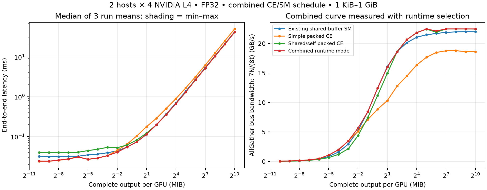

# Combined small/large AllGather preset, 2026-11-17

Historical experiment from the earlier refactor checkout. Its commands and source
paths describe that checkout; exact measured sources are archived here. The
[latest-branch port and fresh validation](../ag_combined_latest_2x4l4_20261117/README.md)
supersede this record for the current implementation.


`--download combined -k 262144` combines the earlier low-submission CE path,
early-consume CE, the existing shared-buffer SM path and the corrected large
CE path. The curve below is a fresh measurement of this one runtime-selected
mode, including its per-call selection cost. It is not stitched from the best
points of independent runs.

At 1 KiB output/GPU it takes **24.16 us** versus existing UCCL Lite's **31.78 us**
(24.0% lower latency). At 1 GiB it takes **41.81 ms** versus **42.73 ms**
(2.1% lower). The middle range selects SM and is within about 0.5% of the baseline
in this sweep. Small and large paths remain available separately for controls.

## Fixed selection rule

The rule was chosen from the prior recorded sweeps before this validation run;
it is not retuned from these results:

| Complete output bytes/GPU | Path |
| --- | --- |
| Measured powers of two, 1–128 KiB | Packed CE, host inputs, copy local exchange, one consumer phase |
| Exactly 256 KiB | Packed CE, host inputs, copy local exchange, early local/remote phases |
| Measured powers of two, 512 KiB–4 MiB | Existing shared/self SM pipeline |
| Measured powers of two, 8 MiB–1 GiB | Packed CE, shared local exchange, own-input bypass, early local/remote phases |
| Other supported extents | Existing shared/self SM pipeline |

Only exact CE extents covered by the recorded sweeps are selected; intermediate
sizes do not inherit a CE performance claim. The mode is an explicit standalone
experiment for the recorded two-host FP32 topology/placement/software, not an
automatic production backend admission profile. No public collective API,
CPU-router admission policy, NCCL interception or serving hook is changed.

The preset requires 256-KiB source chunks, 256-thread SM consumers, DMA upload,
multicast network and no worker/lean/per-path overrides. It owns the progress,
local-input, local-exchange and early-consume choices. Both shared packets and
packed receive buffers are prepared before timing. `selectCombined()` runs inside
each timed collective call; it does not allocate or register resources. Every
call drains slot readers and sends before the next may switch layouts.

Shared-window cleanup uses the preparation state, not the last selected mode.
This matters when the last invocation is a small CE call that does not consume
shared packets. `--size-order alternating` is a harness check option that visits
smallest/largest remaining extents alternately within one process lifetime.

## Hardware and method

- Two hosts: mibura-sky-test-02 / 10.10.55.2 and mibura-sky-test-01 / 10.10.55.1;
  four NVIDIA L4s and two IB NICs per host; two NUMA groups with two GPUs/group.
- FP32, out-of-place; four MPI processes (two/node), two GPUs/process; MPI/UCX;
  existing CPU/NUMA/rail affinity helpers. CUDA 12.9, sm_89, Open MPI 4.1.7rc1.
- N is complete output/GPU; each GPU contributes N/8. All modes use 256-KiB
  per-source chunks, three slots and DMA upload. Both CUDA targets built with
  the repository Makefile. Runtime validation exercises MPI/UCX; the optional
  direct-RDMA executable is compilation-checked only.
- Timing: slowest-process host submission through GPU completion and send
  retirement. Allocation/registration, input generation, pre-call MPI barrier,
  timing reduction and full-output verification are outside timing.
- Twenty-one powers-of-two sizes, 1 KiB–1 GiB. Five modes: existing shared SM,
  simple packed CE, early packed CE, shared/self packed CE, and combined.
- Three separate jobs/mode, 20 warmups + 30 timed calls/size/job; configuration
  order reverses in round 2. Values are medians of three run means. CSVs retain
  all run means and min/max. No NCCL baseline is used in this experiment.
- Constituent controls use fixed configurations; combined selects the schedule
  at runtime according to the table above. No offline best-per-size envelope
  or historical performance points are used in the combined curve.

## Correctness

All **9,450 timed main calls + 6,300 warmups** passed full rank/index/generation
output checks on both hosts. Additional checks passed:

- Alternating all 21 extents in one process lifetime, with GPU rank 3 delayed:
  210 timed calls + 105 warmups. This switches repeatedly between private packed
  CE, shared CE and shared SM, including different numbers of packet slots.
- Alternating 1–256 KiB, ending on a small CE extent, also delaying rank 3:
  90 timed calls + 45 warmups. This checks shared-window cleanup when the final
  runtime path does not use shared exchange.
- Eight non-power-of-two extents, 131,200–16,793,600 bytes, in alternating order,
  with GPU rank 6 delayed: 80 timed calls + 40 warmups. All select the shared SM
  fallback; full outputs and short final pieces pass.
- 35 backend-policy checks, 74 host-dispatcher checks, CUDA dispatcher checks,
  732 four-GPU eager cases and 1000 captured mixed-collective cases passed.
  These graph regressions cover the separate optional router core, not graph
  support for this eager-only MPI experiment. No sanitizer claim is made.

`guard_checks.json` records rejection of unsupported combined-mode overrides.
`routes.csv` preserves the selected path for each main size. Historical timing
results motivated the rule but do not validate this changed source; the fresh
main and transition runs provide that evidence.

## Results

Positive latency change is slower; negative is faster. All times are microseconds.

| Output/GPU | Selected path | Existing SM (us) | Combined (us) | Latency change |
| ---: | --- | ---: | ---: | ---: |
| 1 KiB | packed-ce | 31.780 | 24.155 | -23.99% |
| 2 KiB | packed-ce | 31.086 | 24.093 | -22.50% |
| 4 KiB | packed-ce | 31.478 | 25.574 | -18.76% |
| 8 KiB | packed-ce | 31.823 | 27.389 | -13.94% |
| 16 KiB | packed-ce | 32.008 | 30.718 | -4.03% |
| 32 KiB | packed-ce | 34.818 | 26.773 | -23.11% |
| 64 KiB | packed-ce | 36.180 | 28.918 | -20.07% |
| 128 KiB | packed-ce | 39.175 | 33.286 | -15.03% |
| 256 KiB | packed-ce-early | 43.862 | 40.538 | -7.58% |
| 512 KiB | shared-self-sm | 54.298 | 54.501 | +0.37% |
| 1 MiB | shared-self-sm | 73.800 | 73.896 | +0.13% |
| 2 MiB | shared-self-sm | 113.985 | 114.549 | +0.49% |
| 4 MiB | shared-self-sm | 197.259 | 197.384 | +0.06% |
| 8 MiB | shared-self-ce | 364.361 | 355.149 | -2.53% |
| 16 MiB | shared-self-ce | 696.957 | 672.156 | -3.56% |
| 32 MiB | shared-self-ce | 1366.403 | 1307.318 | -4.32% |
| 64 MiB | shared-self-ce | 2706.360 | 2653.650 | -1.95% |
| 128 MiB | shared-self-ce | 5364.598 | 5225.792 | -2.59% |
| 256 MiB | shared-self-ce | 10691.651 | 10449.176 | -2.27% |
| 512 MiB | shared-self-ce | 21347.349 | 20903.287 | -2.08% |
| 1 GiB | shared-self-ce | 42725.044 | 41812.306 | -2.14% |



Standard AllGather bus bandwidth is 7N/(8t) in decimal GB/s; it is not raw H2D or
NIC throughput. Shading is the range of three job means, not a confidence interval.
The plot shows baseline, simple CE, corrected CE and combined; the early CE
control is retained in the CSVs and raw logs.

## Use and reproduce

Use `--download combined -k 262144` in place of the per-path download/local-input/
local-exchange/early-consume flags. The preset chooses those internally.

From the Lite root:

```bash
make multinode_host_allgather multinode_host_rdma_allgather \
  BUILD=build/ag_combined_20261117 \
  MPICXX=/usr/mpi/gcc/openmpi-4.1.7rc1/bin/mpicxx \
  MSCCLPP_IB_BUILD=/home/zhongjie/third_party/mscclpp/build-ib-pcieccl
# Stage the MPI-only executable at the identical build path on the second host.
python3 scripts/validate_multinode_ag_contiguous.py \
  --binary build/ag_combined_20261117/uccl_lite_multinode_host_allgather \
  --out build/ag_combined_repeat \
  --modes packet_sm packed_dma packed_dma_early packed_dma_fixed combined \
  --rounds 3 --warmups 20 --iterations 30 \
  --begin 1024 --end 1073741824 --timeout 600
```

The runner refuses to overwrite results. Manifest files preserve exact commands,
UTC times and binary SHA-256; both hosts used the same executable. Source snapshots,
hashes and `combined.patch` preserve the measured implementation. Raw logs, CSVs,
fresh topology/GPU records, transition/fallback/cleanup checks and regression logs
are retained. Historical results do not validate later source edits.
