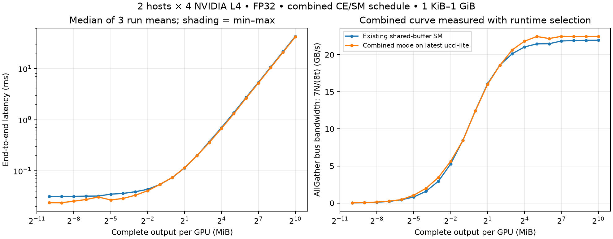

# Combined AllGather on latest uccl-lite, 2026-11-17

The combined CE/SM implementation was ported onto **f9665eaead1eb13180628bf3861d004eebbda63e**,
the latest `origin/uccl-lite` revision at validation time. It lives in that branch's
`src/collectives/multinode_host_allgather.cu`, preserving its existing helpers and
source organization. No unrelated refactor-branch changes were imported.

This record contains fresh builds, fresh two-host timings and fresh correctness
checks of the port. Earlier experiments in the sibling November 17 records were
performed in an older refactor working tree; they motivate the fixed selection
rule but do not validate this latest-branch source.

At 1 KiB output/GPU the port measures **23.80 us**, versus the current shared SM
baseline's **31.43 us** (24.3% lower latency). At 1 GiB it measures **41.81 ms**
versus **42.81 ms** (2.3% lower). The middle region uses the existing SM schedule.
The combined curve is measured as one runtime-selected implementation, including
selection overhead, not assembled from independent per-size winners.

## Implementation and selection

Use `--download combined -k 262144`. The preset owns local-input, local-exchange,
early-consume and progress settings; do not pass overrides for those paths.

| Complete output bytes/GPU | Selected schedule |
| --- | --- |
| Measured powers of two, 1–128 KiB | Simple packed CE, one consumer phase |
| Exactly 256 KiB | Packed CE with early local/remote consumption |
| Measured powers of two, 512 KiB–4 MiB | Existing shared/self SM pipeline |
| Measured powers of two, 8 MiB–1 GiB | Shared/self packed CE with early consumption |
| Other supported extents | Existing shared/self SM pipeline |

The three-slot pipeline overlaps upload, network progress and consumption. Packed
rows use 2D copies into rank-ordered output. Large CE retains the own shard in GPU
memory and reads local packets through shared mappings with reader ACKs, reducing
H2D payload to 7N/8 and eliminating the local payload exchange. Both layouts are
prepared outside timing; per-call selection allocates no resources. Cleanup uses
the preparation state even if the last selected schedule does not use shared memory.
This remains an explicitly selected eager standalone experiment, not automatic
production backend admission or a performance claim for other hardware/software.

## Fresh validation protocol

- Hardware: mibura-sky-test-02 / 10.10.55.2 and mibura-sky-test-01 / 10.10.55.1;
  four NVIDIA L4s and two IB NICs per host; two NUMA groups with two GPUs/group.
- FP32, out-of-place; four MPI processes (two/node), two GPUs/process; MPI/UCX;
  existing CPU/NUMA/rail affinity helpers. CUDA 12.9, sm_89, Open MPI 4.1.7rc1.
- Sizes are full output N bytes/GPU; each GPU contributes N/8. Source packet
  capacity is 256 KiB. Baseline is the latest branch's existing shared-ready SM
  path, exercised in the same newly built executable.
- Timing is slowest-process host submission through GPU completion and send
  retirement. Setup, generation, pre-call MPI barrier, timing reduction and
  full-output verification are excluded. Runtime selection is included.
- Twenty-one powers-of-two sizes, 1 KiB–1 GiB; three jobs per mode, each with
  20 warmups and 30 timed calls/size. Mode order reverses in round 2. Values
  are medians of three run means; CSV preserves each mean and min/max.
- All **3,780 timed calls + 2,520 warmups** passed full rank/index/generation
  output checks. Alternating small/large schedules with a delayed consumer,
  cleanup after a small final call, and non-power-of-two fallback/tail checks
  passed another **380 timed calls + 190 warmups** on the same fresh executable.
- The Makefile built both affected CUDA targets. Runtime tests use MPI/UCX;
  the optional direct-RDMA target is only compilation-checked.
- Latest-branch regression binaries were rebuilt from its own sources: policy,
  host/CUDA dispatcher, 732 four-GPU eager cases and 1000 captured mixed cases
  passed. Graph checks cover the separate router core, not graph support for
  this eager MPI experiment. No sanitizer validation is claimed.

## README figure provenance

The main README AllGather figure uses the **fresh combined measurements in this
record for both panels**: latency at 1 KiB–1 MiB and bus bandwidth at 1 MiB–1 GiB.
Bus bandwidth is computed as `7N/(8t)` in decimal GB/s; it is not raw link bandwidth.

All 66 plotted NCCL values are retained numerically unchanged from
[the recorded figure inputs](../ag_latency_2x4l4_20261116/figure_inputs.csv).
Their latency controls come from the November 16 latency/recheck record; their
throughput controls retain the original sources identified in that file and the
[November 16 reference record](../nccl_tuned_2x4l4_20261116/README.md).
Those sources describe their own repetitions, protocol settings and selection.
No NCCL measurements were rerun here, and these curves are not simultaneous
paired controls for the new UCCL run. Existing legend names and protocol choices
are retained; the archived orange throughput control is not uniformly an
unconfigured NCCL run. The two panels' NCCL 1-MiB points have separate provenance.

`readme_figure_inputs.csv` records all 88 displayed values and their sources.
`readme_figure_sources.json` records hashes of the input tables. The generator
asserts that every NCCL point is unchanged and that every UCCL point comes from
the measured combined mode. The latency axis retains its existing break so the
recorded NCCL spikes remain visible. There is no post-hoc best-per-size envelope.

## Fresh UCCL comparison

Positive latency change is slower; negative is faster. All times are microseconds.

| Output/GPU | Selected path | Existing SM (us) | Combined (us) | Latency change |
| ---: | --- | ---: | ---: | ---: |
| 1 KiB | packed-ce | 31.426 | 23.796 | -24.28% |
| 2 KiB | packed-ce | 31.642 | 23.682 | -25.16% |
| 4 KiB | packed-ce | 31.604 | 25.444 | -19.49% |
| 8 KiB | packed-ce | 31.909 | 27.433 | -14.03% |
| 16 KiB | packed-ce | 32.068 | 30.709 | -4.24% |
| 32 KiB | packed-ce | 34.896 | 26.880 | -22.97% |
| 64 KiB | packed-ce | 36.029 | 28.739 | -20.23% |
| 128 KiB | packed-ce | 38.948 | 33.229 | -14.68% |
| 256 KiB | packed-ce-early | 43.411 | 40.681 | -6.29% |
| 512 KiB | shared-self-sm | 54.037 | 54.257 | +0.41% |
| 1 MiB | shared-self-sm | 73.767 | 73.897 | +0.18% |
| 2 MiB | shared-self-sm | 114.053 | 114.627 | +0.50% |
| 4 MiB | shared-self-sm | 197.286 | 197.548 | +0.13% |
| 8 MiB | shared-self-ce | 364.573 | 355.474 | -2.50% |
| 16 MiB | shared-self-ce | 697.525 | 672.687 | -3.56% |
| 32 MiB | shared-self-ce | 1368.041 | 1307.699 | -4.41% |
| 64 MiB | shared-self-ce | 2733.853 | 2647.600 | -3.15% |
| 128 MiB | shared-self-ce | 5375.086 | 5225.329 | -2.79% |
| 256 MiB | shared-self-ce | 10722.755 | 10458.582 | -2.46% |
| 512 MiB | shared-self-ce | 21410.208 | 20909.473 | -2.34% |
| 1 GiB | shared-self-ce | 42808.707 | 41809.472 | -2.33% |



## Reproduction

From `experimental/lite` on the ported latest branch:

```bash
make multinode_host_allgather multinode_host_rdma_allgather \
  BUILD=build/ag_combined_latest_20261117 \
  MPICXX=/usr/mpi/gcc/openmpi-4.1.7rc1/bin/mpicxx \
  MSCCLPP_IB_BUILD=/home/zhongjie/third_party/mscclpp/build-ib-pcieccl
# Stage the MPI-only executable at the identical build path on the second host.
python3 scripts/validate_multinode_ag_contiguous.py \
  --binary build/ag_combined_latest_20261117/uccl_lite_multinode_host_allgather \
  --out build/ag_combined_latest_repeat --modes packet_sm combined \
  --rounds 3 --warmups 20 --iterations 30 \
  --begin 1024 --end 1073741824 --timeout 600
python3 benchmarks/data/ag_combined_latest_2x4l4_20261117/readme_figure.py
```

The runner refuses to overwrite results. Manifest files preserve commands,
UTC times and binary SHA-256; both hosts used the same executable. Exact active
source snapshots/hashes, the base revision, implementation patch, fresh hardware
records, raw samples, transition/fallback/cleanup checks and regression logs are
retained. Historical results do not validate subsequent source edits.
