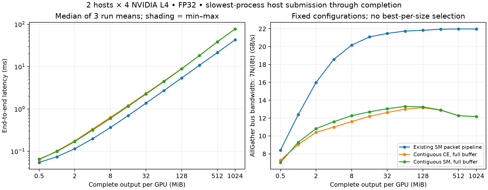

# Contiguous AllGather, 512 KiB–1 GiB, 2026-11-17

Historical experiment from the earlier refactor checkout. Its commands and source
paths describe that checkout; exact measured sources are archived here. The
[latest-branch port and fresh validation](../ag_combined_latest_2x4l4_20261117/README.md)
supersede this record for the current implementation.


The full-buffer contiguous CE prototype loses to the existing shared-ready SM
packet pipeline at every tested size. At 512 KiB it takes 63.02 us versus
54.61 us (15.4% higher latency); at 1 GiB it takes 77.22 ms versus 42.75 ms
(80.6% higher latency). This extends the earlier small-message experiment;
it does not splice historical baseline measurements into this sweep.

## What was measured

`--download contiguous-dma` still uploads each GPU's full input directly into its
rank-ordered interval of a NUMA-local pinned host buffer, and receives the other
three groups directly into their output intervals. Once both source uploads and
all receives are complete, it issues one complete-output H2D memcpy per GPU.
It waits for consumers and outgoing sends before reusing the buffer. No explicit
CPU concatenation pass is added; MPI may internally copy payloads.

The former one-piece size guard was removed: this is explicitly a full-tensor
schedule, independent of the 256-KiB packet setting. The existing overall 1-GiB
limit bounds each MPI group message to 256 MiB, below INT_MAX. The same schedule
and layout with one SM consumer kernel (`contiguous-sm`) provides a control.
Both modes retain compatibility checks for unsupported shared/early/worker modes.
The ordinary packet modes and production routing policies were not changed.

The current packet baseline uses 256-KiB chunks per source GPU, three slots,
DMA upload, SM download, shared local exchange, own-input retention, early
consumption and readiness-driven progress. It overlaps upload, communication and
consumption across pieces. The contiguous paths wait for full inputs and complete
receives before downloading; they transfer N bytes H2D instead of 7N/8, and use
an MPI local payload exchange instead of sharing the original local packet.
Consequently this is an end-to-end schedule/layout comparison, not an isolated
CE-versus-SM bandwidth test. In particular, both contiguous consumers are nearly
equal at 1 GiB (CE 77.22 ms; SM 77.25 ms), while both lose to the packet pipeline.
This supports a schedule/layout limitation rather than attributing the large
regression to CE alone. No profiler-based attribution of the individual costs
is claimed. No pipelined contiguous variant was implemented in this experiment.

## Hardware, timing and validation

- Two hosts: mibura-sky-test-02 / 10.10.55.2 and mibura-sky-test-01 / 10.10.55.1;
  four NVIDIA L4s and two IB NICs per host; two NUMA groups, two GPUs/group.
- FP32, out-of-place; four MPI processes (two per node), two GPUs per process.
  Existing helpers bind each group to its NUMA CPUs and corresponding UCX rail.
- CUDA 12.9, sm_89; Open MPI 4.1.7rc1 and MPI/UCX transport. Both host CUDA targets
  compiled with the repository Makefile. The optional direct-RDMA target is only
  compilation-checked; the runtime experiment uses MPI/UCX.
- Sizes are complete output bytes per GPU; each GPU's input is N/8. At maximum
  size each process reserves a 1-GiB contiguous pinned buffer, outside timing.
- Timing is slowest-process host submission through GPU completion and send
  retirement. Allocation/registration, input generation, pre-call MPI barrier,
  timing reduction and full-output verification are outside timing.
- Twelve power-of-two sizes, 512 KiB–1 GiB. Three jobs per configuration, each
  with 10 warmups and 20 timed calls/size. Configuration order reverses in round 2.
  Reported values are medians of three run means; summary.csv retains min/max.
- All 2,160 timed invocations and 1,080 warmups passed complete rank/index/generation
  output checks on eight GPUs. Extra delayed-consumer checks (rank 3) passed for
  both contiguous modes at 3 MiB + 128 B, 6 MiB + 256 B and 12 MiB + 512 B:
  60 timed calls and 30 warmups. No graph or sanitizer validation is claimed.
- Each curve uses one fixed configuration at all sizes; no best-per-size selection.
  The baseline is the current UCCL SM pipeline, not NCCL. The earlier 1–256-KiB
  experiment remains archived separately and is not new-source validation.

## Results

| Output/GPU | Existing SM pipeline (ms) | Contiguous CE (ms) | Contiguous SM (ms) | CE slower than pipeline | CE bus GB/s |
| ---: | ---: | ---: | ---: | ---: | ---: |
| 512 KiB | 0.05461 | 0.06302 | 0.06525 | 15.4% | 7.28 |
| 1 MiB | 0.07411 | 0.10167 | 0.09878 | 37.2% | 9.02 |
| 2 MiB | 0.11478 | 0.17644 | 0.16969 | 53.7% | 10.40 |
| 4 MiB | 0.19751 | 0.33406 | 0.31662 | 69.1% | 10.99 |
| 8 MiB | 0.36398 | 0.63246 | 0.59806 | 73.8% | 11.61 |
| 16 MiB | 0.69614 | 1.20418 | 1.15594 | 73.0% | 12.19 |
| 32 MiB | 1.36698 | 2.32507 | 2.24883 | 70.1% | 12.63 |
| 64 MiB | 2.70065 | 4.51635 | 4.41451 | 67.2% | 13.00 |
| 128 MiB | 5.38051 | 8.91948 | 8.86366 | 65.8% | 13.17 |
| 256 MiB | 10.69956 | 18.24178 | 18.20233 | 70.5% | 12.88 |
| 512 MiB | 21.37193 | 38.28451 | 38.30383 | 79.1% | 12.27 |
| 1 GiB | 42.75312 | 77.22411 | 77.25391 | 80.6% | 12.17 |

Bus bandwidth uses the conventional AllGather metric `7N/(8t)` in decimal GB/s;
it is not a measurement of raw H2D or NIC bandwidth. At 1 GiB the existing SM
pipeline reaches about 21.98 GB/s, versus contiguous CE's 12.17 GB/s.



## Reproduction

From the Lite root:

```bash
make multinode_host_allgather multinode_host_rdma_allgather \
  BUILD=build/ag_contiguous_large_20261117 \
  MPICXX=/usr/mpi/gcc/openmpi-4.1.7rc1/bin/mpicxx \
  MSCCLPP_IB_BUILD=/home/zhongjie/third_party/mscclpp/build-ib-pcieccl
# Stage the MPI-only executable at the identical build path on the second host.
python3 scripts/validate_multinode_ag_contiguous.py \
  --binary build/ag_contiguous_large_20261117/uccl_lite_multinode_host_allgather \
  --out build/ag_contiguous_large_repeat \
  --modes packet_sm contiguous_dma contiguous_sm \
  --rounds 3 --warmups 10 --iterations 20 \
  --begin 524288 --end 1073741824 --timeout 600
```

The runner refuses to overwrite results. `manifest.json` preserves commands,
UTC times and the measured binary SHA-256; both hosts used that identical binary.
`measured_source/`, `source_hashes.json` and `large_extent.patch` preserve source
and the extension relative to the small-message experiment. Raw logs,
`run_means.csv`, `summary.csv`, fresh GPU/topology/dependency records, and
`tail_delay_checks/` are retained. Run `plot.py` here to regenerate the charts.
Historical results do not validate subsequent source edits.
