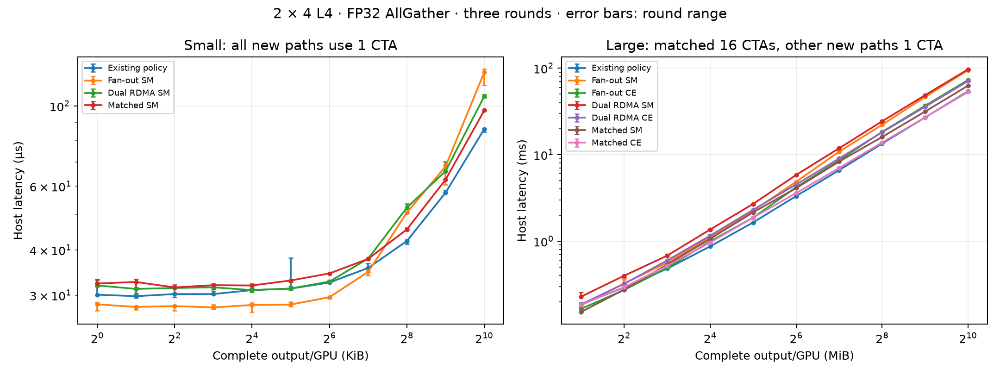

# Dual RDMA and matched AllGather, two four-L4 hosts

This experiment tests (1) two RDMA destinations for each source shard and
(2) locally matched peer exchanges that avoid concurrent P2P payload fan-in/out.
The implementation and lifetime invariants are in
[the design note](../../../docs/multinode-allgather-matched.md).
Both remain manual experimental options; no automatic policy changes.

## Hardware and method

`mibura-sky-test-02` and `mibura-sky-test-01` (`l40`), four NVIDIA L4 GPUs and
two IB HCAs each. GPU 0/1 + mlx5_0 are NUMA 0; GPU 2/3 + mlx5_1 are NUMA 1.
CUDA 12.9, Open MPI 4.1.7rc1, MSCCL++ from the IB-enabled build, FP32 out-of-place
AllGather, eight MPI ranks, one per GPU. Local/remote binary and library hashes
and topology are recorded alongside the raw logs.

Sizes are **complete output bytes per GPU**, so input per rank is N/8.
Every warmup and timed invocation checks the complete output using changing
rank/index/generation-dependent input. Input fill/checking are outside the
slowest-rank host enqueue-to-completion timing interval.

There are two distinct paired sweeps, each with three rounds:

| Sweep | Complete output sizes | Warmups / timed calls per size per round | Matched geometry |
| --- | --- | --- | --- |
| `small/` | 1 KiB–1 MiB, powers of two | 10 / 20 | 1 CTA × 256 threads |
| `large/` | 2 MiB–1 GiB, powers of two | 10 / 10 | 16 CTAs × 256 threads |

Each sweep allocates for its own maximum size. The matched geometry changes at
the boundary; these are separate experiments, not a continuous one-configuration
curve. The block choices came from pilots and are fixed throughout each sweep.
All other new paths use 1 CTA × 256 threads. All use 4 MiB per-rank pieces,
lookahead 4, and matched order `^2 → ^1`. There is one chunk through 32 MiB
complete output, and 32 chunks at 1 GiB. No per-size candidate envelope is used.

| Label | Implementation |
| --- | --- |
| auto | Existing direct SM through 2 MiB, existing ring above 2 MiB |
| fanout_sm | Previously optimized SM fan-out, one final notification per peer |
| fanout_ce | Previously optimized CE fan-out, one final notification per peer |
| dual_sm | Two RDMA destinations, SM local fan-out |
| dual_ce | Two RDMA destinations, CE local fan-out |
| matched_sm | Ready/data-gated matched exchanges, SM payload |
| matched_ce | GPU ready handshake, CE matched payload |

Rounds 1/3 execute in table order; round 2 reverses it. Within each size, all
ratios use controls from the same sweep and timing window. The earlier
[1 MiB–1 GiB NCCL comparison](../ag_1m_1g_2x4l4_20261115/README.md) is a separate
record and is not used to construct speedups in this experiment.

## Small-message result

Three-round medians in microseconds. Full results and round ranges are in
[`small/summary.csv`](small/summary.csv). All 4,620 timed calls passed output checks.

| Output/GPU | Original fan-out (`auto`) | Optimized fan-out SM | Matched SM | Dual-RDMA SM |
| ---: | ---: | ---: | ---: | ---: |
| 1 KiB | 30.09 | **28.30** | 32.31 | 31.92 |
| 4 KiB | 30.21 | **27.98** | 31.52 | 31.40 |
| 16 KiB | 30.99 | **28.18** | 31.91 | 30.98 |
| 64 KiB | 32.52 | **29.61** | 34.45 | 32.71 |
| 128 KiB | 35.67 | **34.80** | 37.80 | 37.86 |
| 256 KiB | **42.33** | 50.73 | 45.58 | 52.36 |
| 512 KiB | **57.59** | 68.08 | 62.59 | 66.06 |
| 1 MiB | **86.35** | 123.93 | 97.18 | 106.33 |

Matched SM does not improve over original fan-out in this range. Dual RDMA also
does not establish a small-message improvement. The retained small-size gain
is the earlier notification/launch-order optimization to SM fan-out, not a gain
from matching. CE variants have larger fixed overhead; their full numbers remain
in the CSV rather than being omitted from the underlying comparison.

## Large-message result

Latency in **ms**, median of three round means.

| Output/GPU | Existing policy | Fan-out SM | Fan-out CE | Dual RDMA SM | Dual RDMA CE | Matched SM | Matched CE |
| ---: | ---: | ---: | ---: | ---: | ---: | ---: | ---: |
| 2 MiB | 0.186 | 0.182 | 0.165 | 0.228 | 0.186 | 0.152 | 0.185 |
| 4 MiB | 0.292 | 0.324 | 0.272 | 0.398 | 0.321 | 0.275 | 0.294 |
| 8 MiB | 0.480 | 0.564 | 0.490 | 0.679 | 0.598 | 0.536 | 0.517 |
| 16 MiB | 0.869 | 1.115 | 0.996 | 1.361 | 1.156 | 1.064 | 0.966 |
| 32 MiB | 1.645 | 2.248 | 1.868 | 2.693 | 2.302 | 2.153 | 1.872 |
| 64 MiB | 3.319 | 4.853 | 4.193 | 5.821 | 4.515 | 4.099 | 3.595 |
| 128 MiB | 6.609 | 10.817 | 8.597 | 11.843 | 9.026 | 8.316 | 7.006 |
| 256 MiB | 13.413 | 22.158 | 18.331 | 24.292 | 18.136 | 16.018 | 13.808 |
| 512 MiB | 26.933 | 46.489 | 36.726 | 48.710 | 35.750 | 31.473 | 26.953 |
| 1024 MiB | 54.129 | 94.735 | 73.026 | 97.063 | 70.955 | 62.848 | 53.121 |

All 2,100 timed large-sweep calls passed output checks. In these fixed settings,
matched-SM improves the existing policy at 2/4 MiB, while matched-CE is close to
ring at 512 MiB and about 1.9% faster at 1 GiB. At 1 GiB, dual-RDMA CE improves
on one-CTA CE fan-out by about 2.8%, but remains much slower than ring.
These comparisons include different CTA counts for matched and fan-out; the
separate 16-CTA control below is needed before attributing the difference to
matching rather than copy parallelism.



Regenerate tables and figure using `report.py` and `plot.py` in this directory,
after running the summarizer for both sweeps.

## Equal-geometry control at 1 GiB

This separate control gives **both** fan-out and matched variants 16 CTAs ×
256 threads, 4 MiB pieces, lookahead 4, the same maximum allocation, five warmups
and ten timed calls, in three reversed-order rounds. All 120 timed calls passed.
The raw logs and medians/ranges are in `geometry_control/`.

| 1 GiB, 16 CTAs × 256 threads | Fan-out (ms) | Matched (ms) | Latency reduction |
| --- | ---: | ---: | ---: |
| CE | 73.595 | 53.143 | 27.8% |
| SM | 91.707 | 62.716 | 31.6% |

The round ranges do not overlap: CE fan-out 73.238–74.953 ms versus matched
53.093–53.180 ms; SM fan-out 90.911–92.061 ms versus matched 62.693–62.976 ms.
The large-message improvement therefore survives equalizing CTA count. Matching
also changes the traffic distribution (cross-NUMA bytes are halved) and phase
structure; this control does not isolate a pure single-ingress effect from those
other algorithm changes. It supports the matched implementation for large
messages, not a claim that matching improves every size or every collective.

## Pilots and correctness history

`pilot/` retains an initial matched failure at 1 KiB caused by using addition
instead of XOR for the second node's output half. `pilot_fixed/` reruns the
corrected implementation. These versions packed the logical shard pairs and
unpacked the full output. `geometry/` compared 16/32/64 CTAs and both matching
orders; cross-NUMA-first was faster in these pilot cases. `direct_layout/`
removed full-output packing/unpacking and checked 1/16/64 CTAs. Preliminary runs
used three warmups and five timed calls. They are not final-source validation.
`reproduction/` contains patches from final source to selected earlier sources.

The final source has separate primary/duplicate receive slots, explicit phase
readiness, sender completion, and disjoint source/destination shard sets. Its
P2P restriction concerns payload traffic; control flags and IB traffic can still
overlap. It is not a CUDA-graph implementation and does not modify the optional
CPU-router core. `validation_commands.sh` records additional tail, consecutive
invocation and AR/RS regression checks.

## Reproduce

Build affected targets with the Makefile:

```bash
make multinode_allreduce multinode_cpu_router \
  MPICXX=/usr/mpi/gcc/openmpi-4.1.7rc1/bin/mpicxx \
  MSCCLPP_IB_BUILD=/home/zhongjie/third_party/mscclpp/build-ib-pcieccl
```

Stage the same executable at the same absolute path on both hosts. From
`experimental/lite`, using new output directories:

```bash
export HOSTS=10.10.55.2:4,10.10.55.1:4 SOCKET_IFNAME=ibp55s0f0
export MPIRUN=/usr/mpi/gcc/openmpi-4.1.7rc1/bin/mpirun
export BUILD_DIR="$PWD/build/ag_dual_matched_20261115"
OUTPUT_DIR="$PWD/build/ag-matched-small-recheck" \
MIN_BYTES=1024 MAX_BYTES=1048576 MATCHED_BLOCKS=1 WARMUPS=10 ITERATIONS=20 \
  bash scripts/run_multinode_ag_matched.sh
OUTPUT_DIR="$PWD/build/ag-matched-large-recheck" \
MIN_BYTES=2097152 MAX_BYTES=1073741824 MATCHED_BLOCKS=16 WARMUPS=10 ITERATIONS=10 \
  bash scripts/run_multinode_ag_matched.sh
python3 scripts/summarize_multinode_ag_matched.py build/ag-matched-small-recheck \
  --iterations 20 --min-bytes 1024 --max-bytes 1048576
python3 scripts/summarize_multinode_ag_matched.py build/ag-matched-large-recheck \
  --iterations 10 --min-bytes 2097152 --max-bytes 1073741824
```

Direct invocation uses `--ag-pipeline matched-sm|matched --ag-first-mask 2`
or `--ag-pipeline sm|ce --ag-dual-rdma 1`, with explicit piece size, block count
and output size range as in the runner.

## Final validation

All final paired samples passed: 4,620 small, 2,100 large, and 120 equal-geometry
control calls. The affected CUDA targets compile without warnings in the saved
final build log. Tail tests use non-power-of-two sizes, 65552-byte pieces,
multiple CTAs, and both matching orders. Fifty-call consecutive-launch tests
check buffer/sequence reuse, followed by a fresh generation check. Existing
AR/RS automatic paths passed the two-host regression sweep. Unsupported dual
RDMA/matched combinations and invalid XOR masks are rejected before transport
initialization. `validation_summary.json` records the checks.

Per-call checks use host barriers; the consecutive batch checks its final output
and a fresh generation. This does not establish arbitrary application-stream or
CUDA-graph behavior. Compute Sanitizer was not run. The CPU-router core and
production dispatch policies remain unchanged.

Shared archived records: [local software identity](../ag_1m_1g_2x4l4_20261115/software_local.txt), [local GPU topology](../ag_1m_1g_2x4l4_20261115/topology_local.txt).
These files are byte-identical to this experiment's recorded copies; fresh
runs must capture their own environment and software identities.
