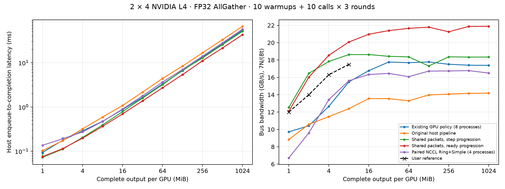

# Active NUMA host-router AllGather, November 15

The user's 1/2/4/8 MiB reference was 12/14/16.3/17.5 GB/s using the same bus
bandwidth convention. The final **single fixed configuration** measures
**12.103 / 16.025 / 18.550 / 20.075 GB/s**. No per-size variant selection is
used for this headline curve. At 1 GiB it measures **42.923 ms / 21.888 GB/s**,
versus the paired existing GPU policy's 54.039 ms: **20.6% lower latency**.

## What changed

Two GPUs upload adjacent shard pieces into each NUMA group's pinned packet.
The fast path retains this D2H aggregation and two remote NUMA destinations,
but removes the intermediate CPU copy of the other local NUMA group's packet.
MPI shared windows provide a mapped view of the source packet, and explicit
GPU-consumer acknowledgments protect it until both readers finish. The GPU's
own shard is copied from its original GPU input. Local/remote output halves
can start independently, and a readiness-driven scheduler avoids blocking
old ready work on future uploads.

The fixed fast path is `shared_ready`: 256 KiB **per-source-GPU** chunks,
three slots, SM download, DMA upload, local-input=self, local-exchange=shared,
early-consume=1, progress=ready, gpu-workers=0, consume-threads=256. At 1 GiB,
input per GPU is 128 MiB and the route uses 512 pieces. The whole 1 MiB–1 GiB
sweep uses those same settings.

See [implementation and lifetime protocol](../../../docs/multinode-host-router.md).

## Hardware and timing

Hosts are `mibura-sky-test-02` and `mibura-sky-test-01` (`l40`), four NVIDIA L4
GPUs and two IB HCAs each. GPU 0/1 + mlx5_0 are NUMA 0; GPU 2/3 + mlx5_1 are
NUMA 1. Fresh topology and local/remote executable/library hashes are included.
CUDA 12.9, Open MPI 4.1.7rc1, NCCL 2.28.7. FP32, out-of-place AllGather.

Sizes denote **complete output per GPU**, with input N/8 per GPU. Bus bandwidth
is `7N/(8t)` in decimal GB/s. Time is slowest-process host enqueue-to-completion;
both GPU streams owned by each host-router process are completed. Input fill
and full-output checking are outside timing. Every warmup and timed call checks
rank/index/generation-dependent data.

There are three reversed-order rounds, 10 warmups and 10 timed calls per size,
11 powers-of-two sizes from 1 MiB to 1 GiB. Values are medians of the three
per-round means; CSVs retain their min/max ranges. The host paths use four MPI
processes (two GPUs/process), the GPU policy uses eight (one GPU/process). This
is an end-to-end implementation comparison, not a same-process-layout kernel
microbenchmark. Every host configuration also runs NCCL Ring+Simple in its own
four-process harness. The NCCL column below always uses the control paired with
`shared_ready`; other paired controls remain in the full CSV.

NCCL receives ten checked, untimed priming calls before the first host case,
then the ordinary per-backend warmups. A diagnostic in `first_size_check.log`
found a first-size state effect: first host round 95.92 µs, later host rounds
71.62/72.18 µs after NCCL ran. `paired/` retains the earlier unprimed runs;
**only `validated/` is used below**. Priming does not change the timed operation
or bandwidth definition. Within each size, the host run precedes its NCCL
control; configuration order reverses in outer round 2.

## Results

| Output/GPU (MiB) | GPU policy (ms) | Original host (ms) | Shared+ready host (ms) | Shared+ready bus GB/s | Paired NCCL, 4 processes (ms) |
| ---: | ---: | ---: | ---: | ---: | ---: |
| 1 | 0.094 | 0.104 | 0.076 | 12.103 | 0.137 |
| 2 | 0.176 | 0.173 | 0.115 | 16.025 | 0.191 |
| 4 | 0.290 | 0.320 | 0.198 | 18.550 | 0.273 |
| 8 | 0.474 | 0.593 | 0.366 | 20.075 | 0.470 |
| 16 | 0.875 | 1.082 | 0.700 | 20.976 | 0.899 |
| 32 | 1.652 | 2.167 | 1.372 | 21.393 | 1.784 |
| 64 | 3.318 | 4.414 | 2.712 | 21.654 | 3.652 |
| 128 | 6.605 | 8.402 | 5.389 | 21.794 | 7.022 |
| 256 | 13.412 | 16.694 | 11.048 | 21.259 | 14.030 |
| 512 | 26.989 | 33.181 | 21.478 | 21.872 | 27.993 |
| 1024 | 54.039 | 66.262 | 42.923 | 21.888 | 56.937 |

The fixed configuration meets or exceeds the reference in median bandwidth.
At 1 MiB the round-mean range is 74.635–78.321 µs (about 11.7–12.3 GB/s), so
this is reproduction of the reference's approximate 12 GB/s level, not a claim
that every run exceeds 12. At 1 GiB the new range is 42.879–42.948 ms. This is
35.2% lower latency than the original host pipeline, and 24.6% lower than its
same-harness NCCL control in this run.



`validated/summary.csv` contains all six configurations plus five separate NCCL
controls. `gpu` is the existing policy (direct through 2 MiB, ring above that).
`legacy` is the old 1 MiB-chunk host pipeline. `early` adds self-input retention
and local/remote split consumption with 256 KiB chunks. `shared` adds shared
local packets, `shared_ready` adds readiness progression, and `shared_rdma`
uses precredited direct host RDMA instead of remote MPI transfers.

## Negative and preliminary experiments

All exploratory records are retained: `pilot/` scans 128 KiB–16 MiB chunks and
SM/DMA downloads; `variants/` tests host relay and local GPU inputs; `workers_fixed/`,
`fine_chunks/`, `early/`, `ready/`, `protocols/`, `sm_upload/`, `atomic_rdma/`,
`lean/`, `threads/`, and `shared/` record successive isolated experiments.
The initial `workers/` launch rejected an unwired CLI option and is not a timing
result. `direct_rdma_smoke.log` precedes the native atomic notification protocol
and is not final correctness evidence. `reproduction/` contains selected earlier
sources as patches from the final source.

Host relay reduced network traffic but lost to remote multicast. Forcing eager
UCX or put_zcopy did not recover the missing performance. GPU workers and SM
upload remain optional experiments rather than defaults. The decisive change
was removing the local packet copy and then progressing ready work promptly.

The separate rank-0 trace at 1 MiB (`profile_1m_stats.txt`, full capture under
`build/ag_host_router_20261115/profile_1m.nsys-rep`) measured about 44 µs of GPU
consumption and a roughly 30 µs upload-to-first-consumer gap in the instrumented
pre-shared implementation. Those times include profiler effects and are not
used for speedup claims.

## Validation

All **3,630 timed comparison calls** passed complete-output checks. Delayed
consumer tests cover non-power-of-two sizes, 131200-byte chunks with tails,
step/ready progression, workers on/off, shared exchange, native host RDMA,
SM upload, DMA download, local GPU-pair inputs, and lean-context operation.
Policy (35 checks), CPU dispatcher (74 checks), CUDA dispatcher, 732 eager
router cases and the 1000-case graph regression passed on four GPUs.
`validation_summary.json` and `checks/` retain evidence.

The core graph checks are regressions of the existing optional router module;
this new MPI-driven host collective is **eager-only**. The CPU-router core and
automatic dispatcher were not modified. The host and optional host-RDMA targets
build through the Makefile. New routes require explicit invocation and are not
a drop-in change to the eight-process GPU API. Compute Sanitizer was not run.

## Reproduction

```bash
make multinode_host_allgather multinode_host_rdma_allgather \
  MPICXX=/usr/mpi/gcc/openmpi-4.1.7rc1/bin/mpicxx \
  MSCCLPP_IB_BUILD=/home/zhongjie/third_party/mscclpp/build-ib-pcieccl
```

Stage both host executables at the same absolute path on both hosts. The
MPI-only host target remains independent of MSCCL++; the second target is an
optional pre-registered host RDMA adapter with CPU IB endpoints and native
host-memory atomic notifications, not GPU atomics.

```bash
HOSTS=10.10.55.2:4,10.10.55.1:4 SOCKET_IFNAME=ibp55s0f0 \
MPIRUN=/usr/mpi/gcc/openmpi-4.1.7rc1/bin/mpirun \
BUILD_DIR="$PWD/build/ag_host_router_20261115" \
GPU_BUILD_DIR="$PWD/build/ag_dual_matched_20261115" \
OUTPUT_DIR="$PWD/build/host-router-recheck" \
  bash scripts/run_multinode_host_router.sh
python3 scripts/summarize_multinode_host_router.py build/host-router-recheck
```

Use a new output directory; existing logs are not overwritten. `validation_commands.sh`
records the main regression commands. Regenerate the plot with `plot.py` in this
record directory, after creating `validated/summary.csv`.
