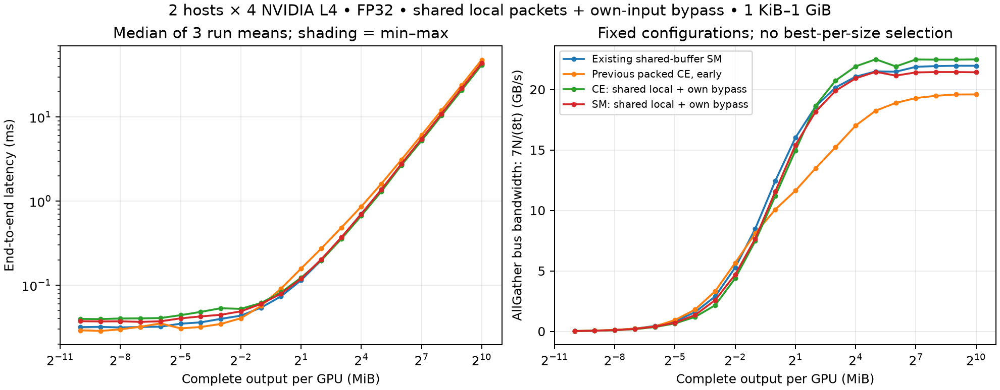

# Packed CE: own-input bypass and shared local packets, 2026-11-17

Historical experiment from the earlier refactor checkout. Its commands and source
paths describe that checkout; exact measured sources are archived here. The
[latest-branch port and fresh validation](../ag_combined_latest_2x4l4_20261117/README.md)
supersede this record for the current implementation.


Both proposed traffic fixes are implemented in the pipelined packed consumer.
At 1 GiB output/GPU, the corrected CE path takes **41.78 ms** versus
**47.96 ms** for the preceding packed CE path with early local consumption
(12.9% lower latency). The current shared-buffer SM baseline is
**42.78 ms** (2.3% lower latency for CE). All values are fresh measurements from the same sweep.

Small messages regress because the fixes add copy submissions: at 1 KiB,
previous packed CE is 29.09 us and corrected CE is
39.76 us. No automatic cutoff or best-per-size curve
was introduced. Existing modes remain available and defaults are unchanged.

## Implementation

`--download packed-dma` and `packed-sm` now accept `--local-input self` and
`--local-exchange shared`, separately or together.

- Own-input bypass copies the complete own contribution from input to its output
  interval once per GPU per collective, on the consumer stream. Chunk consumers
  skip that row. Consumer completion events cover the preceding D2D copy, and
  no later consumer overwrites that interval. Upload of the own contribution
  still occurs because other GPUs need it. H2D drops from N to 7N/8.
- Shared local mode uploads into the existing MPI shared owner packet and sends
  its readiness notification, not its payload, to the other local NUMA group.
  Both local GPU consumers read the owner packet directly. Existing per-slot
  ACKs ensure the owner cannot overwrite the packet while the peer's GPUs read.
- Four remote source rows still land directly in a packed, NUMA-local receive
  region. CE batches physically adjacent rows with cudaMemcpy2DAsync and splits
  at shared-buffer boundaries and the omitted own row. There is no CPU repacking.
- With both options, each GPU consumes one local sibling row, two rows from the
  other local group, and four remote rows: three H2D submissions per chunk.
  With early consumption, the two local copies start before the remote copy.
  Own-shard D2D is one submission per collective rather than per chunk.
- SM uses the same source layout, own-row bypass and readiness/ownership rules,
  reusing the existing scatter kernel. This supplies a matched consumer control.

The three-slot pipeline and ready-progress loop are retained. The change is in
this standalone two-host experiment; the independently linked CPU-router core,
public collective API and automatic admission policies were not changed.

## Hardware and method

- Two hosts: mibura-sky-test-02 / 10.10.55.2 and mibura-sky-test-01 / 10.10.55.1;
  four NVIDIA L4s and two IB NICs per host, two NUMA groups with two GPUs each.
- FP32, out-of-place; four MPI processes (two per node), two GPUs/process;
  MPI/UCX transport with the existing NUMA/rail binding helpers. CUDA 12.9,
  sm_89, Open MPI 4.1.7rc1. Sizes are full output N bytes/GPU; input is N/8.
- Fixed 256-KiB source chunks, three slots, DMA upload, readiness progress,
  early local consumption and no GPU helper workers in all six configurations.
- Baseline is the existing shared-ready SM pipeline. The old packed CE control
  uses local payload exchange and host input for every row. Additional controls
  apply each fix separately, both fixes together, and both fixes with SM.
- Twenty-one powers-of-two sizes, 1 KiB–1 GiB; three separate jobs/configuration,
  each with 20 warmups and 30 timed calls/size. Configuration order reverses in
  round 2. Reported values are medians of three run means; min/max are in CSV.
- Timing is slowest-process host submission through GPU completion and send
  retirement. Setup/registration, input generation, pre-call MPI barrier, timing
  reduction and full-output verification are outside timing. No NCCL timing is
  used here. Every curve has fixed settings; no best variant per size is selected.

## Validation

All **11,340 timed calls and 7,560 warmups** in the performance sweep passed
full rank/index/generation output checks on eight GPUs. Extra delayed-consumer
checks (GPU rank 3) cover six variants, including unsplit shared CE and own-only
SM, 14 non-power-of-two extents (1152–9,437,184 bytes) and 131,200-byte chunks:
840 timed calls + 420 warmups, all passing. These exercise short final rows,
shared-reader credits and repeated three-slot reuse.

Both affected CUDA targets built using the repository Makefile. Runtime tests
use MPI/UCX; the optional direct-RDMA target is only compilation-checked.
Repository regressions passed: 35 backend-policy checks, 74 host dispatcher
checks, CUDA dispatcher capture rejection/eager recovery checks, 732 four-GPU
eager cases and 1000 captured mixed-collective cases. The graph regression is
for the separate optional router core; this MPI experiment remains eager-only.
No sanitizer validation is claimed. Unsupported combinations still reject;
`guard_checks.json` records those cases.

A separate Nsight Systems trace of MPI rank 0's GPUs 0/1 uses 16-MiB outputs,
256-KiB chunks, 5 warmups and 10 checked timed calls, with both fixes enabled:

- Per GPU, each call has 2 MiB D2H payload, 14 MiB H2D payload and one 2-MiB D2D.
  The recorded totals assert exactly N/8, 7N/8 and N/8, respectively.
- H2D records per GPU comprise 120 each of 256 KiB, 512 KiB and 1 MiB across
  the 15 calls. Each GPU has exactly 15 own-shard D2D records, not 120.
- Only input-fill and output-check kernels appear; there is no SM consumer kernel.
- Both GPUs show D2H/H2D payload overlap (113 and 105 operation pairs). Network
  traffic was not separately traced; zero local payload transfer follows from
  the shared-path notification/ACK code, not a NIC-counter measurement.
- Profiled timings are excluded from the performance results. Raw capture,
  wrapper/log and parsed counts are in `profile/` and `profile_traffic.json`.

## Results

The complete table is in **microseconds**.

| Output/GPU | Existing shared SM | Previous packed CE, early | CE with both fixes | SM with both fixes |
| ---: | ---: | ---: | ---: | ---: |
| 1 KiB | 31.771 | 29.089 | 39.762 | 37.354 |
| 2 KiB | 32.002 | 28.609 | 39.569 | 37.128 |
| 4 KiB | 31.465 | 29.859 | 40.207 | 37.220 |
| 8 KiB | 31.896 | 32.051 | 40.337 | 36.664 |
| 16 KiB | 32.142 | 35.158 | 40.717 | 37.239 |
| 32 KiB | 34.897 | 30.663 | 44.038 | 40.369 |
| 64 KiB | 36.161 | 31.863 | 48.180 | 42.569 |
| 128 KiB | 39.818 | 34.629 | 53.232 | 44.521 |
| 256 KiB | 43.456 | 40.490 | 52.345 | 48.888 |
| 512 KiB | 54.009 | 56.582 | 61.402 | 59.835 |
| 1 MiB | 73.688 | 90.990 | 81.914 | 79.266 |
| 2 MiB | 114.579 | 157.768 | 122.696 | 119.144 |
| 4 MiB | 197.527 | 272.291 | 196.847 | 202.187 |
| 8 MiB | 363.941 | 481.997 | 353.919 | 368.889 |
| 16 MiB | 697.166 | 862.807 | 670.026 | 701.641 |
| 32 MiB | 1365.822 | 1608.731 | 1305.167 | 1368.207 |
| 64 MiB | 2735.215 | 3108.418 | 2680.772 | 2776.950 |
| 128 MiB | 5369.668 | 6087.781 | 5224.469 | 5484.820 |
| 256 MiB | 10707.717 | 12058.944 | 10455.523 | 10955.065 |
| 512 MiB | 21391.773 | 23984.454 | 20911.032 | 21909.671 |
| 1 GiB | 42781.643 | 47963.997 | 41784.399 | 43854.043 |

| 1-GiB configuration | Median latency (ms) |
| --- | ---: |
| Previous packed CE, early | 47.964 |
| Own-input bypass only | 43.350 |
| Shared local exchange only | 46.032 |
| Both fixes | 41.784 |
| Existing shared-buffer SM | 42.782 |
| Matched packed SM with both fixes | 43.854 |



Standard AllGather bus bandwidth is 7N/(8t) in decimal GB/s. It is not raw H2D
or NIC throughput. Min/max shading is the range of three job means, not a
statistical confidence interval. The CSV retains all six curves, including
negative small-message results; the plot shows the four principal comparisons.

## Use and reproduce

Select both fixes explicitly in the standalone harness:

```text
--download packed-dma --upload dma --local-input self
--local-exchange shared --early-consume 1 --progress ready -k 262144
```

From the Lite root:

```bash
make multinode_host_allgather multinode_host_rdma_allgather \
  BUILD=build/ag_packed_fixed_20261117 \
  MPICXX=/usr/mpi/gcc/openmpi-4.1.7rc1/bin/mpicxx \
  MSCCLPP_IB_BUILD=/home/zhongjie/third_party/mscclpp/build-ib-pcieccl
# Stage the MPI-only executable at the identical build path on the second host.
python3 scripts/validate_multinode_ag_contiguous.py \
  --binary build/ag_packed_fixed_20261117/uccl_lite_multinode_host_allgather \
  --out build/ag_packed_fixed_repeat \
  --modes packet_sm packed_dma_early packed_dma_self packed_dma_shared \
          packed_dma_fixed packed_sm_fixed \
  --rounds 3 --warmups 20 --iterations 30 \
  --begin 1024 --end 1073741824 --timeout 600
```

The runner refuses to overwrite results. Manifest files preserve exact commands,
UTC times and binary SHA-256; both hosts used the same executable. Source snapshots,
hashes and `shared_self.patch` preserve the measured implementation. Raw logs,
CSVs, fresh topology/GPU records, tail checks, trace and regression logs are retained.
Historical measurements do not validate later source edits.
