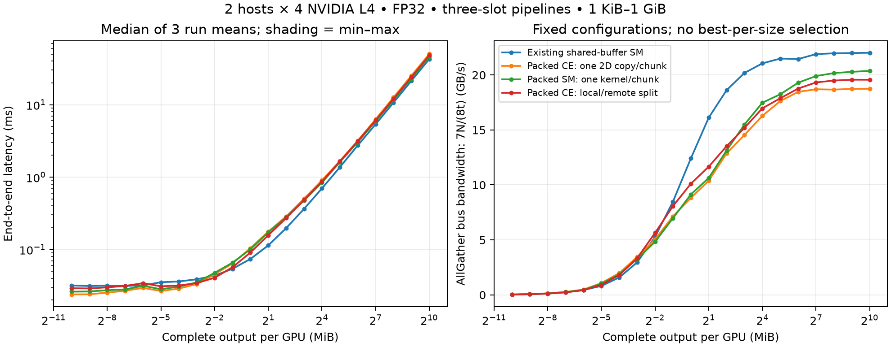

# Pipelined packed-host AllGather validation, 2026-11-17

Historical experiment from the earlier refactor checkout. Its commands and source
paths describe that checkout; exact measured sources are archived here. The
[latest-branch port and fresh validation](../ag_combined_latest_2x4l4_20261117/README.md)
supersede this record for the current implementation.


The proposed chunked design is correct and does overlap GPU transfers. A packed
host chunk can be consumed with one cudaMemcpy2DAsync per GPU while later chunks
are uploading/in flight. The complete tensor need not arrive first.

At 1 GiB output/GPU, packed CE takes **50.12 ms**, versus a fresh
full-buffer CE control's **77.39 ms** (35.2% lower
latency). The current shared-buffer SM pipeline remains faster at
**42.67 ms**. Packed SM is **46.12 ms**;
CE with early local consumption is **48.02 ms**.
The result corrects the earlier full-buffer experiment's limitation: contiguous
staging does not require waiting for a complete tensor. This particular packed
CE implementation is not a universal improvement over the existing pipeline.

## Implementation and comparison

Each of the three slots owns a NUMA-local pinned buffer with eight adjacent
source rows. Source uploads and group MPI receives write directly into the
corresponding row intervals; there is no explicit CPU concatenation pass (MPI
may internally copy). Rows use the actual piece length, including short tails.

For `--download packed-dma`, each ready chunk submits:

```text
cudaMemcpy2DAsync(
    output + pieceOffset, destinationPitch = completeShardBytes,
    packedHost,            sourcePitch = actualPieceBytes,
    width = actualPieceBytes, height = 8, H2D, consumerStream)
```

This copies `[A_j B_j ... H_j]` into the strided final rank-ordered output.
`packed-sm` uses the same packet layout, network traffic, scheduler and readiness
rules, replacing the 2D copy with the existing vectorized SM scatter kernel.
The optional `--early-consume 1` splits each consumption into local and remote
four-row phases, two 2D copy calls per GPU per chunk. No consumer waits for later
chunks. Upload/download events and outgoing MPI requests retain the existing
slot retirement rules; a slot is reused only after all readers/sends finish.

The packed modes reuse the ready-driven three-slot pipeline. They use local MPI
payload exchange rather than the baseline's shared local mapping, and read the
GPU's own shard back from host: N H2D bytes instead of 7N/8. Thus packed CE versus
packed SM isolates the consumer choice, while comparison with the existing
shared-buffer baseline also includes these traffic/layout differences. The full-
buffer control also differs in buffer footprint and scheduling, so its entire
latency difference is not attributed to one isolated mechanism.

The standalone experiment is opt-in. Unsupported shared/self-input/worker/SM-
upload combinations reject explicitly. Defaults, public collective APIs and
production router policy remain unchanged. The full-buffer modes remain useful
controls; earlier historical measurements are preserved.

## Hardware and method

- Two hosts: mibura-sky-test-02 / 10.10.55.2 and mibura-sky-test-01 / 10.10.55.1;
  four NVIDIA L4s and two IB NICs per host; two NUMA groups with two GPUs each.
- FP32, out-of-place; four MPI processes, two GPUs/process; MPI/UCX transport.
  Existing helpers provide CPU/NUMA/rail binding. CUDA 12.9, sm_89,
  Open MPI 4.1.7rc1. Both affected CUDA targets built using the repository Makefile.
  The optional host-RDMA executable was compilation-checked; runtime uses MPI/UCX.
- N denotes complete output bytes/GPU; each GPU contributes N/8. Per-source
  packet capacity is fixed at 256 KiB for all main configurations and sizes.
- Existing baseline: shared-ready SM packet pipeline, DMA upload, self-input
  retention, shared local exchange, early consume and no extra GPU workers.
- Timing: slowest-process host submission through GPU completion and send retirement.
  Setup/registration, input generation, pre-call MPI barrier, timing reduction
  and complete-output verification are outside the timed interval.
- Main comparison: 21 powers-of-two sizes, 1 KiB–1 GiB; four fixed configurations;
  three jobs/configuration, 20 warmups + 50 timed invocations per size/job.
  Configuration order reverses in round 2. Table values are medians of three
  run means, not medians of individual samples. CSV retains all run means/ranges.
- There is no per-size best-variant selection. NCCL is not a measured baseline.
- Fresh full-buffer CE control: three separate 1-GiB jobs after the main sweep,
  also 20 warmups + 50 timed calls/job, same binary and hosts. This control was
  not interleaved into the main configuration order. Its run-mean range is
  77.250–77.424 ms.

## Correctness and trace evidence

All **12,600 timed main calls + 5,040 warmups** passed full rank/index/generation
output checks on both hosts. The full-buffer control passed another 150 timed
calls + 60 warmups. Delayed-consumer checks (GPU rank 3) exercised all four new
packed variants, including early SM, with 14 extents from 1152 to 9,437,184 bytes
and 131,200-byte chunks: 560 timed calls + 280 warmups, all passing. These include
non-power-of-two extents, partial final rows and repeated three-slot reuse.
Invalid-mode checks are recorded in `guard_checks.json`. No graph or sanitizer
validation is claimed; this MPI harness is eager-only.

A separate Nsight Systems capture profiles rank 0's two GPUs at 16 MiB output,
256-KiB chunks, packed CE, 5 warmups + 10 checked timed calls:

- 240 cudaMemcpy2DAsync calls and 240 H2D activity records, each 2 MiB.
- 120 D2H payload uploads and 120 H2D downloads per GPU. Verification's 4-byte
  D2H reads are excluded from payload analysis.
- Only input-fill and output-check kernels appear. There is no SM download kernel.
- Each GPU shows 73 temporally overlapping D2H/H2D payload-operation pairs,
  totaling about 1.06 ms overlap over the capture. This confirms actual transfer
  overlap, not just asynchronous submission. Network progress was not separately
  traced, so no quantified network-overlap claim is made.
- The instrumented timing results are excluded from every performance table.

`profile/summary.json`, the raw `.nsys-rep`, wrapper and log preserve this evidence.
The SQLite export is under `build/ag_packed_pipeline_20261117/`.

## Results

All times below are **microseconds**.

| Output/GPU | Existing shared SM | Packed CE | Packed SM | Packed CE, early local |
| ---: | ---: | ---: | ---: | ---: |
| 1 KiB | 31.911 | 23.984 | 26.185 | 29.179 |
| 2 KiB | 31.332 | 24.042 | 26.348 | 29.013 |
| 4 KiB | 31.645 | 25.426 | 27.399 | 30.005 |
| 8 KiB | 31.361 | 26.925 | 28.089 | 31.411 |
| 16 KiB | 31.988 | 29.523 | 31.566 | 34.309 |
| 32 KiB | 35.300 | 26.718 | 28.284 | 31.013 |
| 64 KiB | 36.182 | 28.851 | 30.691 | 31.800 |
| 128 KiB | 38.762 | 33.245 | 35.100 | 34.338 |
| 256 KiB | 43.514 | 45.398 | 47.569 | 40.691 |
| 512 KiB | 54.072 | 64.231 | 65.761 | 56.799 |
| 1 MiB | 73.943 | 104.016 | 100.458 | 90.790 |
| 2 MiB | 113.823 | 176.779 | 172.531 | 157.349 |
| 4 MiB | 197.103 | 285.107 | 279.395 | 271.363 |
| 8 MiB | 363.594 | 504.504 | 473.612 | 483.060 |
| 16 MiB | 697.176 | 901.277 | 839.787 | 865.091 |
| 32 MiB | 1366.014 | 1665.738 | 1609.279 | 1641.923 |
| 64 MiB | 2737.408 | 3180.106 | 3042.195 | 3129.394 |
| 128 MiB | 5363.095 | 6279.839 | 5900.591 | 6077.553 |
| 256 MiB | 10690.752 | 12581.089 | 11642.509 | 12049.229 |
| 512 MiB | 21357.033 | 25069.468 | 23156.983 | 24003.917 |
| 1 GiB | 42665.554 | 50121.261 | 46116.566 | 48017.585 |



Bus bandwidth is the standard AllGather metric `7N/(8t)` in decimal GB/s,
not measured NIC or raw H2D bandwidth. Min/max shading is the range of three
run means, not a statistical confidence interval.

## Reproduction

From the Lite root:

```bash
make multinode_host_allgather multinode_host_rdma_allgather \
  BUILD=build/ag_packed_pipeline_20261117 \
  MPICXX=/usr/mpi/gcc/openmpi-4.1.7rc1/bin/mpicxx \
  MSCCLPP_IB_BUILD=/home/zhongjie/third_party/mscclpp/build-ib-pcieccl
# Stage the MPI-only executable at the identical build path on the second host.
python3 scripts/validate_multinode_ag_contiguous.py \
  --binary build/ag_packed_pipeline_20261117/uccl_lite_multinode_host_allgather \
  --out build/ag_packed_pipeline_repeat \
  --modes packet_sm packed_dma packed_sm packed_dma_early \
  --rounds 3 --warmups 20 --iterations 50 \
  --begin 1024 --end 1073741824 --timeout 600
```

The runner refuses to overwrite results. `manifest.json` preserves commands,
UTC times and binary SHA-256; `remote_binary_hash.txt` confirms the same executable
on both hosts. Source snapshots, hashes and `packed_pipeline.patch` preserve the
measured changes. Raw logs, CSVs, fresh GPU/topology records, tail checks, trace,
and full-buffer control are retained. Run `plot.py` here to regenerate the charts.
Historical results do not validate subsequent source changes.
