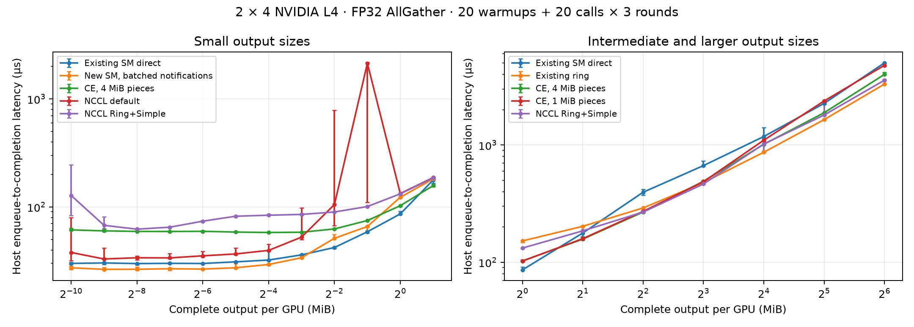

# AllGather copy-engine/pipeline experiment, November 15

Hardware: `mibura-sky-test-02` and `l40` / `mibura-sky-test-01`, each with four
NVIDIA L4 GPUs and two IB HCAs. GPU 0/1 + mlx5_0 are NUMA 0; GPU 2/3 + mlx5_1
are NUMA 1. Topology, driver versions, and matching executable/library SHA256s
are recorded in the adjacent files. CUDA 12.9, Open MPI 4.1.7rc1, NCCL 2.28.7.
The independently linked CPU-router module was not changed or used.

The implementation is described in
[the AllGather pipeline design](../../../docs/multinode-allgather-pipeline.md).
All new paths remain explicitly selected experiments; `--ag-auto` is unchanged.

## Final comparison method

`paired/` uses the final source in [source and binary hashes](../ag_1m_1g_2x4l4_20261115/hashes.txt), staged identically on both hosts.
AllGather is FP32, out-of-place, with eight MPI processes, one per GPU. Sizes
1 KiB–64 MiB are **complete output bytes per GPU**; input per GPU is one eighth
of that number. Both UCCL and NCCL use slowest-rank host enqueue-to-completion
timing. Initialization, input fill, and checking are outside the timed interval.
Every warmup and timed invocation checks the complete output with changing input.
There are 20 warmups and 20 timed calls per size, repeated in three rounds.
The CSV gives median/min/max of the three per-round arithmetic means.

Nine fixed configurations are measured:

| Label | Configuration |
| --- | --- |
| serial | Existing direct SM AllGather, one CTA / 256 threads |
| ring | Existing local ring, default 24 CTAs / 512 threads |
| flat | Existing proxy/DMA flat multicast, default 24 CTAs / 512 threads |
| sm4096 | New SM forwarding, 4 MiB pieces |
| ce1024 | New CE forwarding, 1 MiB pieces |
| ce4096 | New CE forwarding, 4 MiB pieces |
| pair4096 | New CE NUMA-pair relay, 4 MiB pieces |
| nccl_default | NCCL algorithm/protocol defaults |
| nccl_simple | NCCL Ring+Simple |

New configurations use one CTA / 256 threads and network lookahead 4. Piece size
counts bytes of one rank's input shard. Therefore `ce4096` uses one chunk through
32 MiB complete output, and two chunks at 64 MiB. `ce1024` uses multiple chunks
above 8 MiB complete output. A one-chunk improvement cannot be attributed to
inter-chunk pipelining.

Round order is the table order in rounds 1 and 3 and its reverse in round 2.
Every curve is a fixed configuration, not a best-variant-per-size envelope.
When comparing against the existing automatic policy, use the measured serial
control through 2 MiB and ring above 2 MiB, matching the current code's dispatch.
NCCL default and Ring+Simple are both retained to expose protocol-sensitive
outliers instead of choosing only a slow control.

## Results

All 9,180 timed comparison samples passed with zero output error. The following
latencies are microseconds, median of three round means. Full per-size results
and round ranges are in [`paired/summary.csv`](paired/summary.csv).

| Complete output/GPU | Existing direct | Existing ring | New CE, 4 MiB pieces | NCCL default | NCCL Ring+Simple |
| ---: | ---: | ---: | ---: | ---: | ---: |
| 64 KiB | 32.22 | 89.22 | 57.93 | 39.58 | 83.75 |
| 1 MiB | 86.09 | 151.95 | 102.58 | 132.98 | 132.13 |
| 2 MiB | 177.65 | 202.66 | **157.47** | 186.92 | 185.33 |
| 4 MiB | 395.59 | 290.51 | **268.30** | 271.58 | 268.04 |
| 8 MiB | 667.81 | **478.20** | 491.15 | 465.43 | 465.60 |
| 16 MiB | 1182.44 | **868.42** | 1015.14 | 902.21 | 1021.07 |
| 64 MiB | 5024.52 | **3313.15** | 4007.80 | 3599.32 | 3575.95 |

At 2 MiB, CE lowers latency by **11.4% versus the existing direct path** and
15.0% versus NCCL Ring+Simple. CE's round-mean range is 154.36–161.22 µs,
compared with direct's 165.44–184.07 µs. At 4 MiB, CE lowers latency by
**7.6% versus the existing ring path** and 32.2% versus extending direct to
that size. CE's range is 267.85–275.75 µs versus ring's 290.07–291.77 µs.
It is effectively tied with NCCL Ring+Simple at 4 MiB, not a demonstrated win.

The new SM schedule also improves small messages with one final notification
per peer and an earlier IB submission. With the same fixed 4 MiB piece setting:

| Complete output/GPU | Existing direct (µs) | New SM (µs) | Latency reduction |
| ---: | ---: | ---: | ---: |
| 1 KiB | 29.98 | 27.32 | 8.9% |
| 16 KiB | 29.94 | 26.58 | 11.2% |
| 64 KiB | 32.22 | 29.30 | 9.1% |
| 128 KiB | 35.97 | 33.84 | 5.9% |

At these points the three-round ranges do not overlap. At 256 KiB and above,
this SM candidate loses to the old direct path in the small/intermediate range
(e.g. 1 MiB: 122.69 versus 86.09 µs). These are fixed-configuration comparisons;
no combined SM/CE selection curve or runtime policy is installed.

The CE path loses to direct at smaller sizes and loses to ring from 8 MiB
upward in this sweep. The 1 MiB-piece pipeline does not establish a larger-size
win over ring either (at 64 MiB: 4790.73 µs versus 3313.15 µs). Thus the CE
positive result is a narrow 2/4 MiB region for batched-notification transfers;
finer-grained pipeline, more SM CTAs, and NUMA-pair relay are negative candidates
here. No candidate-envelope plot or automatic threshold update is made.



Regenerate the figure with `python3 benchmarks/data/ag_pipeline_2x4l4_20261115/plot.py`.

## Exploratory results

`pilot/` used one local notification for every copy/chunk, five warmups and ten
timed calls. CE small chunks incurred many proxy and doorbell operations.
`tune/` combined these into one final notification per local peer, and explored
64 KiB–4 MiB pieces plus 1/4/8 CTAs. More SM CTAs did not reliably help.
`relay/` tested NUMA-pair forwarding: cross-NUMA payload is halved compared with
flat multicast, but the additional cross-peer wait and relay did not pay off.
These preliminary records are retained, not used as final-source validation.
`reproduction/` contains patches from the final source to the pilot/tune source;
apply only in a separate checkout. The original source/binary hashes are in
`pilot_hashes.txt` and `tune_hashes.txt`.

## Reproduce

From `experimental/lite`:

```bash
make multinode_allreduce multinode_cpu_router nccl_2x4l4_baseline \
  MPICXX=/usr/mpi/gcc/openmpi-4.1.7rc1/bin/mpicxx \
  MSCCLPP_IB_BUILD=/home/zhongjie/third_party/mscclpp/build-ib-pcieccl
```

Stage identical `uccl_lite_multinode_allreduce` and
`uccl_lite_nccl_2x4l4_baseline` binaries at the same absolute build path on both
hosts. Use a new output directory (the runner refuses to overwrite logs):

```bash
HOSTS=10.10.55.2:4,10.10.55.1:4 SOCKET_IFNAME=ibp55s0f0 \
MPIRUN=/usr/mpi/gcc/openmpi-4.1.7rc1/bin/mpirun \
BUILD_DIR="$PWD/build/ag_pipeline_20261115" \
OUTPUT_DIR="$PWD/build/ag-pipeline-recheck" \
  bash scripts/run_multinode_ag_pipeline.sh
python3 scripts/summarize_multinode_ag_pipeline.py build/ag-pipeline-recheck
```

## Correctness and limitations

Both affected Makefile targets (the multi-node executable and its CPU-router
wrapper) compile. The final paired runs check all outputs on both four-GPU hosts.
`validation_commands.sh` additionally tests all three new modes with 1/4 CTAs,
non-power-of-two output extents, 65552-byte pieces with short last chunks, and
lookahead 3. Consecutive-call tests use lookahead 1/4, 50 timed launches without
per-call host barriers, and verify the final result and a fresh generation.
Existing AR/RS automatic paths receive a two-host per-call-checked regression
sweep. Invalid operation, piece alignment, lookahead and chunk-count settings
must exit with configuration error before transport initialization.

The input pattern is the existing rank/index/generation-dependent reference;
this is eager execution, not validation of CUDA graph replay. No CPU-router
policy, dispatcher calibration, or production backend promotion is included.

## Copy-engine trace

A separate Nsight Systems 2025.1.3 capture instruments rank 0 at 2 MiB complete
output, `ce4096`, with two validation calls, two warmups and three timed calls.
`profile_ce_stats.txt` and `profile_ce_counts.json` show **42 peer payload copies
of 262144 bytes and 21 peer notifications of 8 bytes**: six payload copies and
three notifications per invocation, matching the batched CE schedule. CUDA
memory-copy activity confirms this is a DMA transfer path, not merely an SM
copy kernel renamed as CE. The trace includes setup/check transfers; its latency
is instrumented and is excluded from every speedup claim. The full capture is
in `build/ag_pipeline_20261115/profile_ce.nsys-rep`.

All additional checks completed successfully; `validation_summary.json` records
per-test coverage and zero output error. Compute Sanitizer was not run.

Shared archived records: [local software identity](../ag_1m_1g_2x4l4_20261115/software_local.txt), [local GPU topology](../ag_1m_1g_2x4l4_20261115/topology_local.txt).
These files are byte-identical to this experiment's recorded copies; fresh
runs must capture their own environment and software identities.
