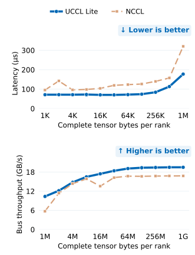

# Current hybrid AllReduce full-range sweep, November 15

The README AllReduce figure uses this fresh sweep of the current working-tree
UCCL Lite source for both panels: **1 KiB–1 MiB latency** and **1 MiB–1 GiB
bus throughput**. No historical small-message points are spliced into the curve.

## Configuration and timing

Two hosts, mibura-sky-test-02 and mibura-sky-test-01, each have four NVIDIA L4
GPUs and two IB HCAs. GPUs 0/1 and 2/3 form the NUMA pairs and use mlx5_0 and
mlx5_1 respectively. Eight MPI ranks, one GPU per rank; FP32 in-place sum,
complete input/output bytes per GPU. CUDA 12.9, Open MPI 4.1.7rc1, NCCL 2.28.7.
The baseline explicitly forces NCCL Ring+Simple at every size.

UCCL Lite uses GPU ReduceScatter followed by host-packet AllGather, explicitly
selected with `--host-gather 1`. Host pieces remain fixed at 256 KiB with three
slots. GPU ReduceScatter uses its current size-dependent policy (96 CTAs,
512 threads and an 8-MiB target for the ring). There is no selection of the
fastest measured candidate per size. This is an eager experiment, not an
automatic dispatch policy.

Both controls measure slowest-rank host enqueue-to-completion latency, including
phase handoff and completion. Preparation, input fill and full-output checking
are outside timing. UCCL Lite has three rounds; NCCL reuses the two rounds completed before the
request to stop NCCL measurement. Each size has twenty warmups followed by
ten timed calls. Every invocation is checked. The first paired round ran
UCCL Lite then NCCL; the second ran NCCL then UCCL Lite. Points are medians
of the available round means; UCCL Lite latency error bars show its round-mean min/max.
NCCL error bars are omitted; its ranges remain in `summary.csv`.
No third NCCL round was launched. The retained NCCL command used the same
eight-rank `ob1`/`self,vader,tcp` harness as the historical hybrid comparison,
with `NCCL_ALGO=Ring` and `NCCL_PROTO=Simple`.
Conventional bus throughput is `7N/(4t)` in decimal GB/s, not wire traffic.
Small-message regressions and outliers are retained.



All 630 UCCL Lite timed calls and their warmups passed full-output checking
on the two four-GPU hosts. The 420 retained NCCL timed calls also passed.
UCCL Lite medians are 71.345 µs at 1 KiB, 177.284 µs at 1 MiB, and
96.411 ms / 19.49 GB/s at 1 GiB. See the [complete table](results_table.md).
The NCCL 1-MiB round means span 204.509–436.013 µs; this variability is
preserved in the CSV rather than used to claim a stable gain.

## Reproduction and provenance

From `experimental/lite`:

```bash
make BUILD=build/ar_latency_2x4l4_20261115 \
  MSCCLPP_IB_BUILD=/home/zhongjie/third_party/mscclpp/build-ib-pcieccl \
  MPICXX=/usr/mpi/gcc/openmpi-4.1.7rc1/bin/mpicxx \
  multinode_allreduce nccl_2x4l4_baseline -j2
# Stage identical binaries under the same build path on the second host.
bash benchmarks/data/ar_latency_2x4l4_20261115/compare.sh
python3 benchmarks/data/ar_latency_2x4l4_20261115/summarize.py
python3 benchmarks/data/ar_latency_2x4l4_20261115/plot.py
```

The comparison script runs UCCL Lite only and refuses to overwrite existing logs. Preserve this record and
choose a new output directory for a rerun. `raw/` retains every call;
`summary.csv` contains the round-mean summary. `build.log`, `environment.txt`,
`hashes.txt` and `remote_hashes.txt` identify the build, source and deployed
binaries. The source was built from the current working tree, including its
existing local changes; `measured_source.patch.gz` records those measured-source
changes against the revision in `environment.txt`. The git revision alone does
not identify that source.
Historical hybrid results remain in
[their original record](../hybrid_ar_2x4l4_20261115/README.md).
