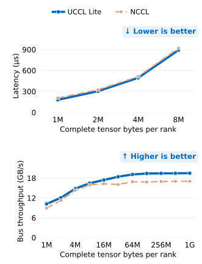

# GPU ReduceScatter + host-packet AllReduce, November 15

The combined eager AllReduce has lower median latency than both controls at
**all 11 tested power-of-two sizes from 1 MiB through 1 GiB**. Reduction stays
entirely on GPUs. The same fixed 256-KiB host-piece configuration is used
throughout, with the existing tuned GPU ReduceScatter selection.

Relative to the original tuned UCCL Lite AllReduce, latency falls **5.8–15.0%**;
relative to NCCL 2.28.7 Ring+Simple it falls **3.1–13.2%**. At 1 GiB, medians
are **96.325 ms** for hybrid, **106.021 ms** for previous UCCL Lite, and
**110.204 ms** for NCCL. Hybrid conventional bus bandwidth reaches **19.51 GB/s**.
All three-round ranges are disjoint from both controls at these measured sizes.
These are configuration-specific results; the new path remains explicitly
selected and no automatic router policy is enabled.

## Hardware, controls and timing

Hosts are mibura-sky-test-02 and mibura-sky-test-01, four NVIDIA L4 GPUs and two
IB HCAs each. GPU pairs 0/1 and 2/3 are the NUMA groups; mlx5_0 and mlx5_1 are
the corresponding rails. CUDA 12.9, Open MPI 4.1.7rc1 and NCCL 2.28.7. Eight
MPI ranks, one GPU per rank, for all three controls. The hybrid's four NUMA
leaders send host packets; every rank performs its own GPU work.

FP32 sum, in-place AllReduce, N=input/output bytes per GPU. Timing is maximum
rank host enqueue-to-completion. GPU ReduceScatter, stream completion at the
handoff, any packed-input protection barrier, host transport, GPU consumption
and slot retirement are all timed. Preparation, input fill and complete-output
checking are outside timing. Bus bandwidth is the conventional `7N/(4t)` in
decimal GB/s, not a measurement of actual wire traffic.

There are three rounds, twenty warmups and ten timed calls per size, eleven
powers of two from 1 MiB to 1 GiB. Backend order rotates so each runs first,
middle and last once. Summary values are medians of the three round means;
summary.csv retains min/max ranges. No best-variant-per-size envelope is used.
The host configuration is fixed; GPU ReduceScatter uses its established serial,
packed and direct-ring size selection, 96 CTAs/512 threads for ring kernels,
and the documented 8-MiB target-piece policy.

The `old` control is the exact `build/multinode_trial` executable used for the
README's November 11 results, with `--ar-auto 1`, remeasured here. The NCCL
control forces Ring+Simple in the existing fully checked eight-rank harness.
Identical NCCL control binaries were staged on both hosts under the experiment
directory after detecting different binaries at the generic build paths. The
NCCL libraries match. hashes.txt identifies all binaries and libraries.

## Results

| Input/GPU (MiB) | Previous UCCL (ms) | Hybrid (ms) | NCCL Ring+Simple (ms) | Hybrid bus GB/s |
| ---: | ---: | ---: | ---: | ---: |
| 1 | 0.212 | 0.180 | 0.205 | 10.19 |
| 2 | 0.329 | 0.304 | 0.324 | 12.09 |
| 4 | 0.567 | 0.496 | 0.513 | 14.81 |
| 8 | 0.956 | 0.892 | 0.920 | 16.46 |
| 16 | 1.786 | 1.683 | 1.799 | 17.45 |
| 32 | 3.540 | 3.186 | 3.649 | 18.43 |
| 64 | 7.065 | 6.143 | 6.944 | 19.12 |
| 128 | 14.129 | 12.097 | 13.935 | 19.42 |
| 256 | 28.270 | 24.151 | 27.667 | 19.45 |
| 512 | 54.128 | 48.260 | 55.092 | 19.47 |
| 1024 | 106.021 | 96.325 | 110.204 | 19.51 |

The original GPU AllReduce and the hybrid use CPU-side input fill/checking;
the existing NCCL control fills/checks on GPU. Both are outside timing, as in
the repository's established comparison harness. This is an end-to-end
implementation comparison, not an isolated kernel microbenchmark.

## Implementation and correctness

The GPU ReduceScatter first produces an N/8-byte reduced shard on each GPU.
Host gathering retains that shard on the GPU, uploads paired adjacent source
pieces, shares local NUMA packets, and progresses three reusable slots. The
only CPU payload operations are movement/assembly by the transport; no CPU
reduction is performed. Network payload rises to 1.5N bytes/node across both
phases, trading more host-network traffic for less GPU peer-copy traffic.

All **990 timed comparison calls** and their warmups pass complete-output
checks. Additional validation covers:

- Three consecutive in-place AllReduce calls without input refill, with an
  independent expected repeated sum, from 1 KiB through 64 MiB.
- Non-power-of-two 6,291,968-byte inputs with 131,200-byte host pieces, a short
  final piece and more pieces than slots; both AG and AR.
- 128-byte host pieces at 1–32 KiB, plus the 16-MiB maximum host piece.
- The inherited flat-RS interval at 24 MiB, including repeated in-place calls.
- 1,000 checked AG calls while a test-owned rank-1 consumer process is paused
  eight times for 50 ms. All calls pass; these timings are stress results only.
- Ordinary GPU AR/AG/RS regression sweeps in the modified executable.
- Existing CPU-router policy (35 checks), host dispatcher (74), CUDA dispatcher,
  732 eager cases and 1,000-case graph regression on the local four GPUs.

The CPU-router core and its dispatcher are unchanged. Their graph test is a
regression of that existing module; the new MPI host-gather path is **eager-only**.
Compute Sanitizer was not run. The non-power-of-two cases establish correctness,
not speedup at unmeasured sizes. In particular, the inherited flat-RS interval
between 16 and 32 MiB has not been performance-qualified for this hybrid.

Initial runs failed on a stale CUDA invalid-handle status left before the first
kernel launch during MPI/shared-memory setup. Diagnostic logging established
that the status predated the launch; after clearing it, the checked operation
succeeded. The implementation filters only that probe status and directly
checks every owned CUDA operation; other CUDA errors propagate. Failed and
diagnostic logs are preserved, excluded from the comparison.

## Reproduce

See [implementation, ownership protocol and command](../../../docs/multinode-hybrid-allreduce.md).
`compare.sh` records the three-round comparison, `edges.sh` and `final_checks.sh`
the additional checks, and `pause_consumer.py` the owned-process pause test.
Run these from lite after staging identical executables at the paths they name.
Comparison logs are not overwritten; other diagnostic scripts use fixed log
names, so preserve prior results before repeating them.

`python3 summarize.py` regenerates summary.csv and rejects incomplete rounds,
sizes, calls or errors. `python3 plot.py` regenerates the record and README
figures. Earlier smoke/diagnostic logs are not used in the headline curve.

ReduceScatter optimization remains open. This result reuses its tuned GPU
implementation; it is a new AllReduce composition, not a ReduceScatter speedup.

## Publication validation

The published change excludes the unrelated CPU-reduction and experimental
paired/fused ReduceScatter work. The isolated build on the updated branch
passed a fresh two-node 1-KiB–64-MiB sweep with three consecutive in-place calls,
non-power-of-two/tail and flat-RS-interval checks, and a 1-GiB check. The latter
measured 96.375 ms over three checked calls after two warmups, consistent with
the recorded hybrid result. These publication checks are separate from the
three-round headline comparison. Both affected targets build; their logs are
retained under `raw/publish_*`.
