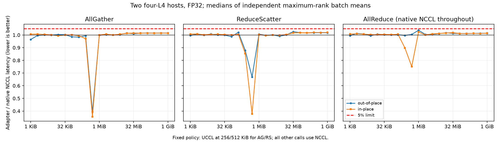

# NCCL drop-in, 1 KiB–1 GiB, November 17

This record tests an unchanged MPI nccl-tests executable with native NCCL and
the UCCL Lite/MSCCL++ adapter on the same two four-L4 hosts. Earlier failures
and unsuccessful implementation experiments are retained alongside the final
measurement. The no-regression criterion is **at most 5% slower in every
collective/size/layout row**, not merely an improvement in the average curve.

**Final result: PASS, 0/126 rows exceed 5%.** All 24 jobs passed nccl-tests
correctness and route assertions. The worst median slowdowns are 1.61% for
AllGather, 2.61% for ReduceScatter, and 3.75% for AllReduce. This is a measured
5%-tolerance result on the recorded configuration, not a claim of literally
zero variation or a guarantee on other hardware/software.



The machine-readable final verdict and all rows are in
`final_validation/performance_verdict.json` and `final_validation/summary.csv`.
The frozen policy routes FP32 AllGather and SUM ReduceScatter at complete
extents **256 KiB and 512 KiB**. AllReduce and every other measured extent use
native NCCL. Positive route counters are required on all eight ranks for
AG/RS; AR must have zero UCCL calls. This is not an all-NCCL pass and does not
claim that the custom kernels run through 1 GiB.

| Routed operation | Complete extent | Layout | Native NCCL (µs) | Adapter (µs) |
| --- | ---: | --- | ---: | ---: |
| AllGather | 256 KiB | out-of-place | 51.270 | 50.960 |
| AllGather | 256 KiB | in-place | 51.180 | 49.720 |
| AllGather | 512 KiB | out-of-place | 201.335 | 79.200 |
| AllGather | 512 KiB | in-place | 215.570 | 76.755 |
| ReduceScatter | 256 KiB | out-of-place | 50.885 | 44.755 |
| ReduceScatter | 256 KiB | in-place | 51.255 | 43.830 |
| ReduceScatter | 512 KiB | out-of-place | 103.625 | 69.355 |
| ReduceScatter | 512 KiB | in-place | 180.595 | 68.435 |

NCCL has substantial size-dependent variation near 512 KiB; the CSV retains
each backend's job minimum and maximum. The AR dips in the plot also reflect
native NCCL variability, not UCCL acceleration: this policy routes no AR calls.
The table does not establish a general speedup over tuned NCCL configurations.

## Measurement contract

- Hardware: mibura-sky-test-02 / 10.10.55.2 and mibura-sky-test-01 / 10.10.55.1,
  four NVIDIA L4s and two IB rails each. Eight MPI ranks, one GPU per process,
  ordered by host; rail map 0/0/1/1. CPU affinity, GPU UUIDs, driver, topology
  and library hashes are in the two host JSON records for each phase.
- FP32, SUM for AR/RS. Extent is full input bytes/GPU for AR/RS and full output
  bytes/GPU for AG. Both NCCL in-place and out-of-place layouts are checked.
- NCCL 2.28.7 and the existing nccl-tests 2.19.7 executables, unchanged between
  controls and candidate. CUDA 12.9 build/linked runtime; IB-enabled MSCCL++
  external checkout 52f659d with its pre-existing local gpu_utils.cc modification.
  No external dependency source was modified during this work.
- Identical native NCCL configuration on both backends; no forced
  algorithm/protocol tuning. Interface ibp55s0f0 and HCAs mlx5_0,mlx5_1;
  MSCCL++ uses host-no-atomic mode. The CPU control root is 10.10.55.2.
- Every final job allocates and warms the full 1-GiB sweep. This is material:
  a 1-MiB maximum produced misleading small-size admission in the earlier work.
- Twenty-one powers of two, 1 KiB–1 GiB; 10 warmups and 50 timed iterations,
  `-a 3` maximum-rank host enqueue/completion batch means, `-c 1` nccl-tests
  correctness checking. Correctness iterations are separate from the timed
  batch, not a check of every timed invocation. Preparation is outside the
  steady-state timing; dispatch, caller IO, kernel and completion bookkeeping
  are inside it.
- Two independent native/candidate/candidate/native rounds per operation:
  four native and four candidate jobs, 24 jobs total. Each plotted/reported
  point is the median of those four job means. No per-size best-run or
  best-kernel envelope is selected. The profile was frozen before this final
  campaign; rejected measurements are not removed from their own records.
- All 126 rows (three operations × 21 extents × two layouts) are gated,
  including native fallback rows. Missing sizes, wrong outputs, missing route
  evidence and invalid timing values fail validation.

## Changes that address the failures

The original staged adapter failed 21/126 rows. Restricting the shapes alone
did not solve it: native metadata collectives and activated backend resources
also affected later fallback calls. AllReduce remained slower even when its
candidate profile selected no AR shapes.

The final adapter exchanges identity votes and the MSCCL++ bootstrap ID through
the existing CPU-only HostControl channel. It does not enqueue metadata
AllGather/Broadcast on the application's native NCCL communicator. The public,
opaque NCCL unique ID is a session key; no private NCCL fields are parsed.
The common control-root address is part of the launcher identity. Failed
control initialization returns an NCCL error; stale/missing profiles still
participate in the vote and collectively choose native fallback.

Caller-buffer IO is fused into the retained single-CTA GPU hierarchy. Vector
loads/stores handle aligned buffers, with scalar access for float-aligned
misaligned buffers. Two registered scratch banks alternate between calls;
the next collective's local and IB handshakes protect the earlier bank's
readers. This removes separate staging-copy launches and the extra entry
handshake without changing the collective's mathematical operation.
The standalone benchmark shares the same device implementations with caller
IO disabled. Explicit capacity and profile checks now support through 512 KiB.

The first fusion attempt staged whole buffers with scalar IO inside the
kernel and was slower. Direct client access helped, and double buffering
removed the redundant synchronization. Those rejected variants and their
correctness/performance logs are preserved, not deployed as alternatives.

## Evidence directories

| Directory | Meaning |
| --- | --- |
| `initial_staging/` | First 1-GiB screen; correctness passes, 21/126 regression failures. |
| `scalar_fusion/` | Correct but slower whole-buffer scalar staging experiment, 1-MiB sweep. |
| `direct_io/` | Direct caller IO experiment retaining the entry handshake, 1-MiB sweep. |
| `double_buffer_correctness/` | Two-bank kernel checks with the original metadata exchange. |
| `native_metadata_regression/` | Two-round 1-GiB test before CPU control; 17/126 failures, including AR with zero UCCL calls. |
| `final_correctness/` | Expanded 512-KiB routes, misalignment, native graph fallback, unsupported reduction, missing profile and full-buffer ABI checks. |
| `final_validation/` | Frozen 256/512-KiB AG/RS policy, CPU control, independent two-round 1-GiB gate. |

The ABI client checks every output and guard element for 72 calls per rank,
across two lifetimes, changing operations, sizes and streams, per-rank mixed
in-place layouts, misalignment, saved empty graphs and grouped/native graph
transitions. Its expected per-lifetime counters are AG=9, RS=9, AR=9,
fallback=9. This broader correctness profile is separate from the narrower
full-range performance policy.

The CPU control check covers four/eight processes, three lifetimes, changing
payloads, a late root, wrong session, disconnected peer and occupied first
port. No GPU sanitizer, native UCCL graph execution or in-process network
fault-recovery certification is claimed.

After the final campaign, a one-host-only missing-profile test passed and
recorded no UCCL execution. Fresh standalone AR/AG/RS regressions from 1 KiB
through 16 MiB passed 30 checked timed samples each after the shared device
code changes. The adapter, affected standalone CUDA targets and ABI client
compiled; formatting and diff checks passed. These additional commands and
logs are retained under `final_validation/`.

## Reproduce

```bash
make nccl-mscclpp \
  MSCCLPP_IB_BUILD=/home/zhongjie/third_party/mscclpp/build-ib-pcieccl

python3 -B tests/nccl_mscclpp/run.py \
  --hosts 10.10.55.2,10.10.55.1 --iface ibp55s0f0 \
  --mpirun /usr/mpi/gcc/openmpi-4.1.7rc1/bin/mpirun \
  --tests build/nccl-tests-mpi \
  --real-nccl /home/zhongjie/third_party/nccl/build/lib/libnccl.so.2 \
  --shapes benchmarks/data/mscclpp_1g_2x4l4_20261117/final_validation/shapes.json \
  --max-bytes 1073741824 --warmup 10 --iterations 50 --rounds 2 \
  --performance-only --max-regression 0.05 --out build/my-new-1g-validation

python3 -B tests/nccl_mscclpp/report.py build/my-new-1g-validation --plot
```

Use a new output directory. External dependencies must resolve at the recorded
paths on both hosts. The launcher regenerates topology/software identities;
historical profile identities must not be used to certify a rebuilt binary.
See [integration documentation](../../../integration/nccl_lite/MSCCLPP.md).
