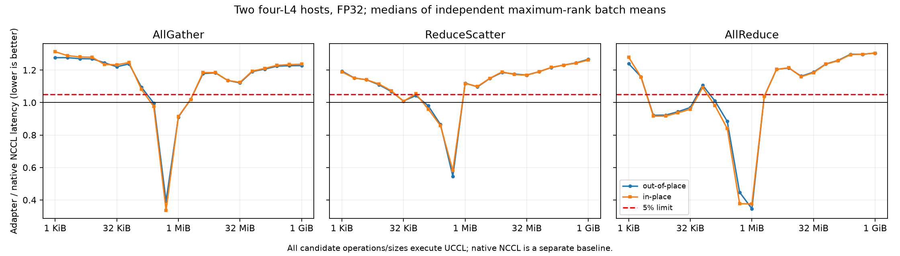

# Strict UCCL-only nccl-tests, November 17

**Correctness and no-fallback checks pass through 1 GiB. Performance does not
pass the 5% regression gate: 91/126 rows fail.** The previous mixed-routing
pass is not a result for this implementation and does not satisfy the strict
requirement.

The final candidate executes FP32 AllGather, SUM ReduceScatter and SUM
AllReduce entirely through UCCL Lite/MSCCL++ at all 21 powers-of-two extents
from 1 KiB to 1 GiB. Native NCCL runs only in separate baseline processes.

| Collective | Checked size/layout rows | Rows slower than native NCCL by >5% | Worst measured ratio |
| --- | ---: | ---: | ---: |
| AllGather | 42 | 34 | 1.3133×, 1-KiB in-place |
| ReduceScatter | 42 | 33 | 1.2663×, 1-GiB out-of-place |
| AllReduce | 42 | 24 | 1.3048×, 1-GiB out-of-place |



Every row, including negative results, is retained in
`final_validation/summary.csv`. The machine-readable failure verdict is
`final_validation/performance_verdict.json`. Ratios use medians of independent
job means, not the fastest observed run at each size.

## Proof that candidates did not execute native NCCL

- The replacement `.so` has SONAME `libnccl.so.2` and is not linked against
  native NCCL. `dependencies.txt` records the resolved dependencies.
- The library implements its own NCCL-compatible communicator, unique-ID,
  allocation, query and collective APIs. It contains no forwarding through
  `dlopen`/`dlsym` and no native collective implementation.
- Candidate initialization checks process mappings for native NCCL. Every
  candidate rank records `native_nccl_loaded=0`.
- Every candidate job records positive UCCL counters for **every measured
  extent on all eight ranks**, plus `fallback=0`. The driver requires the
  complete rank/operation/size set, not just a nonzero total counter.
- Unsupported requests return errors. The strict ABI client explicitly tests
  unsupported reduction, extent, grouped calls and nonempty capture. A
  one-host-only missing profile also rejects rather than choosing NCCL.

The nccl-tests `nccl-library=22807` line is the compatibility API version
reported by the replacement, not evidence that native NCCL is loaded. The
candidate binary and launcher hashes, complete commands, and ordered host
identities are in each phase's manifest/host records.

## Hardware and method

- Two hosts: mibura-sky-test-02 / 10.10.55.2 and mibura-sky-test-01 /
  10.10.55.1; four NVIDIA L4s and two IB rails each. One MPI rank per GPU,
  consecutive ranks by host, rail map 0/0/1/1.
- FP32, SUM for AR/RS. Extent is full input bytes per GPU for AR/RS and full
  output bytes per GPU for AG. Both in-place and out-of-place layouts.
- Existing MPI nccl-tests 2.19.7 executables, unchanged between candidate and
  control. Native baseline NCCL 2.28.7. CUDA 12.9 build and linked runtime;
  external IB-enabled MSCCL++ checkout 52f659d with its pre-existing local
  gpu_utils.cc modification. No external dependency source was modified here.
- Interface ibp55s0f0, HCAs mlx5_0,mlx5_1; MSCCL++ host-no-atomic mode.
  CPU control root 10.10.55.2. Exact GPU UUIDs, driver, topology, CPU affinity,
  environment and library identities are recorded in the host JSON files.
- Every final job allocates the full 1-GiB sweep. `-w 10 -n 50 -c 1 -a 3`:
  maximum-rank host enqueue/completion batch means, with separate nccl-tests
  correctness iterations. This is not a check of every timed invocation.
  Explicit preparation occurs before steady-state timing; input/output
  staging, GPU communication, synchronization and completion events are timed.
- Two native/candidate/candidate/native rounds for each operation: four jobs
  per backend per operation, 24 jobs total. All 24 jobs passed correctness.
  The median of four independent job means defines each point. Both layouts
  and every size are included in the 126-row gate.
- Fixed dispatch: fused single-CTA hierarchy through 512 KiB, then retained
  GPU rings/pipeline with GPU-driven local transfers. No native fallback,
  per-size best-run selection, or envelope of independently tuned variants.

## Integration and additional correctness checks

MSCCL++ NativeAlgorithm, context caching, TCP bootstrap, registration,
MemoryChannel, PortChannel, semaphores and IB progress are reused. The strict
ABI shim creates no native NCCL communicator. Exact topology/software/shape
consensus is CPU-only. Small calls use two registered scratch banks; large
calls use an entry handshake and one reusable bank, keeping the complete
registration below the 32-bit port-offset limit through 1 GiB.

The first large-message port integration passed single-operation nccl-tests
but hung when a caller mixed operations/streams and copied output to pageable
host memory before the collective completed. Host-sync instrumentation
removed the hang, while replacing only client staging did not. The retained
fix uses GPU MemoryChannel local ring transfers rather than a local CUDA-copy
proxy that needs host CUDA submissions to progress. IB still uses the MSCCL++
proxy/verbs path. Historical standalone PortChannel variants remain available;
their old timing figures do not validate this changed ABI implementation.

`final_abi/abi.log` passes **108 fully checked calls per rank over two
communicator lifetimes**, mixing small and large operations up to 16 MiB,
alternating streams, per-rank in-place/misaligned pointers, every output and
guard element, empty saved graphs and explicit unsupported-operation errors.
This client links against the ordinary NCCL ABI but loads only the strict
replacement at runtime. There is no GPU sanitizer or network-fault-recovery
claim.

Fresh standalone AR/AG/RS checks through 16 MiB passed 30 checked timed samples
each after templating the local transfer primitive. Both retained standalone
CUDA targets and the strict library built. The one-host missing-profile
rejection and standalone commands/logs are under `final_validation/`.

## Preserved experiments

| Directory | Evidence |
| --- | --- |
| `port_screen/` | First strict 1-GiB sweep: all UCCL, correctness passes, 63/126 performance failures. This path was not retained because the mixed-call ABI test exposed a hang. |
| `port_mixed_failure/` | Mixed-call hang and trace identifying the first large operation after small mixed calls. |
| `host_sync_diagnostic/` | Host synchronization diagnostic that completes the mixed ABI test; not a performance candidate. |
| `staging_only_failure/` | GPU client-staging experiment that did not remove the hang. |
| `gpu_ring_abi/` | GPU-driven local ring variant passes the mixed ABI test. |
| `final_abi/` | Final build, no diagnostic synchronization: 108 guarded calls/rank and strict errors pass. |
| `final_validation/` | Final 24-job, 1-KiB–1-GiB correctness/routing and performance evaluation; performance gate fails. |

The slower final result is retained. It is not replaced with the earlier
mixed-routing curve or the faster but incorrect port integration.

## Reproduce

```bash
make nccl-mscclpp-strict build/nccl_lite/mscclpp_strict_abi_check \
  MSCCLPP_IB_BUILD=/home/zhongjie/third_party/mscclpp/build-ib-pcieccl \
  MPICXX=/usr/mpi/gcc/openmpi-4.1.7rc1/bin/mpicxx

python3 -B tests/nccl_mscclpp/run.py \
  --hosts 10.10.55.2,10.10.55.1 --iface ibp55s0f0 \
  --mpirun /usr/mpi/gcc/openmpi-4.1.7rc1/bin/mpirun \
  --tests build/nccl-tests-mpi \
  --real-nccl /home/zhongjie/third_party/nccl/build/lib/libnccl.so.2 \
  --max-bytes 1073741824 --warmup 10 --iterations 50 --rounds 2 \
  --performance-only --max-regression 0.05 --out build/my-new-strict-1g-run

python3 -B tests/nccl_mscclpp/report.py build/my-new-strict-1g-run --plot
```

Use a new output directory. Exit code 2 means the performance gate failed;
correctness and no-fallback status remain separately inspectable in the logs.
`--real-nccl` is only the independent baseline, never a candidate fallback.
See [strict integration instructions](../../../integration/nccl_lite/MSCCLPP.md).
