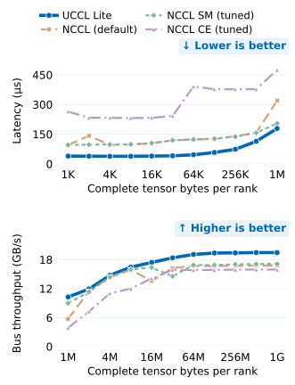
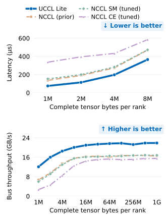
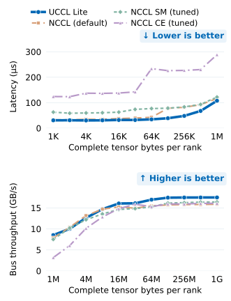

# Multi-node NCCL SM/CE references, November 16

This record adds **NCCL SM (tuned)** and **NCCL CE (tuned)** to AllReduce,
AllGather and ReduceScatter. **UCCL Lite is not rerun.** The figures
preserve all original UCCL Lite and prior-NCCL points, loaded from their existing
CSVs without modification; source hashes are in `environment.json` and checked
by the analysis and plotting scripts. The orange curve is labeled **NCCL
(prior)** because its recorded policies are not uniformly NCCL defaults.

## Small search and frozen selection

There are four SM and three CE candidates per collective. All exact environment
settings are in `candidates.json`.
SM candidates disable both P2P and SHM CUDA-memcpy transports:

1. Default topology/algorithm/protocol policy.
2. Ring + Simple, default topology policy.
3. Ring + Simple with `NCCL_P2P_LEVEL=SYS`.
4. Candidate 3 with four fixed channels.

CE candidates force Ring + Simple and `NCCL_P2P_LEVEL=SYS`, enable
`NCCL_P2P_USE_CUDA_MEMCPY=1`, and keep SHM memcpy disabled:

1. Default buffer size and channel policy.
2. Four fixed channels, default buffer size.
3. Eight fixed channels with an 8-MiB NCCL buffer.

Two complete calibration sweeps per candidate use five warmups and ten checked
timed calls per size. The first round uses a seeded shuffled candidate order;
the second reverses it. Each collective/family selects **one fixed configuration
for its entire curve**, minimizing the equally weighted geometric mean latency
across every size and both calibration rounds. There is no per-size best-of
selection. `calibration_scores.json` retains all candidates, including losses.

`schedule.json` freezes the winners **before** three independent validation
sweeps (ten warmups and ten timed calls per size). The evaluation order reverses
in round two within each cohort; all sweeps traverse sizes in ascending order on one communicator.
Final plotted points are medians of the three validation run means, not the
calibration minima. This limited search is not a claim of global NCCL optimality.

| Curve | Selected fixed configuration |
| --- | --- |
| AR SM | Ring + Simple, default topology/channel/buffer policies |
| AG SM | Default topology/algorithm/protocol/channel/buffer policies |
| RS SM | Ring + Simple, P2P level SYS, default channel/buffer policies |
| AG CE | Ring + Simple, P2P level SYS, P2P CUDA memcpy, default channel/buffer policies |
| AR/RS CE | Ring + Simple, P2P level SYS, P2P CUDA memcpy, default channel/buffer policies |

Selecting the default AG SM policy is an outcome of tuning, not an omitted
search. CE is independently selected within its requested family; it need not
beat SM, and all losing size points remain visible.

AR/RS CE were measured in a second cohort after the
original SM and AG CE validation. They use the same three CE candidates,
two-round selection rule and independent three-run validation; the already
measured curves are not rerun or reselected from validation results.
`schedule_initial.json` and `initial_validation_hashes.json` verify that their
choices and all twelve original validation records remain unchanged. Run
records retain the actual commands and chronological timestamps.

## Hardware, process layout and timing

Two hosts, mibura-sky-test-02 and mibura-sky-test-01, each have four NVIDIA L4
GPUs and mlx5_0/mlx5_1 IB rails. GPUs 0/1 and 2/3 are the NUMA pairs. CUDA 12.9,
NCCL 2.28.7, Open MPI 4.1.7rc1; exact GPU IDs, driver, topology, libraries,
source and deployed-binary hashes are recorded in `environment.json`.
`NCCL_SOCKET_IFNAME=ibp55s0f0` and `NCCL_IB_HCA=mlx5_0,mlx5_1` are common.
MPI uses ob1/self,vader,tcp for bootstrap and barriers; NCCL owns the data path.

- FP32, eight NCCL GPU ranks. AR is in place; AG/RS are out of place.
- AR/RS: eight MPI processes, one GPU per process, matching the existing UCCL
  process layout. Sizes are full input bytes per GPU, 1 KiB–1 GiB powers of two.
- AG: four MPI processes, two GPUs per NUMA group, matching the current UCCL
  host-router figure. Sizes are complete output bytes per GPU, 1 MiB–1 GiB.
  The NCCL-only harness groups its two GPU calls and waits for both streams.
- Timing is maximum-process host enqueue-to-completion latency, including
  submission/grouping and stream completion. Fill, allocation, initialization,
  MPI barriers and full-output verification are outside timing. The standalone
  NCCL harness allocates per size outside timing. Every warmup and timed call
  checks every output element, with changing inputs; no graph replay is used.
- Conventional bus bandwidth is `7N/(4t)` for AR and `7N/(8t)` for AG/RS,
  in decimal GB/s. It is not measured link traffic.
- AR/RS latency panels show 1 KiB–1 MiB, throughput 1 MiB–1 GiB. AG preserves
  its existing 1–8 MiB latency panel and 1 MiB–1 GiB throughput panel; no older
  sub-MiB UCCL points are spliced in. NCCL error bars are omitted; min/max of
  validation run means remain in `summary.csv`. Original UCCL bars are preserved.

CE means **copy-engine-assisted local P2P transport**, not a zero-SM collective
or a copy-engine network transport. Actual `P2P/CUMEM/CE` connections and
inter-node `NET/IB` connections are checked in every CE run. Every SM run is
checked for absence of `/CE` transport. `validation.json` retains edge counts
per run, and the archive retains the initialization logs from both hosts.
Only initialization/environment/transport logging is enabled; per-call NCCL
tuning-decision logging is excluded from timed validation.

These fresh NCCL measurements are independent of the historical UCCL Lite
runs; they do not revalidate that code or establish a simultaneous paired
speedup. The previous orange control also remains historical:

- [UCCL AR and its prior NCCL control](../ar_small_fix_2x4l4_20261115/README.md).
- [UCCL AG and its four-process Ring+Simple control](../ag_host_router_2x4l4_20261115/README.md).
- [UCCL RS and its prior NCCL control](../rs_direct_medium_2x4l4_20261115/README.md).

## Validated results

All **60 full sweeps** pass: **7,420 calibration** and **3,180 independent
validation timed calls**, plus **6,890 checked warmups**. Two additional harness
smokes pass the original eight-process AG interface and a 6,291,968-byte
four-process CE tail (20 timed calls plus 10 warmups); their samples are not
used for tuning or curves. See `smoke_validation.json`.

At **1 GiB complete tensor per GPU**, selected NCCL bus throughput is:

| Collective | SM (tuned), GB/s | CE (tuned), GB/s |
| --- | ---: | ---: |
| AllReduce | 17.120 | 15.942 |
| AllGather | 16.832 | 15.512 |
| ReduceScatter | 16.419 | 16.090 |

CE is slower than SM at 1 GiB for all three collectives and also has a worse
calibration-wide geometric mean. All CE curves are retained in full. The
[complete CSV](summary.csv) preserve all sizes, run ranges and
regressions. No claim is made that every tuned point beats its prior control.

## Figures







## Reproduction

Build only the NCCL control through the Makefile, and deploy identical binaries
at the same absolute path on both hosts:

```bash
make BUILD=build/nccl_multinode_tuned_20261116 \
  MPICXX=/usr/mpi/gcc/openmpi-4.1.7rc1/bin/mpicxx nccl_2x4l4_baseline
python3 benchmarks/data/nccl_tuned_2x4l4_20261116/run.py calibrate
python3 benchmarks/data/nccl_tuned_2x4l4_20261116/run.py calibrate-ce
python3 benchmarks/data/nccl_tuned_2x4l4_20261116/run.py select
python3 benchmarks/data/nccl_tuned_2x4l4_20261116/run.py evaluate
python3 benchmarks/data/nccl_tuned_2x4l4_20261116/smoke.py
python3 benchmarks/data/nccl_tuned_2x4l4_20261116/analyze.py
python3 benchmarks/data/nccl_tuned_2x4l4_20261116/plot.py
```

Run from lite. The runner invokes only `uccl_lite_nccl_2x4l4_baseline`, never a
UCCL collective executable. `--gpus-per-process 2` is restricted to AG; the
original one-GPU-per-process interface remains the default. GPU-rank mapping,
byte conventions and the full-output checker are shared by both modes.

The runner resumes only completed passing records and refuses to overwrite a
partial stdout file. Preserve the published record and use a new output directory
before reruns. `measurements.tar.gz` contains all 60 run records, per-call outputs,
stderr and per-host NCCL initialization logs; extract it under
`build/nccl_multinode_tuned_20261116/` to inspect the recorded runs. Source/binary
hashes identify the measured harness on top of the recorded base revision;
`build.log` records its exact Makefile command. `figure_inputs.csv` exports every
plotted point and its original CSV source. PNG/SVG exports are saved alongside
this README, with README assets under `docs/assets/`.
