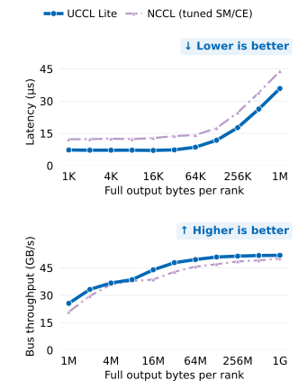
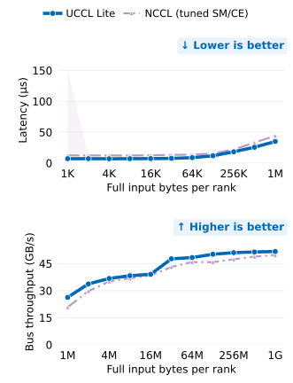

# UCCL Lite AllGather and ReduceScatter on eight RTX PRO 6000 GPUs

**Both collectives beat tuned NCCL at all 21 sizes in all five independent
validation rounds.** At every size, the slowest UCCL Lite run is faster than
the fastest NCCL run. The same result holds in the separate validation with
per-operation NCCL tracing enabled. Policies were frozen before either set.

At 1 GiB, AllGather takes **18.125 ms versus 18.765 ms** and ReduceScatter
**18.170 ms versus 18.880 ms**, for UCCL Lite and tuned NCCL respectively.
UCCL Lite reaches **51.84 and 51.71 GB/s**, close to the historical AllReduce
result of 51.94 GB/s. Across the complete size grid, speedups are
**1.021–1.879× for AllGather** and **1.015–1.766× for ReduceScatter**.
This remains an experimental, hardware-specific standalone implementation.

[Every size and observed range](results.md) · [AllGather samples](allgather.csv) ·
[ReduceScatter samples](reducescatter.csv) · [frozen policy](policy.json) ·
[raw evidence](measurements.tar.gz)

| Operation | Size | UCCL Lite | Tuned NCCL |
| --- | ---: | ---: | ---: |
| AllGather | 1 KiB | 7.27 µs | 12.27 µs |
| ReduceScatter | 1 KiB | 7.08 µs | 12.34 µs |
| AllGather | 4 MiB | 99.97 µs | 102.22 µs |
| ReduceScatter | 4 MiB | 99.88 µs | 104.69 µs |
| AllGather | 1 GiB | 18.125 ms | 18.765 ms |
| ReduceScatter | 1 GiB | 18.170 ms | 18.880 ms |




Points are medians; bands retain the full observed ranges. The panels use the
same linear y axes and shared styling as the other collective figures. The
initialization-only NCCL ReduceScatter data retain a 151.35-µs run at 1 KiB;
its median is 12.34 µs. No samples are removed.

## Measurement

Eight NVIDIA RTX PRO 6000 Blackwell Server Edition GPUs on `wxz-pro6000`,
dual-socket AMD EPYC 9B45, four GPUs per NUMA node, no NVLink. XOR-1 peers
share a PCIe switch; XOR-2 connects switches on the same socket; XOR-4 crosses
sockets. Driver 580.178.04, CUDA compiler 13.3.73/SM120, C++20 `-O3`, NCCL
2.28.9, and the existing MSCCL++ installation used by the AllReduce study.
The archive records UUIDs, topology, CPU layout, exact commands, runtime-library
hashes, source snapshots, binary hashes, and the compiler/environment record.
The machine has 384 logical CPUs.

The matched C++ harness directly calls `ncclAllGather` or `ncclReduceScatter`;
it is not the official nccl-tests executable. UCCL Lite does not link or call
NCCL. Eight processes perform FP32 out-of-place operations at all 21 powers
of two from 1 KiB through 1 GiB. Bytes mean **the complete AllGather output
per rank or the complete ReduceScatter input per rank**; each individual
shard is one eighth of that size. The bus-throughput factor is 7/8 for both
operations. The historical AllReduce factor is 7/4.

Each batch has ten warmups and twenty continuously queued operations.
`steady_clock` encloses enqueue through final caller-stream completion, with
the slowest rank reported. Allocation, registration, initialization, checking,
CPU placement and rank barriers are outside timing. All required local copies,
reductions, communication, and stream joins are inside timing. Each process
reserves full 1-GiB user-buffer capacity even for narrow calibration ranges;
UCCL also has private receive/partial storage and packet space: approximately
4.2 GiB of reserved user/scratch/packet buffers per rank. NCCL's caller buffers
reserve 2 GiB per rank, in addition to its internal workspace.

Both backends restore the original four-core mask on every live thread after
warmup and verify it after timing. Core ranges are 0–3, 4–7, 8–11, 12–15,
96–99, 100–103, 104–107, and 108–111. The reference's generic kernel geometry
fields are unused: its environment and actual NCCL dispatch logs identify its
configuration. All communication is within one host.

## Selection and independent validation

The fixed catalog has 18 UCCL configurations and 26 NCCL configurations per
operation. It includes default NCCL, explicit cross-socket P2P SM, LL/LL128/
Simple protocols, SM channel/thread choices, and CE channel/buffer choices.
Each configuration is calibrated in three fresh-process rounds with a
predefined shuffled order. The lowest median chooses each exact size for each
backend. This is a per-size selected curve; it is not one fixed variant for
all sizes.

The source, binaries, libraries, hardware, placement and selected policies are
frozen before five validation rounds. Selected configurations sweep their
whole supported size ranges, backend order alternates, and only the frozen
size/configuration pairs form the reported curve. Validation never selects a
new variant. There are 264 successful calibration process runs and 195
successful validation process runs. Points are medians of five slowest-rank
run means; bands are observed ranges, not confidence intervals. Tables retain
all five samples, paired wins, losses, and whether the slowest UCCL run beats
the fastest NCCL run.

A second **195-run, five-round paired validation** repeats exactly the same
policy, commands, shapes, seeds, placement, binaries and libraries, while
removing NCCL's per-operation `TUNING` messages. Only `INIT,ENV,GRAPH` logging
remains for setup/teardown rather than per-operation tuning. **These latter results
form every primary table and figure.** Each run retains its own actual
transport edges; per-size protocol/algorithm dispatch is attested by the
matching traced validation. The auditor rejects any non-logging environment
or command difference. [The complete logging control](logging-control.csv)
retains both sets; differences are run-to-run observations, not isolated
causal estimates of logging cost.

Both validation sets win every paired size and have separated observed ranges.
Together with calibration, the audit verifies 2,608 NCCL rank logs. The policy
SHA256 is `bf65382c8ef3d4f5b0195c6cc1482bda190ab5bccde5c6f0da8990ef97c65470`.

This NCCL reference chooses among both SM and CE. The earlier FP32 AllReduce
figure compares against tuned CE, so its small-message speedup factors are
not directly comparable. AllReduce's recorded ~51.94 GB/s is a historical
throughput reference, not validation of these new kernels.

## Implementation

- Direct LL packets handle small messages. Packet positions encode source
  rank, while ReduceScatter input offsets encode destination rank. Device-side
  epochs support repeated CUDA graph launches with fresh input.
- The SM ring uses the physical Gray-code order
  `0 -> 1 -> 3 -> 2 -> 6 -> 7 -> 5 -> 4 -> 0`, with independent lanes owning
  disjoint intervals within each public-rank shard. AllGather fuses its first
  input read into local and remote stores. ReduceScatter combines an incoming
  shard with local input directly into its next outgoing store.
- Each lane/peer direction has one signaling thread. A system-release counter
  store replaces the remote atomic increment; MSCCL++ supplies registration,
  peer channels and acquire waits. The original atomic and full-fence paths
  remain ablation controls. Multi-CTA remote writes retain per-thread system
  fences; a single CTA uses its barrier and the leader's release signal.
- The channel table remains in immutable device storage. Loading only the two
  needed peer handles removed an 888-byte per-thread stack frame. The observed
  SM-ring register count fell from 134 to 96. This is supported by retained
  `cuobjdump --dump-resource-usage` output, not inferred from latency alone.
- The large-message ring uses MSCCL++ PortChannels and copy engines. Partial
  sums occupy distinct immutable scratch positions. Completion acknowledgments
  drain outgoing copies before storage reuse. AllGather also waits for each
  receiver to enter the new call before writing its public output.

Rank-contiguous output is independent of internal ring order. The kernels and
harness live in `include/uccl_lite/pro6000_ag_rs.cuh` and
`src/collectives/pro6000_ag_rs.cu`; application integrations and CPU-router
policy are not changed.

## Correctness and retained negatives

The checker uses signed, position/rank/seed-dependent exactly representable
FP32 values. Each size checks nine changing inputs, verifies the complete
output and unchanged input, then checks the result after the timed batch.
Four-KiB guards surround active user buffers and private staging regions.
Timed intermediate outputs are not individually checked.

Separate suites enqueue changing input, poisoned output and full GPU checking
without host barriers between calls. A rotating rank is deliberately delayed.
These exercise eager and graph execution, repeated reuse, multi-CTA lanes,
non-power-of-two tails, full 1-GiB allocation capacity, and exact 1-GiB tensors.
The documented four-L4 topology is tested separately with the same CUDA
sources compiled for four ranks and SM89. Each host passes 56 final suites,
including exact 1-GiB eager/graph SM and CE operations. Those suites perform
293,632 full per-rank checks on the PRO 6000 host and 146,816 on four L4s.
Calibration and the two validation sets add 700,320 checks, for **1,140,768
full output/input checks** in the final evidence, excluding exploration.
The six host-only evidence tests and clang-format 14 checks also pass.

Retain the complete experimental record:

- An early allgather version failed changing-input tests because a fast rank
  overwrote a slow caller's previous output. Explicit receiver readiness fixed
  it; the failed logs remain in the archive.
- Introducing the delayed-rank test exposed CUDA lazy-loading deadlocks in
  both UCCL proxy CE and NCCL CE. The same binaries passed with eager loading.
  The harness now preloads the delay/poison kernels before peer-dependent work,
  preserving the delayed test and normal runtime loading mode. NVIDIA documents
  this hazard and the preload remedy in its
  [lazy-loading guide](https://docs.nvidia.com/cuda/cuda-programming-guide/04-special-topics/lazy-loading.html).
- Hierarchical packets, direct SM writes, host-queued CE, larger unroll factors,
  and alternating ring directions did not close the medium-size gap in their
  tested configurations. Their checked timings and measured sources remain
  available. Rejected 1024-thread launches exceeded device residency limits
  and are excluded from performance curves.

The evidence auditor rejects incomplete/bad ranks, wrong traffic factors,
changed source or policies, mismatched placement, and missing actual NCCL
transport/dispatch evidence. Correctness is bounded by the recorded hardware,
software, sizes and inputs; it is not a proof for every FP32 rounding order.

## Reproduction

Use the Makefile with the matching installed CUDA, MSCCL++ and NCCL paths:

```sh
make pro6000-ag-rs pro6000-ag-rs-reference CUDA_ARCH=sm_120 \
  MSCCLPP_HOME=/path/to/mscclpp NCCL_HOME=/path/to/nccl
make pro6000-ag-rs-evidence-check
```

`scripts/run_pro6000_ag_rs_experiment.sh` uses the recorded isolated testbed
environment by default, or accepts another environment script as its second
argument. Its first argument must name a new output directory. It creates
calibration jobs, holds the shared GPU lock during each stage, freezes the
policy, runs held-out validation, and audits the results. It refuses to overwrite
an existing experiment or policy. Full commands and parameters are also in
each archived run's JSON record.

From `experimental/lite/`, use fresh output directories to replay the audits:

```sh
mkdir -p build/pro6000-ag-rs-replay
tar -xzf benchmarks/data/pro6000_ag_rs_cpp_20261116/measurements.tar.gz \
  -C build/pro6000-ag-rs-replay
python3 -B scripts/summarize_pro6000_ag_rs.py summarize \
  --calibration build/pro6000-ag-rs-replay/final-epoch-v16/calibration \
  --validation build/pro6000-ag-rs-replay/final-epoch-v16/init-only-validation \
  --diagnostic build/pro6000-ag-rs-replay/final-epoch-v16/validation \
  --policy build/pro6000-ag-rs-replay/final-epoch-v16/policy.json \
  --output build/pro6000-ag-rs-report
python3 -B scripts/summarize_pro6000_ag_rs.py audit \
  build/pro6000-ag-rs-replay/pro6000-checks
python3 -B scripts/summarize_pro6000_ag_rs.py audit \
  build/pro6000-ag-rs-replay/four-l4
python3 -B scripts/plot_pro6000_ag_rs.py \
  --summary build/pro6000-ag-rs-report --preview
```

Plotting requires Matplotlib. The archive's `exploration/index.json` lists the
retained early epochs and failures; `exploration/screening-minima.csv` explicitly
labels its best-of-screen values as exploratory. `tools/` retains the analysis
scripts; `metadata/` contains the platform, build and compiler-resource evidence.
Binaries and dependency trees are excluded. [Provenance](provenance.json)
records the archive/artifact hashes and measured source identities.

For a new measurement, run the calibration/validation script, then the separate
initialization-only control using its frozen policy:

```sh
bash scripts/run_pro6000_ag_rs_experiment.sh build/new-ag-rs-epoch \
  /path/to/runtime_env.sh
# Use the same runtime environment and CUDA library path as the first command.
python3 -B scripts/run_pro6000_ag_rs_init_only.py \
  --epoch build/new-ag-rs-epoch \
  --output build/new-ag-rs-epoch/init-only-validation
```

These policies apply only to the recorded FP32 shapes, placement and software
on this testbed. There is no automatic production backend selection, serving
hook, CPU-router change, or multi-node claim in this experiment.
