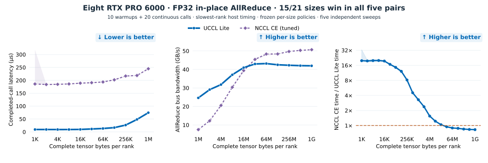

# Experimental FP32/C++ AllReduce versus tuned NCCL CE on eight RTX PRO 6000 GPUs

**Placement erratum:** a [subsequent thread-affinity audit](../pro6000_allreduce_ce_ring_cpp_20261116/README.md)
found that MSCCL++ expanded some CPU masks during initialization. This epoch
matched the initial pinning requests, but did not enforce matching masks
throughout timing. The measurements below remain unchanged and describe that
historical configuration. The follow-up enforces and checks every thread's
mask and freshly calibrates both backends.

**The 21-of-21 goal was not achieved.** UCCL Lite wins all five independent
pairs at **15/21 sizes (1 KiB–16 MiB)**, with separated observed ranges.
It loses at **32, 64, 128, 256 and 512 MiB, and 1 GiB** in every pair.
At 1 GiB, the independently validated medians are **41.97 GB/s** for
UCCL Lite versus **50.68 GB/s** for tuned NCCL CE
(44.77 versus 37.08 ms).
At 1 KiB, latency is 9.38 versus 185.76 µs.

The final epoch contains 120 successful calibration runs and 75 successful
validation process runs across five rounds. All **113,200 per-rank full-output
checks**, plus all guards, pass in validation. A first-epoch CE reuse failure
was repaired and the entire failed epoch is preserved below; none of its
validation measurements are reused. The implementation and per-size policies
remain experimental.

[Every size and every loss](results.md) · [all five measurements per size](summary.csv)



## Measurement contract

Eight C++ processes, one GPU per rank, FP32 in-place SUM. Every power of two
from 1 KiB through 1 GiB is covered, for 21 sizes. Both backends allocate
capacity for a complete 1-GiB tensor even when a candidate measures a subset.
Each size receives 10 warmups followed by 20 continuously queued calls.
`steady_clock` encloses enqueue, error polling and final stream synchronization;
the reported mean is the slowest of the eight ranks. All algorithm staging,
peer copies, acknowledgements and stream joins are included. Allocation,
registration, input generation, rank barriers and checking are outside timing.
There is no Python in the timed path, graph replay, NCCL call inside UCCL Lite,
or omitted caller copy. Both backends operate directly on their registered or
allocated in-place buffer.

The checker uses signed, position/rank/seed-dependent integers scaled by
2^-100. The first SUM and subsequent power-of-eight growth remain exactly
representable in FP32 through all 30 calls. For every size it checks three
changing input seeds, three calls per seed, every output element after each
call, and the complete output after the warmup plus timed batch. It rejects
nonfinite values and checks 4-KiB canaries immediately before/after the active
output and all seven UCCL data/staging regions. Timed intermediate results are
not copied out individually. This preserves continuous-call timing while
checking repeated buffer reuse and the final timed result.

The historical original checker and BF16/Python CE numbers are not used as
validation. The original source under
`../pro6000_original_cpp_latency_20261116/measured_source/` remains unchanged.
The new executable retains its algorithms as explicitly named experimental
controls, with the matched checker, capacity, CPU placement and timing above.

## Hardware and software

- `wxz-pro6000`: eight NVIDIA RTX PRO 6000 Blackwell Server Edition GPUs,
  dual-socket AMD EPYC 9B45, four GPUs per NUMA node. XOR-1 peers are PIX,
  XOR-2 NODE and XOR-4 SYS. Physical GPU order is 0–7.
- CUDA compiler 13.3.73, SM120, C++20 with `-O3`; NCCL 2.28.9,
  driver 580.178.04. The pinned environment is `/home/wxzheng/eat-pcieccl-vllm-pro6000-20261115-074910/runtime_env.sh`.
  The existing patched MSCCL++ installation is reused; its installed version
  header, all header hashes and actual shared-library hash are archived.
- Requested initial rank CPU masks are 0–3, 4–7, 8–11, 12–15, 96–99, 100–103, 104–107,
  and 108–111. Both backends use the same placement function before CUDA and
  worker initialization. The exploratory legacy and single-core controls are
  separate. Clock settings and system configuration are unchanged.
- Every eight-GPU job holds `/home/wxzheng/uccl-eval.lock` and checks GPU
  process occupancy before launch. Timeouts terminate only the job's process
  group. No other experiment or dependency install is overwritten.

## Source changes and profiling

`src/collectives/pro6000_allreduce.cu` is an explicit experimental harness,
with kernels in `include/uccl_lite/pro6000_allreduce.cuh` and the shared checker
in `include/uccl_lite/allreduce_validation.cuh`. The UCCL executable does not
link NCCL; the independently compiled reference only enqueues `ncclAllReduce`.
This adds no production routing policy, CPU-router change or serving hook.

The logical peer payload remains 1.75N bytes per rank. Bus bandwidth uses
that factor; it does not count LL packet metadata. The changes target local
memory traffic, synchronization, launch geometry and overlap:

- LL divides the tensor among independent CTAs, keeping the six packet phases
  and alternating packet slots. Calibration includes 1/4/16/32 CTAs and
  256/1024 threads. Small-message latency is selected independently.
- `drained-ce` preserves the original staging algorithm and adds a final
  acknowledgement to make outgoing-copy lifetime explicit across calls.
- `staged-ce` retains the three immutable ReduceScatter send stages, then
  assembles AllGather directly in the output. It copies only the local N/8
  shard into that output, instead of the original N/8 + N/4 + N/2 staging
  copies. It saves 0.75N copied bytes, or 1.5N DRAM read/write bytes per rank.
  A final peer acknowledgement proves outgoing copies drained before reuse.
- `chunk-ce` independently pipelines tiles, reduces in place, writes AllGather
  directly, and explicitly acknowledges every received phase. Cooperative CTA
  groups improve tile reduction bandwidth. Residency is checked before launch.
- This installed MSCCL++ implementation shares a CUDA IPC copy stream within
  each Context. A candidate uses separate contexts for PIX/NODE/SYS paths;
  the dependency itself is not changed. `host-ce` separately tests explicit
  CUDA copies, stream-ordered signal/reduce kernels and included event joins.

Separate profile runs retain per-phase device cycle counters for transfer/
acknowledgement and local reduction/copy work. These are aggregate cycle
weights, not a simultaneous-tile wall-clock decomposition or Nsight trace.
Profile runs are excluded from calibration and validation. At 1 GiB, local
work accounts for 15.16% of the recorded phase cycles in the completion-safe 16-CTA
control and 4.69% in the reduced-staging 128-CTA variant; both staging and
geometry differ. The pipelined case reduces that fraction to 1.75% but remains
slower overall. These counters exclude entry/exit and the final acknowledgement;
completed-call timing includes them. See `profiles.csv`.

| Separate 1-GiB profile | CTAs / geometry | Profiled completed-call time |
| --- | --- | ---: |
| Original staging with completion acknowledgement | 16 × 512 | 50.18 ms |
| Reduced AllGather staging | 128 × 512 | 44.75 ms |
| Chunked pipeline | 16 lanes × 8 CTAs × 256 threads; 4-MiB tiles; 3 contexts | 47.13 ms |

Each row is one separate eight-rank FP32 process run with 10 warmups and 20
continuous timed calls, under the same placement. The counters accumulate all
39 calls (nine checked calls plus warmups/timing). These diagnostic timings
include instrumentation and do not enter the final five-run curve.
 The original
control, slower pipeline candidates, and rejected settings remain in the
archive; a faster local stage is not assumed to produce a faster collective.

## Independent selection and validation

NCCL and UCCL Lite are calibrated independently. NCCL has 19 candidates:
CE with automatic/Ring/Tree algorithm choice, Ring channel counts 1/2/4/8/16,
1-/16-/64-MiB buffers, and 128-thread controls. All use the Simple protocol,
`NCCL_P2P_USE_CUDA_MEMCPY=1`, system-wide P2P, disabled SHM and no IB. Every
accepted NCCL process has eight rank logs showing actual `P2P/CUMEM/CE` edges;
per-size tuning traces also prove the selected algorithm and Simple protocol.
This is the copy-engine P2P transport with GPU reduction kernels. The
reference header's generic mode/geometry fields are unused; its environment
and per-size NCCL traces identify the actual settings.

The 21 UCCL candidates include all eight LL geometries, three PUT geometries,
three completion-safe original CE geometries, three reduced-staging geometries, three pipeline
controls and a host-driven copy control. Exploratory candidates not advanced
to calibration are also preserved. Each calibrated candidate gets three fresh
process runs, with deterministic shuffled order between rounds. Failed
candidates are excluded, never replaced with an unrecorded retry.

For each exact size, the lowest median calibration latency selects a policy.
[The frozen policy](frozen-policy.json) fixes both policies, calibration hashes, source/binary
hashes, hardware/software identity and placement before validation. Five
independent rounds start fresh processes for each selected fixed configuration.
Each configuration sweeps the full grid (LL ends at its 4-MiB capacity); only
its frozen size/configuration pairs contribute to the comparison. Backends
are interleaved, with their order reversed in alternate rounds. Extra
unselected points remain in raw logs and are not used to form a faster curve.

The table reports medians of five slowest-rank run means, all five individual
values, and observed ranges. The speedup is NCCL time divided by UCCL time.
A five-pair win requires UCCL to be faster in every corresponding round.
The stricter range test requires UCCL's slowest run to beat NCCL's fastest run.
Observed ranges are not confidence intervals. No best-final-run or
best-final-variant selection is performed; no average-speedup success claim
is substituted for the 21-size requirement.

## Failures and validation limits

The first frozen validation epoch failed in round three: the 128-CTA variant
of the original CE algorithm reported **8,128 bad checks on every rank at 128 KiB** and aborted.
That point was an extra control point (the frozen policy used LL there), but
the entire epoch is retained as failed under `failed-epoch1/`. Its two completed
rounds are not reused in the final curve. The original source remains intact.

The original CE path lacked an explicit acknowledgement proving that outgoing
reads of `recv[1]` had drained before the next invocation reused that region.
The failure is consistent with this lifetime hazard. The repaired `drained-ce`
variant adds a symmetric final GPU acknowledgement; the reduced-staging variant
already had it. Diagnostics now separate output and guard failures. Both
backends are freshly recalibrated for a new epoch, and repaired CE controls
are calibrated over the entire 1-KiB–1-GiB grid, including the failing size.


Initial setup failed because connection and memory receive operations sharing
an MSCCL++ tag were ordered incorrectly. Two exploratory jobs were stopped
while stalled; the corrected harness completes communication before checker
runtime/module operations. Their logs and return codes remain archived and
do not contribute performance results. Early exploratory versions have hashes;
subsequent profiling, calibration and validation also retain source snapshots.
The legacy/single-core placement controls expose severe NCCL progress-thread
contention; final comparisons use the matched four-core masks above.

The documented four-L4 host (`l41`) also passed six suites: single/multiple CTA
LL, PUT, shared/separate-context chunk CE, and host CE. They cover every size
through 1 GiB, with LL through 4 MiB, complete outputs, guards and reuse checks.
That build uses four ranks, CUDA 12.9/SM89 and an isolated MSCCL++ dependency
built under `build/`; it checks the shared kernels, not eight-rank performance.
The repaired original-staging and reduced-staging eight-rank controls are validated on all eight
PRO6000 GPUs. No multi-node or graph performance claim is made.

## Reproduction and evidence

From `experimental/lite` on the recorded host:

```bash
bash scripts/build_pro6000_allreduce.sh
python3 -B scripts/run_pro6000_allreduce.py calibrate \
  --output build/calibration --backend nccl
python3 -B scripts/run_pro6000_allreduce.py calibrate \
  --output build/calibration --backend ours \
  --configs ll-1-256,ll-1-1024,ll-4-256,ll-4-1024,ll-16-256,ll-16-1024,ll-32-256,ll-32-1024,put-4,put-16,put-64,drained-ce-16,drained-ce-64,drained-ce-128,staged-ce-32,staged-ce-64,staged-ce-128,chunk-ce-16-4m-s3,chunk-ce-32-4m-w4-s3,chunk-ce-4-16m-w8,host-ce-4-64m
python3 -B scripts/run_pro6000_allreduce.py freeze \
  --output build/validation --calibration build/calibration
python3 -B scripts/run_pro6000_allreduce.py validate --output build/validation
```

Use a fresh output directory; the runner refuses to overwrite a run or frozen
policy. Source/binary changes invalidate calibration. `--experiment` can point
to an identical isolated dependency layout elsewhere. The CPU masks and
hardware identity are explicit; this schedule is specific to the recorded host.

Offline verification requires Python 3.10+ and no GPUs. Figures additionally
require Matplotlib (3.10.8 used here):

```bash
make pro6000-ar-evidence-check
make pro6000-ar-summary
make pro6000-ar-figures
```

`measurements.tar.gz` contains calibration/validation logs and per-rank NCCL
transport logs, frozen policy, source snapshots, hardware/library identities,
all exploratory failures/regressions, phase profiles, build logs and four-L4
checks. `checksums.json` identifies the package and report files. The audit
reconstructs selection exclusively from calibration, verifies every log hash,
complete rank/size coverage, guards/output status, transport, timing contract,
identities, and five independent rounds. Generated output goes under `build/`;
the published figure uses `scripts/figure_style.py`, with previews under
`build/figures/`.

Source and plotting-script checksums identify recording commit `93110886`;
the README checksum includes the later placement erratum. The original raw
archive, policies, measurements, and figure are unchanged.
