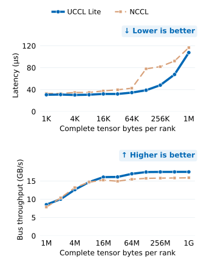

# ReduceScatter: direct medium-message ring, November 15

Standalone `--rs-auto 1` now uses a **single direct-ring piece at 8–16 MiB**.
The original standard-layout input remains immutable, so the input permutation
kernel and its packed-buffer traffic are avoided. Other size regimes retain
the established serial, packed, flat and direct-ring policies. Hybrid AllReduce
keeps its existing RS selection and packing/handoff protection; the AllReduce
small-message fix is preserved. All arithmetic stays on GPUs.

## Measurement contract

Two hosts, mibura-sky-test-02 and mibura-sky-test-01; four NVIDIA L4 GPUs and
two IB rails each. GPUs 0/1 and 2/3 are NUMA groups, mapped to mlx5_0/mlx5_1.
Eight MPI ranks, FP32 sum. N=input bytes/GPU; output N/8. CUDA 12.9, Open MPI
4.1.7rc1, MSCCL++ build-ib-pcieccl. Timing is slowest-rank host enqueue-to-completion,
excluding setup, fill and complete-output checking. Bus bandwidth is `7N/(8t)`
in decimal GB/s, not measured wire traffic.

The baseline is the AllReduce-fixed source at `39ce6ad9`, using the actual tuned
RS configuration: `--rs-auto 1 --rs-piece-bytes 8388608 -B 96 -T 512`. Candidate
uses the same settings, hardware, allocation extent and timing. Three rounds
alternate baseline/candidate order (candidate first in round two). Both sweep
all 21 powers of two from 1 KiB through 1 GiB, with ten warmups and ten timed
calls per size. Every invocation is checked. `comparison.csv` contains medians
and min/max of round means. The candidate uses one fixed size rule, not a
measured best-variant-per-size envelope. This remains an explicit standalone
eager benchmark; no automatic application router changes.

The [exploratory screen](../rs_full_screen_2x4l4_20261115/README.md) retains the
rejected launch, piece-size, serial and fused-forwarding experiments. Gains
against the old default launch are not used to qualify this change.



The displayed NCCL curve is **unchanged historical data** from the
[November 11 tuned control](../nccl_tuned_2x4l4_20261111/README.md). No NCCL
benchmark is run for this change. Its hardware/dtype and host timing scope match,
but these are separate measurement dates, not a fresh paired comparison.
`summary.csv` combines candidate measurements with those recorded NCCL rows;
NCCL error bars are omitted. Candidate latency bars show round-mean ranges.

## Results

| Input/GPU | Tuned baseline (µs) | Candidate (µs) | Latency reduction |
| ---: | ---: | ---: | ---: |
| 8 MiB | 509.857 | 499.090 | 2.11% |
| 16 MiB | 976.998 | 914.445 | 6.40% |
| 1 GiB | 53,625.940 | 53,714.251 | −0.16% |

The 8- and 16-MiB round-mean ranges are disjoint between baseline and candidate.
No large-message improvement is claimed: unchanged 32-MiB–1-GiB paths measure
0.06–0.30% slower medians in this record, with overlapping ranges. Small-message
results fluctuate as well; their algorithm is unchanged. The
[complete table](results_table.md) and CSV retain every point and regression.
All 1,260 paired timed calls and their warmups pass full-output checks.

## Correctness and reproduction

Both affected CUDA targets build through the Makefile. The two-node checked
sweep covers all sizes. Additional checks exercise extents immediately below,
at and above both 8- and 16-MiB boundaries, non-power-of-two 12,583,424-byte
inputs, the unchanged 24-MiB flat interval, and 100 consecutive RS invocations
without input refill. Native AR/AG and hybrid AR receive separate checked
1-KiB–64-MiB sweeps; hybrid also checks three consecutive in-place calls without
refill at each size. The output checker and 1e-5 tolerance are unchanged.
No graph replay or Compute Sanitizer result is claimed.

```bash
make BUILD=build/rs_direct_medium \
  MSCCLPP_IB_BUILD=/home/zhongjie/third_party/mscclpp/build-ib-pcieccl \
  MPICXX=/usr/mpi/gcc/openmpi-4.1.7rc1/bin/mpicxx \
  multinode_allreduce multinode_cpu_router -j2
# Stage identical executables at the same path on the second host.
bash benchmarks/data/rs_direct_medium_2x4l4_20261115/run.sh
python3 benchmarks/data/rs_direct_medium_2x4l4_20261115/summarize.py
python3 benchmarks/data/rs_direct_medium_2x4l4_20261115/plot.py
```

Run from lite. The baseline uses the separately preserved `build/ar_fix`
executables from `39ce6ad9`; `run.sh` records both build paths and refuses to
overwrite comparison logs. Preserve this record and choose a new output
location before reruns. `raw/`, `build.log` and local/remote hashes retain
measurement and exact-binary provenance.
