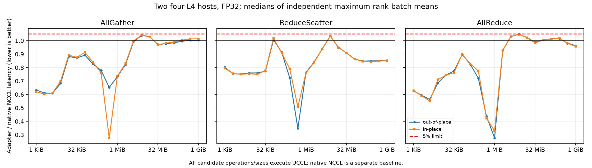

# Strict UCCL Lite NCCL replacement: final validation

**126/126 rows pass the established 5% per-row latency gate.** All numerical,
full-size route and native-library assertions pass. This does not claim zero
absolute slowdown: the worst observed ratio is 1.04712× native.
Candidate processes execute UCCL collectives and load no native NCCL library.
Native NCCL runs only in separate baseline processes.

## Measurement contract

Two hosts: mibura-sky-test-02 (10.10.55.2) and mibura-sky-test-01 (10.10.55.1),
four NVIDIA L4s each, eight MPI ranks, one GPU/process, rail map 0/0/1/1.
FP32 AllGather and SUM ReduceScatter/AllReduce, both in-place and out-of-place.
The 21 extents are powers of two from 1 KiB to 1 GiB. Extent denotes full
output bytes/GPU for AG and full input bytes/GPU for RS/AR.

Unchanged MPI nccl-tests 2.19.7; native NCCL 2.28.7. Two independent ABBA rounds
per operation, 10 warmups and 50 timed iterations/job, 24 admitted jobs total.
Each point is the median of four independent job means/backend. Timing uses
maximum-rank host enqueue/completion batch means (`-a 3`), including all per-call
staging, communication, graph updates/launch, completion events and periodic
queue retirement. Initialization and teardown are outside steady-state timing.
The fixed implementation is measured as a whole; no best-per-size or best-run
envelope is selected. Host JSONs preserve exact topology/software identities.

| Operation | Worst candidate/native ratio | Rows passing |
| --- | ---: | ---: |
| AllGather | 1.04125 | 42/42 |
| ReduceScatter | 1.03403 | 42/42 |
| AllReduce | 1.04712 | 42/42 |

[All 126 rows](verified_final/summary.csv), [gate](verified_final/performance_verdict.json),
[commands and raw results](verified_final/manifest.json), [completion audit](completion_audit.json).

## Controller recovery

The original controller session ended during AR's second round. Candidate 6
finished with complete correct output, but its process exit status was not
observable. Original logs and the recovered diagnostic result remain in
`final/`. Before admitting a result, `verification_decision.json` recorded that
the entire second AR ABBA round would be repeated regardless of those ratios.
`verified_final/` contains the admitted data: both completed AG/RS rounds,
the completed first AR round, and the complete repeated second AR round.
All retry exits are recorded as zero in `controller_exit.json`. No individual
row/run was chosen by timing. The retry controller was detached so its status
survived session changes.

## Correctness and lifetime evidence

- Normal extended NCCL ABI: 126 guarded calls/rank, two lifetimes, rotating and
  recycled pointers, independent alignment/in-place layouts, delayed rank,
  mixed operations/sizes, 32-MiB multi-piece cases and finalize rejection.
- Core size check: 168 guarded calls/rank over two lifetimes, including
  non-power-of-two extents, short ownership chunks and capacity boundaries.
- Queue stress: 604 queued 8-MiB AR calls/rank over two lifetimes, changing data,
  layouts/alignment, delayed producer, caller-buffer freeing before transport
  retirement, explicit synchronization and destruction drains on every rank.
- Forced 32-bit packet-generation wrap: extended ABI at 1-GiB capacity plus
  1101 timed small-message iterations (1–64 KiB); reset assertions pass for all
  ranks. Separate build seeds the counter near UINT32_MAX; release uses zero.
- Shared standalone AR/AG/RS: 30 checked samples each through 16 MiB, zero error.
  Both affected standalone CUDA targets compile with clang-format-14 formatting.

Current source and release library identities match the tested artifacts.
Library SHA-256: `4b19a65448dca9e9a7400c331c6afdf96216fdd70e7a5ea628bf07cd84ce9be0`. SONAME is `libnccl.so.2`; dependencies contain MSCCL++
and CUDA, with no native NCCL dependency or dynamic forwarding.

The supported drop-in scope remains eager FP32 AG/SUM RS/SUM AR on the explicit
matched two-host profile, one communicator/GPU per process. Other dtypes,
reductions, unprofiled extents, grouped collective submission and nonempty
caller capture return errors. This is not a full NCCL API or failure-recovery
certification. See [build/use instructions](../../../integration/nccl_lite/MSCCLPP.md).

## Provenance

`source/` and `source_sha256.json` preserve the frozen implementation and tests.
Generated binaries remain in `build/`; no dependency tree is vendored.
[Optimization history](../strict_ll_rs_graph_2x4l4_20261117/README.md) retains
negative results, earlier correctness/build failures, diagnostic captures and
screening outliers. Historical measurements do not validate changed source.
