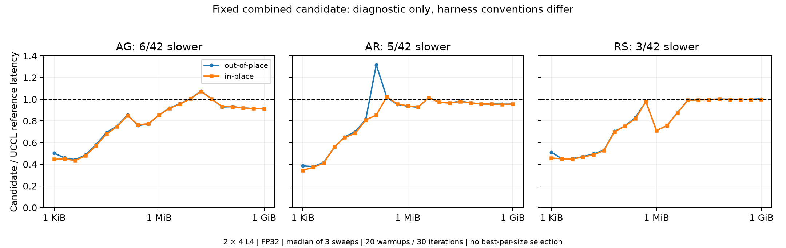

# Combined partial-output candidate

**Zero-regression remains unmet: 14/126 diagnostic rows are slower.**
All operations use one binary: `774c613fe440205740990f426a8ca3f52a0c49ab016f6569ea86650f0c09ec44`.

Two four-L4 hosts, FP32 SUM AR/RS and bitwise AG; all 21 powers of two from
1 KiB to 1 GiB, both layouts, three unchanged nccl-tests sweeps per operation,
20 warmups and 30 timed iterations. Timing includes host enqueue/completion,
maximum rank, and the plotted statistic is the median across three sweeps.
This is one measured fixed policy, not a best-per-size envelope. The original
UCCL reference has different process, pointer-reuse and timing conventions;
this remains diagnostic rather than matched admission.

| Operation | Slower rows / 42 | 1-GiB candidate out/in | Fresh UCCL |
| --- | ---: | --- | --- |
| AG | 6 | 38.160 / 38.189 ms | 41.922 ms |
| AR | 5 | 92.076 / 92.063 ms | 96.445 ms |
| RS | 3 | 53.865 / 53.646 ms | 53.693 ms |

The policy uses whole-grid cooperative AG through 8 MiB and the persistent
four-uploader/16-consumer/one-publisher path above it. Source packet capacity
is 1 MiB for cooperative calls; bulk persistent calls still use 256-KiB packets.
RS alternating banks cover through 32 MiB. The own-half final local RS sum is
written to actual caller output, then the remote sum is added in place; the
registered remote-send half is unchanged. Caller input for that piece has been
consumed before output is written, including standard in-place RS. Dynamic
output pointers still come from the per-call GPU descriptor.

The 60-call component and 144-call mixed ABI checks pass over two lifetimes.
All nine performance jobs pass numerical, per-size/per-rank routing, native
library absence and zero-fallback checks. No default release has been promoted.

An AR 128-KiB out-of-place row has round means 49.45–77.05 us and median
75.84 us. It remains a failed diagnostic row; it was not discarded or replaced
with a later result. The subsequent hybrid-from-1-MiB AR screen is a separate
binary and cannot retroactively qualify this complete matrix.
