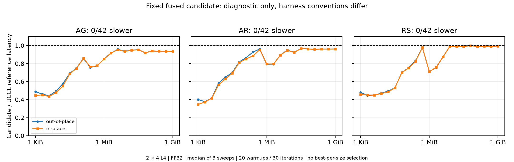

# GPU readiness-gate candidate

**All 126/126 diagnostic medians pass; final admission remains unproven.**
All operations use one binary: `b8fe5a46ecc3bd87b63b852b890a1c548605314eec20676b222e9ede9f6c348b`.

Two four-L4 hosts, FP32 SUM AR/RS and bitwise AG, 21 powers of two from
1 KiB to 1 GiB, both layouts, three unchanged nccl-tests sweeps per operation,
20 warmups and 30 timed iterations. Timing includes host enqueue/completion
and uses the maximum rank. Each row is the three-run median. This is one fixed
policy, not an envelope of per-size minima. Original UCCL harness process,
pointer-reuse and timing conventions differ, so this is not matched admission.

| Operation | Slower rows / 42 | 1-GiB candidate out/in (ms) | UCCL (ms) |
| --- | ---: | --- | --- |
| AG | 0 | 39.188 / 39.155 | 41.922 |
| AR | 0 | 92.788 / 92.743 | 96.445 |
| RS | 0 | 53.450 / 53.343 | 53.693 |

The fixed policy uses one-packet cooperative AG through 4 MiB, GPU readiness gates in the persistent
four-uploader/16-consumer/one-warp-publisher path above it, alternating RS banks
through 32 MiB, and hybrid AR from 1 MiB. The 512-KiB direct-input AR path is
retained. Exactly 256-KiB AR uses 384 threads. RS waits for the remote sum before its final own-half addition, then
writes the result once. Arithmetic order remains (own + local partial) + remote.
All forwarding has finished before that wait, and only the opposite half is
sent over IB. In-place input is read before overwrite; future pieces are disjoint.

The mixed ABI passes 144 calls/rank over
two lifetimes. All nine timing jobs pass numerical, exact per-size/per-rank
routing, native-library-absent and zero-fallback checks. No default release
has been promoted. No positive diagnostic ratio is rounded into a pass.

Build commands, raw logs, complete curves and this generator are retained.
Negative experiments are preserved in the surrounding records.
