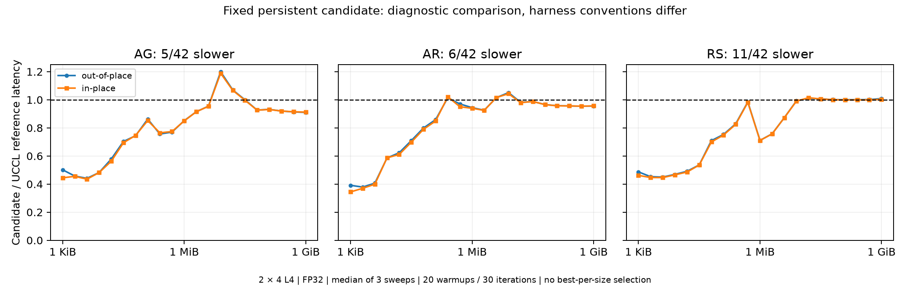

# Fixed persistent candidate: 16 consumers

**Zero-regression remains unmet: 22/126 diagnostic rows are slower.**
The same binary was used for all three operations:
`093552a3b930858b5294935a89eeb1700747c62c405ce7ff52e213c171331e33`.

Two four-L4 hosts, FP32 SUM AR/RS and bitwise AG, all 21 powers of two from
1 KiB to 1 GiB, out-of-place and in-place. Three unchanged nccl-tests sweeps
per operation, 20 warmups and 30 timed iterations, maximum-rank host enqueue
through completion batch means, with medians across the three sweeps. This is
one fixed compiled policy; no curve selects the best variant per size.

The original UCCL reference has different process/layout, pointer-reuse and
per-call timing conventions. These comparisons are diagnostic, not matched
admission. The baseline and zero-slowdown criterion have not been relaxed.

| Operation | Slower rows / 42 | 1-GiB candidate out/in | Fresh UCCL |
| --- | ---: | --- | --- |
| AG | 5 | 38.149 / 38.235 ms | 41.922 ms |
| AR | 6 | 92.180 / 92.247 ms | 96.445 ms |
| RS | 11 | 54.162 / 53.874 ms | 53.693 ms |

The persistent grid has one control block, four upload blocks and 16 consumer
blocks. The 64 vector tiles of a 256-KiB source packet divide evenly among the
consumers. The cooperative launch checks whole-grid residency. Producer system
fences, per-slot completion counts, system-release upload/reader flags, receive
credits and outgoing retirement remain enforced. The CPU worker performs only
host atomics and MSCCL++ RDMA. Caller stream completion includes all GPU actors.

The fixed policy retains cooperative one-packet AG through 4 MiB and uses this
persistent path above it. Public 8-MiB RS is streamed; hybrid AR retains graph
RS for its private shard producer. The direct-input AR experiment applies only
at 512 KiB, retaining its original single-bank reuse/drain protocol.

The component passes 54 calls/rank over two lifetimes. The expanded mixed ABI
passes 144 calls/rank, including the 512-KiB boundary, offsets, per-rank layout
variations, caller streams and recycled allocations. All nine nccl-tests jobs
pass numerical, exact per-size/per-rank route, native-library-absent and zero
fallback checks. No sanitizer or universal NCCL compatibility claim is made.

Remaining diagnostic failures: AG at 8 and 16 MiB, plus a small 32-MiB
out-of-place excess; AR at 256 KiB, 4 MiB and 8 MiB; eleven RS rows. Even tiny
positive ratios remain failures here. Same-condition paired admission and a
complete zero-regression gate are still required. This is not a default release.
