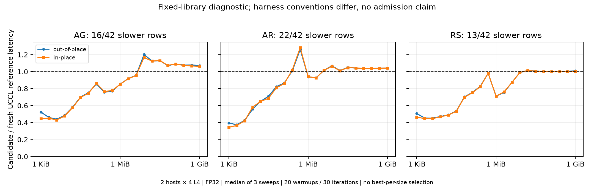

# Fixed cooperative AG + 8-MiB streamed RS candidate

**The zero-regression goal remains unmet.** This is one experimental binary;
all three complete curves were measured with that same SHA-256:

`723d9941c04dba57fd78b3ec5369f149cefd1733507419bcc02c633c74d37cc3`

Two four-L4 hosts (10.10.55.2 and 10.10.55.1), FP32 SUM AR/RS and bitwise AG.
Three unchanged nccl-tests sweeps per operation, all 21 powers of two from
1 KiB to 1 GiB, out-of-place and in-place, 20 warmups and 30 timed iterations.
Timing includes host enqueue through completion and reports the maximum rank.
Each row uses its three-run median. No curve selects the best variant per size.

The comparison uses the freshly reproduced original README UCCL implementations.
Their process layout, per-call checking, pointer reuse and timing conventions
differ from nccl-tests, so these ratios are diagnostic, not matched admission.
The original baseline and zero-slowdown criterion have not been relaxed.

| Operation | Slower diagnostic rows / 42 | Worst ratio |
| --- | ---: | ---: |
| AG | 16 | 1.2019 |
| AR | 22 | 1.2834 |
| RS | 13 | 1.0139 |

The fixed compile-time policy uses cooperative host-packet AG at 256 KiB–4 MiB,
with a single source packet per call and explicit grid residency/fence/ACK
rules. Larger AG retains the three-lane CE path. Hybrid AR uses GPU RS and
that host gather. RS uses the existing streamed path at 8 MiB and CE graphs
from 16 MiB, retaining the original 8-MiB graph-piece target. Other sizes keep
their existing UCCL algorithms. This build is not enabled by default.

The extended ABI passes 126 calls/rank over two communicator lifetimes,
including alignment, mixed per-rank layout, streams and allocation recycling.
The cooperative component separately passes 54 calls/rank with packet tails;
see the preceding one-packet record. Every timed job passes nccl-tests numerical
checks, per-rank/per-size strict route checks and native-library-absent checks.
The library has SONAME libnccl.so.2 and no native NCCL dependency or fallback.

Build command, source hashes, ABI evidence, raw logs, all 126 comparison rows
and this report generator are retained here. Exact source snapshots and binaries
remain under build/uccl_cooperative_rs8_candidate/. Negative experiments are
retained in the neighboring host_control_experiments record.
