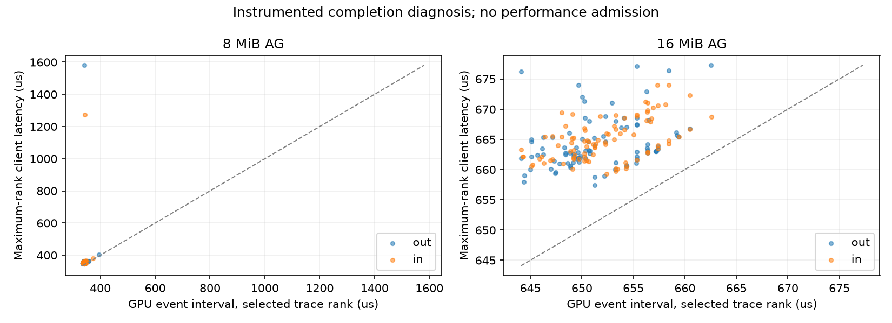

# Completion observation diagnosis — not scored performance

Both diagnostic builds use the frozen prefix candidate's algorithm configuration
on two four-L4 hosts, FP32 AllGather, fixed 1-GiB allocations, all 21 sizes 1 KiB–1 GiB,
both layouts, 20 warmups and 30 iterations, three repetitions. They pass ABI 234 and
six full-output/route/native-absence/trace-count jobs each. All samples remain.

The first build separates host enqueue, device selection, GPU-boundary waiting,
CPU-transport draining and device restoration. Its fixed trace storage is zeroed
before measurement and written only after the run. The long 8/16-MiB calls primarily
spend time in GPU-boundary waiting, rather than enqueue or CPU transport draining.

The second build adds CUDA timing events around enqueued GPU work. Those extra
records/queries perturb timing, so this is diagnostic attribution, not an acceptance
curve. In two 8-MiB calls, GPU elapsed time is about 341/343 us while the main thread's
GPU-boundary wait takes 1509/1232 us and full client time 1581/1275 us. This shows late
host observation of completion for those captured calls; it does not by itself prove
whether CUDA's wait implementation or OS scheduling causes the delay. The 16-MiB
spikes seen in the CPU-only trace were not reproduced by this event-instrumented run.
A separate uninstrumented explicit-query candidate will test that hypothesis while
waiting on exactly the same event and retaining all transport retirement conditions.

| Bytes | Repeat/layout/iteration | Trace rank | Client(us) | GPU elapsed(us) | Host GPU wait(us) | Enqueue(us) | CPU drain(us) |
| ---: | --- | ---: | ---: | ---: | ---: | ---: | ---: |
| 8388608 | 0/out/11 | 1 | 1580.986 | 340.992 | 1509.004 | 8.993 | 7.201 |
| 8388608 | 0/in/2 | 0 | 1274.663 | 343.040 | 1232.350 | 7.544 | 5.495 |
| 16777216 | 2/out/10 | 2 | 677.270 | 662.528 | 657.394 | 8.444 | 6.266 |
| 16777216 | 2/out/7 | 0 | 677.089 | 655.360 | 651.012 | 9.299 | 10.643 |
| 16777216 | 2/out/29 | 2 | 676.408 | 658.432 | 654.890 | 7.155 | 8.193 |
| 16777216 | 1/out/29 | 0 | 676.242 | 644.096 | 639.310 | 16.849 | 17.309 |
| 16777216 | 1/in/29 | 2 | 674.008 | 657.312 | 652.757 | 7.756 | 10.713 |
| 16777216 | 1/out/5 | 4 | 673.995 | 649.664 | 645.996 | 12.045 | 13.121 |
| 16777216 | 2/in/27 | 0 | 673.965 | 658.432 | 655.256 | 7.124 | 8.970 |
| 16777216 | 2/out/15 | 2 | 672.943 | 656.288 | 652.646 | 7.296 | 6.669 |
| 16777216 | 2/in/0 | 2 | 672.277 | 660.480 | 656.818 | 6.975 | 5.827 |
| 16777216 | 1/out/6 | 4 | 672.016 | 650.048 | 645.700 | 8.811 | 14.690 |
