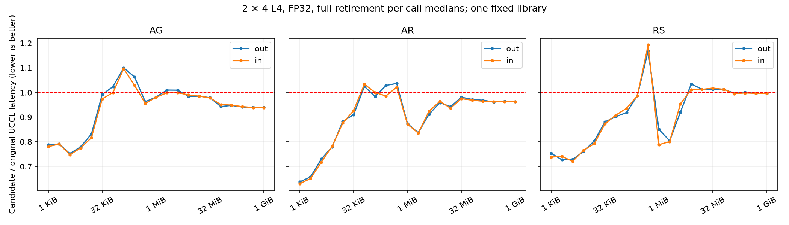

# Output-overlap and ordered-retirement full comparison

The zero-regression goal remains unmet. This fixed library passes all nine unchanged
nccl-tests sweeps with 126/126 batch medians no slower than the original UCCL reference.
The aligned per-call campaign completes all 27 jobs with full output verification and
candidate route/native-absence checks, but **25/126 rows are slower**:
AG 8, AR 6, RS 11.

Hardware: two hosts, four NVIDIA L4 GPUs each, mlx5_0/mlx5_1. Dtype: FP32 copy for AG,
FP32 SUM for AR/RS. Baseline: the SHA-verified original README UCCL binaries and original
process layouts (AG four processes/two GPUs each; AR/RS eight processes). Candidate:
eight processes/one GPU each, both out-of-place and in-place. Each candidate layout
is compared to the original recorded reference layout. No native NCCL implementation
is loaded or executed by candidates.

All 21 powers of two from 1 KiB through 1 GiB are included. Three paired rounds alternate
reference/out/in ordering. Warmups/timed calls are AG20/30, AR20/10, RS10/10. Each point
is the median of three maximum-rank per-call means, with fixed pointers, matching data
preparation, and full GPU plus internal send retirement. Full-output checks and MPI
barriers are outside timing. No per-size winner envelope or tolerance relaxation is used.
The diagnostic synchronize extension is used for this protocol; ordinary nccl-tests
remains unchanged. The campaign had no concurrent compilation or candidate GPU tests.

Candidate SHA-256: `f048c3d1529130a6b02856663464f553ed1355051698a56a7d442a98ccc36f50`. Original failure data (54/126 rows
for the earlier candidate) remain intact. This result is neither a release promotion
nor final zero-regression admission. The current source also has later unmeasured
instrumentation/specialization; exact tested source snapshots are included here.

| Operation | Bytes | Layout | Original (us) | Candidate (us) | Ratio |
| --- | ---: | --- | ---: | ---: | ---: |
| ag | 65536 | out | 29.087 | 29.791 | 1.024174 |
| ag | 65536 | in | 29.087 | 29.095 | 1.000253 |
| ag | 131072 | out | 33.005 | 36.318 | 1.100371 |
| ag | 131072 | in | 33.005 | 36.198 | 1.096736 |
| ag | 262144 | out | 40.414 | 42.963 | 1.063064 |
| ag | 262144 | in | 40.414 | 41.594 | 1.029195 |
| ag | 2097152 | out | 114.021 | 115.183 | 1.010188 |
| ag | 4194304 | out | 197.393 | 199.318 | 1.009754 |
| ar | 65536 | out | 45.420 | 46.547 | 1.024822 |
| ar | 65536 | in | 45.420 | 46.963 | 1.033983 |
| ar | 131072 | in | 56.621 | 56.637 | 1.000293 |
| ar | 262144 | out | 74.197 | 76.345 | 1.028957 |
| ar | 524288 | out | 113.847 | 118.074 | 1.037132 |
| ar | 524288 | in | 113.847 | 116.345 | 1.021943 |
| rs | 524288 | out | 68.010 | 79.451 | 1.168228 |
| rs | 524288 | in | 68.010 | 81.060 | 1.191882 |
| rs | 8388608 | out | 496.346 | 513.591 | 1.034743 |
| rs | 8388608 | in | 496.346 | 502.473 | 1.012343 |
| rs | 16777216 | out | 913.253 | 925.740 | 1.013673 |
| rs | 16777216 | in | 913.253 | 924.875 | 1.012726 |
| rs | 33554432 | out | 1812.255 | 1837.085 | 1.013701 |
| rs | 33554432 | in | 1812.255 | 1845.581 | 1.018390 |
| rs | 67108864 | out | 3449.599 | 3497.035 | 1.013751 |
| rs | 67108864 | in | 3449.599 | 3494.763 | 1.013093 |
| rs | 268435456 | out | 13433.342 | 13440.718 | 1.000549 |
