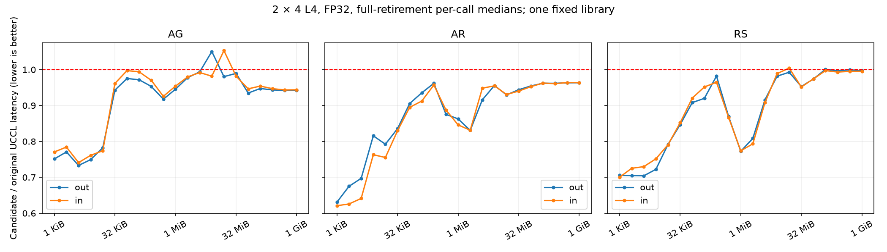

# Prefix128 combined full comparison

The zero-regression goal remains unmet. This fixed library passes all nine unchanged
nccl-tests sweeps with 126/126 batch medians no slower than the original UCCL reference.
The aligned per-call campaign completes all 27 jobs with full output verification and
candidate route/native-absence checks, but **4/126 rows are slower**:
AG 2, AR 0, RS 2.

Hardware: two hosts, four NVIDIA L4 GPUs each, mlx5_0/mlx5_1. Dtype: FP32 copy for AG,
FP32 SUM for AR/RS. Baseline: the SHA-verified original README UCCL binaries and original
process layouts (AG four processes/two GPUs each; AR/RS eight processes). Candidate:
eight processes/one GPU each, both out-of-place and in-place. Each candidate layout
is compared to the original recorded reference layout. No native NCCL implementation
is loaded or executed by candidates.

All 21 powers of two from 1 KiB through 1 GiB are included. Three paired rounds alternate
reference/out/in ordering. Warmups/timed calls are AG20/30, AR20/10, RS10/10. Each point
is the median of three maximum-rank per-call means, with fixed pointers, matching data
preparation, and full GPU plus internal send retirement. Full-output checks and MPI
barriers are outside timing. No per-size winner envelope or tolerance relaxation is used.
The diagnostic synchronize extension is used for this protocol; ordinary nccl-tests
remains unchanged. The campaign had no concurrent compilation or candidate GPU tests.

Candidate SHA-256: `c5bf14aa1f0877d767db5285d4259c93ce0901ffc7a865a25826f0ed6105e446`. Original failure data (54/126, 25/126 and12/126 rows
for the earlier candidate) remain intact. This result is neither a release promotion
nor final zero-regression admission. The current source also has later unmeasured
instrumentation/specialization; exact tested source snapshots are included here.

| Operation | Bytes | Layout | Original (us) | Candidate (us) | Ratio |
| --- | ---: | --- | ---: | ---: | ---: |
| ag | 8388608 | out | 355.707 | 373.599 | 1.050299 |
| ag | 16777216 | in | 671.938 | 707.485 | 1.052901 |
| rs | 16777216 | in | 919.048 | 922.944 | 1.004239 |
| rs | 134217728 | out | 6725.080 | 6730.977 | 1.000877 |
