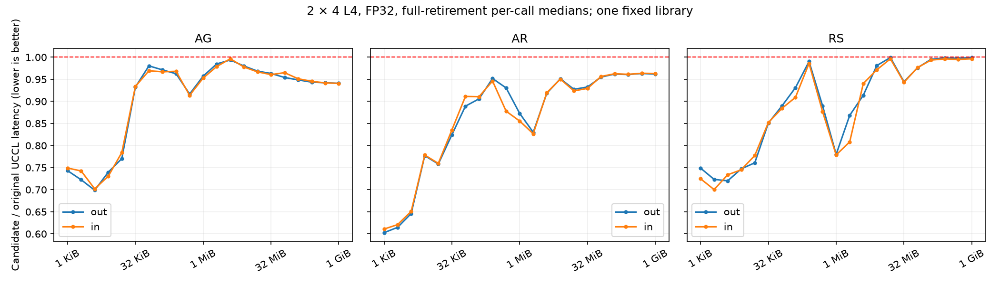

# Qualified strict UCCL Lite NCCL replacement

**All 126/126 aligned size/layout points pass the zero-slowdown criterion versus
the frozen original README UCCL Lite implementations.** All 9 unchanged nccl-tests
sweeps pass numerical, route and native-absence checks. The default Makefile policy
is now `graph512`, and the default library has been rebuilt and independently
validated. This is measured parity on the recorded configuration, not a guarantee
for other hardware, API modes or future runs.

Hardware: two hosts with four NVIDIA L4s each, two NUMA groups/host,
mlx5_0/mlx5_1 and ibp55s0f0. Dtype: FP32 copy for AG and FP32 SUM for AR/RS.
Coverage: every power of two from 1 KiB through 1 GiB, both legal out-of-place and
in-place layouts, one GPU/process, eager execution. Size is the complete AG
output, complete RS input, or AR buffer. Exact GPU UUIDs, CPU affinity, topology,
driver/dependency hashes and relevant environment are recorded in the host files.

Baseline: SHA-verified original README UCCL binaries and original process layouts
(AG four MPI processes/two GPUs each; AR/RS eight processes). The replacement uses
eight processes/one GPU each. Each candidate layout is compared with the original
recorded reference layout. The original AG native-NCCL control is disabled.
Neither candidate nor default-library runs load or execute native NCCL.

Three paired rounds alternate reference/out/in ordering. Warmups/timed calls are
AG 20/30, AR 20/10 and RS 10/10. Each point is the median of three maximum-rank
per-call means with fixed pointers, matching data preparation and full GPU plus
internal send retirement. Preparation, MPI barriers and full-output verification
are outside timing. No samples are trimmed and no tolerance is added. One fixed
library supplies the entire curve; it is not a best-variant-per-size envelope.
Both hosts have no active nsys sessions before or after the campaign.

| Operation | Passing points | Worst candidate/original latency ratio |
| --- | ---: | ---: |
| AG | 42/42 | 0.996521338 |
| AR | 42/42 | 0.963631707 |
| RS | 42/42 | 0.999463772 |



The 9 stock nccl-tests jobs use 20 warmups, 30 timed iterations and 3 repetitions per
operation, covering both layouts. Their batch timing comparison is diagnostic;
the separate aligned 27-job campaign supplies the per-call admission above. The
independent auditors reconstruct all values from raw logs, verify binary identities,
finite positive timings, every sample index and exact rank/size routes. Eight
corrupted-log/manifest fixtures are rejected. All earlier slower results remain
in the neighboring experiment directories and progress record.

## Default artifact and build

```bash
make -j2 nccl-mscclpp-strict \
  MSCCLPP_IB_BUILD=/home/zhongjie/third_party/mscclpp/build-ib-pcieccl \
  MPICXX=/usr/mpi/gcc/openmpi-4.1.7rc1/bin/mpicxx
```

This selects `UCCL_LITE_NCCL_POLICY=graph512` without an override and produces
`build/nccl_lite/libuccl_lite_nccl_strict.so`, with SONAME `libnccl.so.2` and alias
`build/nccl_lite/strict/libnccl.so.2`. The old default artifacts were backed up
before rebuilding. The library has no native NCCL dependency, symbol forwarding
or fallback path; unsupported operations return errors.

Measured library SHA-256: `8ad6c2da1808eb85983902e9383138ac6e009d0c228e89406a675d08c6da11a5`.

Default library SHA-256: `9320881d124c8408f91530669673758645e36cfd8d34e0f182b480b1a6710671`.

Loaded-runtime identity: `3c83cd30c5ad4ef86e31c06140edaff0b8e6c5ca38f92341fedefe312c54f3bf`.

The raw hashes differ because NVCC records a temporary source filename and ELF
build-ID metadata. The identity comparison retains every allocated section,
layout/program header, dynamic symbol/relocation, constant, code and CUDA fatbin;
only the GNU build-ID descriptor is masked, and non-allocated debug/symbol tables
are excluded. The default and measured loaded code/data match. Code/dynamic-data
mutation self-checks reject differences. This comparison does not alter any timing.
Default-build host records match the measured records except for the library hash.

The explicit policy rebuild verifies no-op behavior and policy-switch invalidation,
and builds the affected backend/component/network-check targets. The canonical
default library separately passes 234 mixed ABI calls/rank over two lifetimes,
including delayed peers, mixed layouts, nonaligned pointers, stream changes,
allocation recycling and unsupported-mode checks. The measured candidate also
passes 48 queued mixed RS/AR calls/rank with full outputs/guards and actual address
reuse. After rebuilding, the default library passes another unchanged nccl-tests
sweep for each operation over the full range; these are correctness/routing smoke
runs, not a replacement performance campaign.

## Use the verified placement/profile

The identity-checked launcher and profile for the canonical default were staged
on both recorded hosts under `build/uccl_default_release/abi`. The exact three
stock-test commands used for the default-library smoke can be repeated with:

```bash
bash build/uccl_default_release/reproduce_nccl_tests.sh
```

The script uses the strict library and unchanged test executables. `--real-nccl`
is only an API/provenance input to the launcher; strict launch does not load it and rejects a process that loads native NCCL. Keep the recorded profile with its matching library/launcher and placement.
Other placements, dtypes, counts, caller graph capture, grouped data submission
and concurrent communicators are outside this qualification.

[Build, launcher and API scope](../../../../../integration/nccl_lite/MSCCLPP.md)
are documented separately. Full measurement logs and exact commands are in the
[fixed-library report](../graph512_full/README.md); the machine-readable
[completion audit](completion_audit.json), default ABI/smoke logs, policy-build
records and local build-input snapshot are included here. External SDK and
MSCCL++ dependencies are hashed, not vendored.

[Per-size stock nccl-tests tables versus the old standalone measurements](nccl_tests_vs_old.md)
explicitly separate the two timing protocols; both layouts are included.
