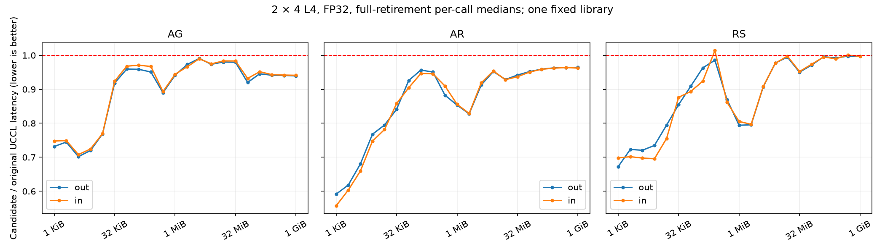

# Primary-context reuse plus event-query completion full comparison

This experimental result does not by itself promote the default build. This fixed
library completes all nine unchanged
nccl-tests sweeps with 126/126 batch medians no slower than the original UCCL reference.
The aligned per-call campaign completes all 27 jobs with full output verification and
candidate route/native-absence checks. **2/126 rows are slower**:
AG 0, AR 0, RS 2.

Hardware: two hosts, four NVIDIA L4 GPUs each, mlx5_0/mlx5_1. Dtype: FP32 copy for AG,
FP32 SUM for AR/RS. Baseline: the SHA-verified original README UCCL binaries and original
process layouts (AG four processes/two GPUs each; AR/RS eight processes). Candidate:
eight processes/one GPU each, both out-of-place and in-place. Each candidate layout
is compared to the original recorded reference layout. No native NCCL implementation
is loaded or executed by candidates.

All 21 powers of two from 1 KiB through 1 GiB are included. Three paired rounds alternate
reference/out/in ordering. Warmups/timed calls are AG20/30, AR20/10, RS10/10. Each point
is the median of three maximum-rank per-call means, with fixed pointers, matching data
preparation, and full GPU plus internal send retirement. Full-output checks and MPI
barriers are outside timing. No per-size winner envelope or tolerance relaxation is used.
The diagnostic synchronize extension is used for this protocol; ordinary nccl-tests
remains unchanged. The campaign had no concurrent compilation or candidate GPU tests. During this
campaign, three orphaned remote Nsight Systems sessions were found still collecting,
although their earlier UCCL Lite target processes had exited. They remained active
through this run to avoid changing its environment mid-campaign. Their impact on
timing is not established; a full clean-environment comparison is required before
release admission. This result and all samples are retained.

Candidate SHA-256: `0adc90877552af4d3585b08591b950aaedc38bb8849835649e7be57be9213f53`. Original failure data (54/126, 25/126 and12/126 rows
for the earlier candidate) remain intact. This result is neither a release promotion
nor final zero-regression admission. The exact tested source snapshots are included here. The candidate reuses the exact observed primary context and polls the same CUDA
event; GPU algorithms and transport retirement are retained. The
raw-log auditor independently reconstructed every result and rejected four corrupted
log/manifest fixtures.

| Operation | Bytes | Layout | Original (us) | Candidate (us) | Ratio |
| --- | ---: | --- | ---: | ---: | ---: |
| rs | 262144 | in | 49.744 | 50.434 | 1.013855 |
| rs | 536870912 | in | 26843.800 | 26857.868 | 1.000524 |
