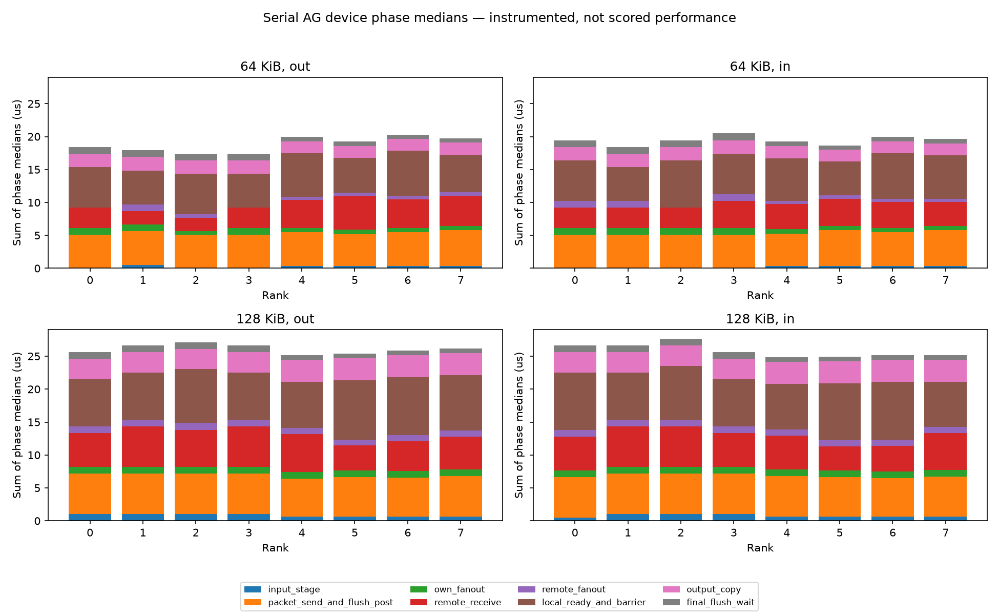

# Serial AG phase diagnosis

Two four-L4 hosts, FP32 AllGather, fixed 1-GiB allocations, 64/128 KiB, both layouts,
20 warmups and 30 measured calls per case. The client includes full send retirement,
while FlashInfer probes attribute device phases. This is an instrumented diagnostic,
not scored performance or admission. The same completion conditions remain in place.
All four jobs pass full-output, exact route and zero-native-fallback checks; the
instrumented build also passes 144 mixed ABI calls/rank. Each rank records all 50 calls;
phase summaries exclude the 20 warmups. Internal helper barriers are included in phase
durations. Source/header hashes and commands are retained. Binary traces remain under
build/uccl_serial_timeline with hashes here.

The local ready/barrier phase dominates 128-KiB AG at roughly 7–9 us per rank; packet
send/flush submission is about 6 us, incoming-packet waiting about 5 us, output copy
about 3.2 us. Own/remote fan-out is roughly 1 us each, explaining why the prior fan-out
experiment did not solve this gap. The early-posted final flush wait is under about 1 us.
Do not subtract probe overhead or treat these numbers as uninstrumented savings.
Ranks 0–3 show coarse 1024-ns quantization in these traces; zero durations can be below
that granularity. Compare phases and unprofiled measurements, not sub-microsecond
claims based on those zeros.

| Phase | 64 KiB out/in (us) | 128 KiB out/in (us) |
| --- | ---: | ---: |
| input_stage | 0.240 / 0.176 | 0.840 / 0.772 |
| packet_send_and_flush_post | 5.126 / 5.170 | 6.030 / 6.072 |
| own_fanout | 0.768 / 0.832 | 1.024 / 1.022 |
| remote_receive | 3.584 / 3.620 | 5.276 / 5.100 |
| remote_fanout | 0.440 / 0.624 | 0.976 / 0.976 |
| local_ready_and_barrier | 5.868 / 6.212 | 7.848 / 7.808 |
| output_copy | 1.928 / 1.924 | 3.218 / 3.220 |
| final_flush_wait | 0.850 / 0.860 | 0.864 / 0.856 |

Table cells are means of the eight per-rank medians, for attribution only.
