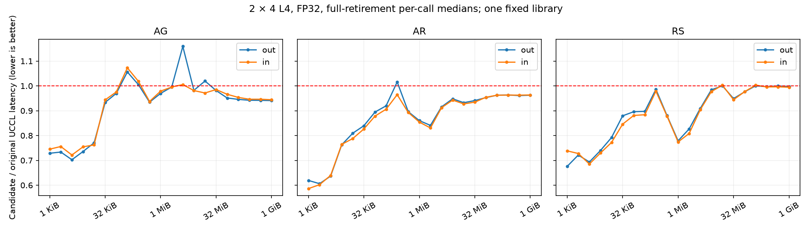

# Single64 graph full comparison

The zero-regression goal remains unmet. This fixed library passes all nine unchanged
nccl-tests sweeps with 126/126 batch medians no slower than the original UCCL reference.
The aligned per-call campaign completes all 27 jobs with full output verification and
candidate route/native-absence checks, but **12/126 rows are slower**:
AG 7, AR 1, RS 4.

Hardware: two hosts, four NVIDIA L4 GPUs each, mlx5_0/mlx5_1. Dtype: FP32 copy for AG,
FP32 SUM for AR/RS. Baseline: the SHA-verified original README UCCL binaries and original
process layouts (AG four processes/two GPUs each; AR/RS eight processes). Candidate:
eight processes/one GPU each, both out-of-place and in-place. Each candidate layout
is compared to the original recorded reference layout. No native NCCL implementation
is loaded or executed by candidates.

All 21 powers of two from 1 KiB through 1 GiB are included. Three paired rounds alternate
reference/out/in ordering. Warmups/timed calls are AG20/30, AR20/10, RS10/10. Each point
is the median of three maximum-rank per-call means, with fixed pointers, matching data
preparation, and full GPU plus internal send retirement. Full-output checks and MPI
barriers are outside timing. No per-size winner envelope or tolerance relaxation is used.
The diagnostic synchronize extension is used for this protocol; ordinary nccl-tests
remains unchanged. The campaign had no concurrent compilation or candidate GPU tests.

Candidate SHA-256: `824297dbe66f1094d360c5693ca0324c43a3d2feed07633e8032c9a6fe8cccbc`. Original failure data (54/126 and25/126 rows
for the earlier candidate) remain intact. This result is neither a release promotion
nor final zero-regression admission. The current source also has later unmeasured
instrumentation/specialization; exact tested source snapshots are included here.

| Operation | Bytes | Layout | Original (us) | Candidate (us) | Ratio |
| --- | ---: | --- | ---: | ---: | ---: |
| ag | 131072 | out | 32.877 | 34.722 | 1.056125 |
| ag | 131072 | in | 32.877 | 35.266 | 1.072668 |
| ag | 262144 | out | 40.301 | 40.495 | 1.004790 |
| ag | 262144 | in | 40.301 | 41.034 | 1.018170 |
| ag | 4194304 | out | 197.425 | 228.845 | 1.159150 |
| ag | 4194304 | in | 197.425 | 198.503 | 1.005462 |
| ag | 16777216 | out | 682.243 | 695.675 | 1.019687 |
| ar | 262144 | out | 73.546 | 74.715 | 1.015892 |
| rs | 16777216 | out | 910.474 | 910.565 | 1.000100 |
| rs | 16777216 | in | 910.474 | 912.971 | 1.002743 |
| rs | 134217728 | out | 6724.959 | 6727.944 | 1.000444 |
| rs | 134217728 | in | 6724.959 | 6746.090 | 1.003142 |
