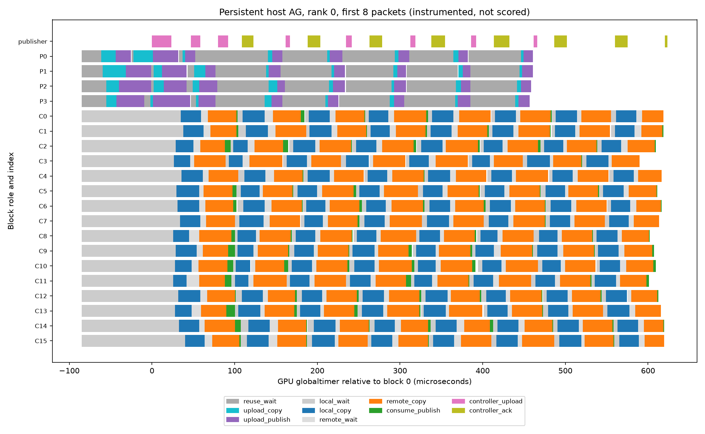

# Current 16-MiB persistent-path timeline

Two four-L4 hosts, FP32 AllGather, current four-uploader/16-consumer/one-publisher
policy. The instrumented binary passes the 144-call mixed ABI and an unchanged
nccl-tests sweep over all 21 powers of two, both layouts, 20 warmups and 30
iterations. Profiling records only 16 MiB, preserving the 1-GiB allocation and
pointer rotation of the full sweep. Later sizes do not overwrite that trace.
The saved buffers represent the final in-place 16-MiB invocation on all eight
GPUs. Exact commands, header hash, decoder and trace hashes are retained here;
raw binary traces remain under build/uccl_timeline16/trace_16m/.

This is instrumentation evidence, not scored performance or matched admission.
Every block's expected phase count and matching begin/end records are checked.
The controller has its own upload/ACK phases; issuing-thread spans include
counter operations, fences and synchronization, and cannot be called pure
payload bandwidth.

Controller upload publication averages about 6–9 us per packet; its three
reader-ACK stores average 12–14 us. Consumer completion counting is only about
1–2 us. The next hypothesis is warp-wide parallel publication of independent
ACKs, retaining all reader counts, release stores and outgoing retirement.
The original per-thread timing and start-skew distributions remain in summary.json.

The warp-publication follow-up passes 60 component and 144 mixed ABI calls/rank,
then all nine full nccl-tests jobs. Its complete matrix is linked in the parent
record. 16-MiB AG remains slower; the profile-driven change does not establish
full zero-regression success. No profile timing is used as a scored result.
