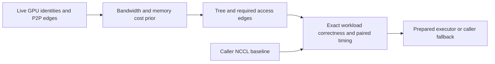

# Topology-derived peer tree candidate

Caller-baseline preparation now considers source-ordered tree forwarding in
addition to direct peer, host packet and the retained peer packet specialization.
It accepts 2–32 logical ranks on a connected bidirectional CUDA peer graph;
GPU count alone does not establish eligibility. The direct staged algorithm
still requires all-pairs peer access. A disconnected graph retains the caller
or another eligible backend.

The planner builds a root-zero spanning tree from actual CUDA-access edges.
The [dependency/overlap model](overlap-model.md) now compares that edge-based
prior with deduplicated BFS trees before choosing the executable tree.
Measured directed peer-read costs and GPU-memory bandwidth guide edge weights.
If rates are unavailable, deterministic capability/locality ordering supplies
an unestimated prior; unknown bandwidth never becomes zero cost. The tree is
chosen at the runtime's fixed capacity and retained for its lifetime, allowing
old handles and owned graphs to coexist across exact-request qualification.
The movement model includes GPU memory, measured paths and shared physical
PCIe bounds. Launch, polling and system-fence overhead remain outside this
advisory estimate and are included in actual qualification timing.
The data-movement model uses per-rank task dependencies matching stream order
and neighbor retirement, rather than serial global phases.

`ExecutionPlan::peerEdges` declares required CUDA accessor-to-peer edges. The
generic planner revalidates every edge. Tree execution imports only neighbors'
CUDA IPC storage and semaphores, with no mapped-host/router buffers or CPU
transport workers. Preparation collectively checks host, dtype, capacity,
parent map, visible GPU identities and local edge capabilities before allocating
GPU storage. Failed low-level preparation requires a new executor.

## Numerical and execution contract

The executor uses private original-input storage, a relay buffer and an FP32
accumulator. It broadcasts one logical source at a time through the tree, rooted
at that source for forwarding. AllGather copies bits. AR/RS accumulate in
ascending logical source rank, with one final BF16 round-to-nearest conversion;
physical routing does not reorder operands. RS forwards each source's complete
input before consuming the destination shard. This can move more data than a
specialized partial-reduction algorithm, especially for RS, and carries extra
launch/handshake overhead. Eligibility is not a performance claim.

Every forwarding depth publishes completion and retires neighboring readers
before relay reuse. Every data-writing thread executes a system fence before
the later semaphore kernel publishes readiness; forwarding loads/stores are
volatile. The fence is attached to the producing threads, as required by the
[CUDA memory-fence scope](https://docs.nvidia.com/cuda/archive/12.9.0/cuda-c-programming-guide/index.html#memory-fence-functions).
Caller streams are chained through completion events. Owned graphs reuse the
same device counters and are independently qualified; external capture remains
unsupported.

Private storage is approximately three times capacity for FP32 and four times
capacity for BF16, plus alignment/control metadata. Creation occurs only at
prepare. Baseline timing blocks contain no retained alternative executor;
previously selected executors and graph bindings are reconstructed afterward.
The candidate must pass the complete-buffer oracle and beat its paired native
baseline by the existing >3% median/nonoverlapping-range rule.

`allowPeer` gates all peer families. C++ `allowPeerDirect` and `allowPeerTree`
provide family-level policy/diagnostic controls, both defaulting to true. C
callers using `UCCL_LITE_ALLOW_PEER` consider both automatically. Reports expose
tree parents and the resource estimate. The local backend code is 4; the unified
runtime/C-report backend code is 5, preserving network-hierarchy code 4.

The tree is currently an automatically qualified alternative when a caller
baseline is supplied. Native-free strict prepared selection retains its
existing direct-peer baseline requirement. The low-level tree constructor is
also available for explicit correctness/experimentation.

## Organization and validation

| File | Responsibility |
| --- | --- |
| `include/uccl_lite/peer_tree.hpp` | Validate and re-root logical forwarding trees |
| `src/planner/peer_plan.cc` | Measured tree prior and movement model |
| `src/planner/planner.cc` | Required-edge capability checks |
| `src/collectives/peer_staged.cu` | Shared IPC/graph lifecycle, direct and tree execution |
| `src/runtime/peer_staged_backend.cc` | Core backend factories |
| `src/runtime/prepared_local.cu` | Isolated four-candidate qualification and retention |

`make peer-tree-check peer-graph-check prepared-runtime-check planner-check`
builds the checks. The independent tree oracle compares complete buffers,
preserved inputs and guards, bitwise gather, scalar tails and both legal alias
forms. Cancellation-sensitive values distinguish ascending-source FP32
accumulation from a reordered partial-sum reduction. Eager and owned-graph calls
alternate across streams and run over two lifetimes.

The initial BF16/star memcheck run produced an oracle mismatch without a
sanitizer memory-access error (`build/peer-tree-memcheck/bf16-star.log`). Added
diagnostics and eight repeats did not reproduce it. Review then identified the
missing per-writer system publication in the relay path. The current kernel
adds that publication and volatile accesses; causality for the original
intermittent failure was not established by a reproducible failing input.
The original negative result is retained.

Post-change results are in `build/peer-tree-final/`: path/star FP32/BF16 through
32 MiB on four L4s; three-rank FP32 and two-rank BF16; and seven four-rank
memcheck jobs with zero memory errors, including four independent BF16/star
repeats. All instrumented runs also pass the full oracle. CPU fixtures cover
sparse 2/3/4/8/32-rank graphs, disconnections, one-way edges, bandwidth-driven
and memory-driven tree changes, unknown-rate handling and qualification.

GPU tests use restricted path/star plans on the documented fully peer-accessible
L4 hardware. This validates execution using only selected edges; it is not a
measurement on physically sparse peer hardware or on more than four GPUs.
The `tree` mode of the unified checker disables other alternatives and adds a
labeled 3-ms native baseline delay to force tree/native transitions. Those
timings establish branch correctness only, not a gain over stock NCCL. Real
native-baseline and distributed regressions are recorded separately.

The final four-L4 FP32 C-interface run checks 36 exact requests over two
lifetimes (AR/AG/RS, 64/257/4096 elements, two per-rank layout patterns). All
36 tree trials are correct, but none beats stock NCCL under the promotion rule;
32 decisions retain NCCL and 4 select peer packet. `summary.json` retains the
counts and the full log retains all samples and parent maps. Timing is
maximum-rank host enqueue-to-stream completion, three ABBA rounds, two warmups
and three timed calls/block, with setup and verification outside timing.
Baseline is NCCL 2.28.7; hardware is the documented dual-NUMA Xeon Silver
4410Y/four-L4 system. No best-variant curve or general speedup is claimed.

`build/peer-tree-network/` passes two four-L4 hosts through the shared C
interface, including automatic network calibration, owned native graphs and
forced fallback. `build/peer-tree-artifacts.sha256` records source and final
binary identities. CPU planner, 35 router-policy, 74 dispatcher and runtime
catalog checks also pass.
