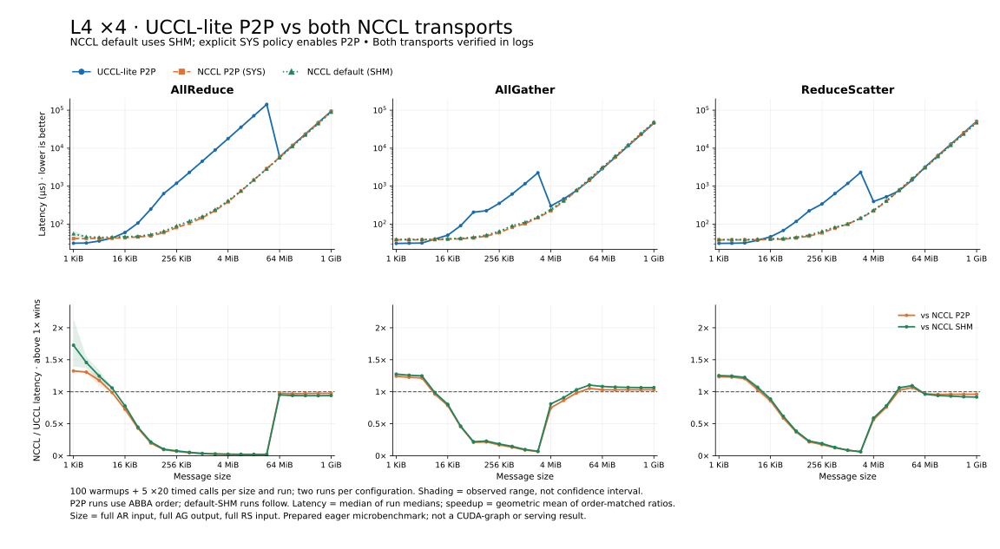

# Retained router and direct-peer optimizations

This integration is based on Zhongjie's UCCL repository at `622fb704`, on the
separate branch `codex/uccl-lite-retained-optimizations`. It preserves that
revision's host-ring ReduceScatter implementation. It imports the retained
router and BF16 direct-peer work from the isolated EAT experiments originally
based on `5b9a7f86:experimental/lite`.

**The performance tables below describe the named experimental snapshots,
not a fresh performance certification of this integrated branch.** Integration
correctness/build results are recorded separately in
[`integration-validation.json`](../benchmarks/data/retained_eat_20261115/integration-validation.json).
The original developer working tree and uncommitted experiments are excluded.

Integration validation passed on `wxz-l4`: all listed build targets, five host
checks (including 860,132 BF16 oracle checks), and fifteen GPU checks covering
four/eight-rank router eager/graph execution, host-ring correctness, dispatcher
capture boundaries, peer selftests and large-AG correctness smokes. Four-port
router/host-ring tests use the 2+2 subset; joint four-rank tests use the four
P2P-capable GPUs within one NUMA group. l41's lock was occupied, so this
integration was not revalidated on its cross-NUMA P2P topology. PRO6000 and
full performance sweeps were not rerun. The dispatcher CUDA test now supports
both a physical four-GPU node and the existing four-port subset of an eight-GPU
node.

## Changes included

### CPU router

- The adaptive dispatcher targets **8 MiB packets for AllGather outputs of at
  least 4 MiB**. Existing capacity clamps still determine the actual geometry.
  An explicit `largeAllGatherPacketBytes` setting takes precedence. A larger
  custom base packet is never reduced. Set `autoLargeAllGatherPacketBytes=0`
  in `CpuRouterOptions` to disable the new automatic target. Direct
  `PacketPipeline` users retain their explicit packet size.
- CPU BF16 reductions with exactly **two inputs** use a four-vector-unrolled
  AVX-512 path when at least 64 elements are available. The specialization uses
  software BF16 conversion, preserves source order and the initial positive-zero
  addition, and falls back for output/input or descriptor-storage overlap.
  This is not a native AVX512_BF16 conversion requirement.
- Profile lookup compares inexpensive workload fields before long identity
  strings. Selection criteria are unchanged. The new packet option participates
  in profile identity: recalibrate after a binary/configuration change.

The count-two specialization applies to local reductions and two-group merges
on the 2+2 L4 host. On the 4+4 L4 host, local reductions still have four inputs;
the main count-two opportunity is the final group merge. Larger AG packets also
change existing producer crews and buffer capacities, so their measured gain
cannot be attributed exclusively to fewer packets.

### Direct peer and joint selection

[`JointCollectives`](../include/uccl_lite/joint_collectives.hpp) adds an optional
single-process, BF16, out-of-place interface for AR/AG/RS. `prepare()` allocates
resources outside timing; `enqueue()` respects caller-stream producers and
publishes both output completion and input-reader completion. Host calls must
be serialized. The joint wrapper is eager-only; its underlying router retains
its separately tested graph API.

The peer path requires all-pairs CUDA P2P and supports two/four ranks:

| Family | Activation | Implementation |
|---|---|---|
| Small coordinator | Through 256 KiB on two ranks; 64 KiB on four | One GPU reads inputs and distributes results; two-rank calls run on the first caller stream. |
| Intermediate | Between the other families' thresholds | Vectorized destination-side peer reads; FP32 accumulation with BF16 output. |
| Bulk AllGather | At least 4 MiB full output | Source-owned peer-copy fan-out. |
| Staged ReduceScatter | At least 4 MiB full input | Peer copies to destination-local scratch, then local reduction. |
| Staged AllReduce | At least 4 MiB on two ranks; 64 MiB on four | Reduce-scatter into local shards followed by peer gathering; requires evenly partitionable input. |

Two-rank staged reductions read their own input directly instead of copying it
into scratch. Internal completion dependencies protect scratch reuse, changing
caller stream sets and destruction.

These are BF16 adaptations of existing peer algorithm families, **not the
repository's best-per-size historical FP32 PCIeCCL envelope**. In particular,
the four-L4 medium-size peer-read path is substantially slower than NCCL.
Do not force this path as a general replacement for NCCL.

`JointMode::Auto` uses exact local calibration records. Missing/stale records
retain supported peer; if peer is unavailable, the wrapper uses a supported
router or rejects the topology. Eight-rank calls use the capability-forced
router; this wrapper has no eight-rank peer implementation. It selects a whole
collective backend rather than composing within-group P2P and cross-group
routing. It never calls NCCL internally. Existing standalone/fusion targets
are not redirected through this interface.

## Measured results and limitations

All speedups are `NCCL latency / UCCL latency`; above 1 favors UCCL. Whole-grid
scores are equal-weight geometric means of 63 BF16 out-of-place cases: three
collectives, powers of two from 1 KiB through 1 GiB. Size means complete AR
input, complete AG output or complete RS input. These are eager collective
microbenchmarks, not inference or concurrent-GEMM results.

### Retained router, snapshot `2ba27356550628122fcff0e539c18a71e9ffd097`

Starting router: `e734b51547466ea141bc38b46b562db58e294890`.

| Testbed | Paired improvement over starting router | Speedup over forced NCCL SHM |
|---|---:|---:|
| l41, L4 x4, 2+2 NUMA | 1.0549x / 1.0783x | 0.8981x–0.9147x |
| l48-1, L4 x8, 4+4 NUMA | 1.0005x / 1.0086x | 1.1485x–1.1644x |

Four-L4 improved 5.5–7.8% but did not beat NCCL SHM overall. Its operation-wide
AG average narrowly wins; AR and RS lose. Eight-L4 aggregate performance is
essentially unchanged; its advantage over SHM existed before this optimization.
The large-AG packet component alone improved its affected four-L4 cases by
about 22% in repeated full runs. No claim of a new 15% eight-L4 code gain is made.

### Retained joint/P2P, snapshot `e734b51547466ea141bc38b46b562db58e294890`

On **PRO6000 x2**, the separately calibrated joint chooser selected peer in all
63 cases. Official full validation was **1.5742x NCCL default/P2P** and
**2.4618x forced NCCL SHM**. The latter is a supplemental baseline, not the
default NCCL comparison. This is an earlier source/configuration than the
latest router result; the new router option requires new joint calibration.

A later, fresh **l41 direct-peer-only** comparison used two full runs per
configuration and verified NCCL transport in logs. Across the serving-sized
8 KiB–16 MiB subset, the retained peer path achieved:

| Collective | Versus NCCL P2P | Versus NCCL default/SHM |
|---|---:|---:|
| AllReduce | 0.0844x | 0.0903x |
| AllGather | 0.3220x | 0.3407x |
| ReduceScatter | 0.3350x | 0.3492x |
| All three | 0.2088x | 0.2206x |

These are geometric means of the two order-matched ratios per case. At 1 MiB,
peer AllReduce was about 4.54 ms versus 146 us for NCCL P2P in the first full
run. At 32 MiB it was about 143 ms, falling to about 5.90 ms at the 64 MiB
staged-algorithm threshold in the reverse run. This is a major unresolved
algorithm/transport-efficiency issue, not CPU-router scheduling overhead.



NCCL default uses SHM on l41 even though CUDA permits peer access between all
four GPUs. Setting `NCCL_P2P_LEVEL=SYS` enabled verified P2P data channels.
The topology has NODE links within each two-GPU group and SYS across groups.
On l48-1, CUDA P2P is available within four-GPU groups but not across them.

Recorded environments differ: l41 used Xeon Silver 4410Y, CUDA 12.9 and
NCCL 2.30.7; l48-1 used a two-NUMA Xeon guest, CUDA 12.9 compilation and
NCCL 2.28.9; PRO6000 used CUDA 13.0 and NCCL 2.29.7. Do not assign node
differences solely to GPU count. Actual router thread placement was not
independently verified. No current EAT inference/E2E benefit is established.

## Build and reproduce on a new checkout

Run from `experimental/lite`. Install/provide CUDA, NCCL and CUTLASS as in
[build.md](build.md); do not use another checkout's old binaries.

```bash
CUDA_HOME=/usr/local/cuda-12.9
CUTLASS_HOME=/path/to/cutlass
NCCL_HOME=/path/to/nccl
make -j2 joint-bench joint-nccl-reference router-checks \
  joint-router-four joint-router-eight \
  CUDA_HOME="$CUDA_HOME" CUDA_ARCH=sm_89 \
  CUTLASS_HOME="$CUTLASS_HOME" NCCL_HOME="$NCCL_HOME"
```

For PRO6000 use the installed CUDA toolchain and `CUDA_ARCH=sm_120`.
The focused four/eight fixtures are copied unchanged from the router study;
their hashes are in `benchmarks/joint/focused/source-hashes.json`. The four-rank
mixed-alignment fixture includes the v1.1 stale-profile test correction.
The NCCL reference targets use `NCCL_REFERENCE_ONLY` and link no router/peer
implementation objects. They link the installed NCCL library, not an NCCL
library rebuilt from source.

### Correctness before timing

Reserve the node exclusively and use the same shared GPU lock as other local
evaluators. Check live GPU processes before and after each command; never kill
another user's process. For l41 the existing lock is
`/ssd1/wxzheng/uccl-eat-l41/eval.lock`; for l48-1 it is
`/home/wxzheng/uccl-eat-l48-1-joint/eval.lock`.

```bash
revision=$(git rev-parse HEAD)
./build/uccl_lite_router_policy_check
./build/uccl_lite_dispatcher_check
./build/uccl_lite_cpu_bf16_check
./build/uccl_lite_router_core_check
./build/uccl_lite_nccl_identity_check
./build/uccl_lite_router_check --gpus 4 --cpu-interleave-scatter \
  --packet-bytes 4194304 --delay-rank 3
./build/uccl_lite_router_graph_check --gpus 4 --cpu-interleave-scatter \
  --packet-bytes 4194304 --large
./build/uccl_lite_dispatcher_cuda_check
./build/uccl_lite_host_ring_check 4
./build/uccl_lite_joint_bench --selftest --gpus 4 --end 4096 \
  --source-identity "$revision"
./build/uccl_lite_router_four_mixed --selftest --gpus 4 --end 4096 \
  --source-identity "$revision"
```

On eight GPUs use the router eager/graph checks with `--gpus 8`, delayed rank
7, `host_ring_check 8`, and the focused `router_eight_bench` and
`router_eight_mixed` selftests. The original `joint_bench` supports only
two/four ranks. The focused eight-rank fixture rejects peer mode.

### Matched measurements

Use a new output directory for each run. Clear inherited `NCCL_*` and
`UCCL_LITE_*` overrides, then record explicit settings, GPU/CPU topology,
library versions, source revision and binary hashes. On an exclusive node:

```bash
mkdir -p results/local-run
common=(--gpus 4 --begin 1024 --end 1073741824 --op all
        --warmup 100 --repeats 5 --iters 20 --seed 20261115)
./build/uccl_lite_joint_bench "${common[@]}" --backend peer \
  --source-identity "$revision" --samples results/local-run/peer.csv

# NCCL default: inspect logs; do not assume that default means P2P.
NCCL_DEBUG=INFO NCCL_DEBUG_FILE="$PWD/results/local-run/default.%p.log" \
  ./build/uccl_lite_joint_nccl_reference "${common[@]}" --backend nccl \
  --samples results/local-run/nccl-default.csv

# Explicit P2P on l41; reject results if channel logs show SHM/NET fallback.
NCCL_P2P_DISABLE=0 NCCL_P2P_LEVEL=SYS NCCL_SHM_DISABLE=1 \
NCCL_IB_DISABLE=1 NCCL_NET=Socket NCCL_DEBUG=INFO \
NCCL_DEBUG_FILE="$PWD/results/local-run/p2p.%p.log" \
  ./build/uccl_lite_joint_nccl_reference "${common[@]}" --backend nccl \
  --samples results/local-run/nccl-p2p.csv

# Forced-router versus forced-SHM: no peer/chooser in either UCCL curve.
./build/uccl_lite_router_four_bench "${common[@]}" --backend router \
  --source-identity "$revision" --samples results/local-run/router.csv
NCCL_DEBUG=INFO NCCL_DEBUG_FILE="$PWD/results/local-run/shm.%p.log" \
  ./build/uccl_lite_router_four_nccl_reference "${common[@]}" \
  --backend nccl --shm-only --samples results/local-run/nccl-shm.csv
```

For eight GPUs, replace `four` with `eight` and set `--gpus 8`. For PRO peer
testing set `--gpus 2`. The commands above illustrate each configuration;
for a comparison run NCCL/peer/peer/NCCL in ABBA order, adding `--reverse` to
the second run of each configuration and using distinct output filenames.
For router changes bracket old/new router measurements with NCCL before and
after, then swap old/new and reverse case order in an independent repeat.
A default/SHM baseline added after the P2P experiment is explicitly a later
measurement window, not an interleaved control.

For automatic selection, first run `joint_bench --backend calibrate` with a
new `--profile` path, distinct seed and `--source-identity`; then use that
profile in a separate `--backend joint` process with the full protocol. Never
select the faster backend retrospectively from final benchmark results.

Every invocation checks the full output, unchanged input and guards outside
timing. Per-case latency is the median of five repeat medians, each containing
20 slowest-rank CUDA-event intervals. Preparation and checks are excluded;
host submission gaps are included. Compute geometric means from case ratios,
not ratios of summed latencies. Report AR/AG/RS separately, the full grid, and
the serving-sized 8 KiB–16 MiB subset. Ranges are observed repeats, not
confidence intervals. Short selftests/smokes do not certify performance.

## Evidence and future updates

The portable [data directory](../benchmarks/data/retained_eat_20261115/)
contains per-case router, PRO joint and l41 peer measurements, plot and hashes.
Run `python3 benchmarks/data/retained_eat_20261115/summarize.py` to verify the
packaged data hashes and recompute the reported aggregates without a GPU.
Snapshot IDs identify the isolated experimental repositories; they are not
ancestors of this branch. Re-running this integration reproduces the protocol,
not guaranteed historical timings or an identical historical source tree.

When updating this document, keep the measured source, transport, dtype,
placement, node, timing scope and repetitions next to each result. Distinguish
source changes from integration, and distinguish collective gains from serving
gains. Keep negative results. Do not promote the four-L4 peer path or replace
the existing host-ring schedule based on the PRO6000 result.
