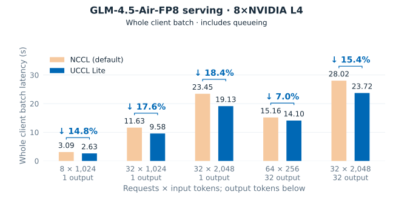
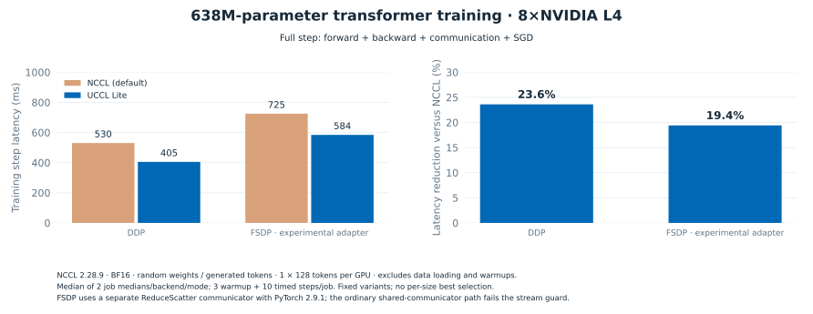

# Large-message end-to-end measurements on eight L4s



Fresh GLM-4.5-Air-FP8 serving measurements show **18.4% lower whole-batch
latency (1.23× throughput)** for 32 concurrent requests with 2,048 input tokens
and one output token: **19.13 s with UCCL Lite versus 23.45 s with NCCL**.
This is a prefill-focused result. The 64-request, 256-input, 32-output control
retains a much smaller **7.0%** gain.

These experiments expose the existing multiprocess packet implementation to
larger application messages. They do not introduce a new collective algorithm
or connect the standalone single-process router to SGLang. The normal launcher
defaults and routing policy are unchanged. Historical measurements remain in
their original reports and are not controls for this revision.

## Serving results

Times include client submission, server queueing, inference, streaming, and
completion of every HTTP response. Client and server run on the same host
over loopback. The statistic is the median of two fresh
server-session medians; each session contains three measured batches per case.
Thus each cell represents six measured batches across two server starts.

| Requests × input × output tokens | NCCL (s) | UCCL Lite (s) | Latency reduction | Throughput ratio |
| --- | ---: | ---: | ---: | ---: |
| 8 × 1,024 × 1 | 3.093 | 2.634 | 14.8% | 1.174× |
| 32 × 1,024 × 1 | 11.627 | 9.578 | 17.6% | 1.214× |
| 32 × 2,048 × 1 | 23.446 | 19.125 | 18.4% | 1.226× |
| 64 × 256 × 32 | 15.161 | 14.100 | 7.0% | 1.075× |

The 32 × 2,048 × 1 session medians were 23.388/23.504 s for NCCL and
19.145/19.106 s for UCCL Lite. These ranges describe the repeated sessions;
they are not confidence intervals. The single-token outputs and prompt hashes
match across all repeats and both backends. The 32-token control has matching
prompt hashes and output lengths, but different generated-text hashes across
backends. These latency measurements do not establish generation equivalence
or model quality.

### Long prompts with 32 generated tokens

The longer-response test also improves whole-request latency:

| Requests × input × output tokens | NCCL (s) | UCCL Lite (s) | Latency reduction | Throughput ratio |
| --- | ---: | ---: | ---: | ---: |
| 32 × 2,048 × 32 | 28.022 | 23.717 | **15.4%** | **1.182×** |

This separate comparison uses one fresh server per backend, NCCL then packet,
one unmeasured full-shape batch, and three measured batches. NCCL's measured
range is 28.018–28.049 s; packet's is 23.702–23.740 s. Both use the same
chunk setting 8,192, proxy capacity 128 MiB, seed, model, input tokens, and
32-token response limit. **Both use `mem_fraction_static=0.90`** instead of
the four-session study's 0.87: its 9,295 KV tokens per DP rank accommodate four
2,048-token prompts plus their responses, while leaving room for the larger
prefill intermediates. Profiles are fixed within each comparison; timings from
different profiles are not substituted for one another.

All six runs return exactly 32 output tokens per request. Prompt hashes match;
text hashes differ across backends and also between NCCL repeats. The data
therefore establish fixed-length serving latency, with no assertion of identical
generated text or quality. This case has fewer independent server starts than
the one-token study. Its raw samples and server flags are in
[long_prompt_response](data/e2e_large_messages_8l4_20261115/long_prompt_response/manifest.json).

To reproduce this case, use the serving command below with
`--backends nccl packet --cases 32:2048:32`, a fresh output directory, and
`--mem-fraction-static 0.90`.

## Hardware and software

- Host `wxz-l4`: eight NVIDIA L4 GPUs, 23,034 MiB reported memory per GPU,
  four GPUs per NUMA socket. Within-socket GPU pairs are PHB; cross-socket
  pairs are SYS. There is no NVLink in the recorded topology.
- Two-socket Intel Xeon 2.20-GHz VM, 24 cores per socket, two hardware threads
  per core, 96 logical CPUs. Driver 580.178.04; normal dynamic GPU clocks.
- Proxy rebuilt through its Makefile with CUDA 12.9.41, `sm_89`, and the
  installed NCCL headers. PyTorch is 2.9.1+cu128; SGLang reports
  `0.0.0.dev0`; Transformers 5.6.0.post5; Triton 3.5.1.
- Serving uses the installed **NCCL 2.27.5** for both modes. This differs
  from the NCCL 2.28.9 used by the historical standalone figures.
- Checkpoint snapshot:
  `zai-org/GLM-4.5-Air-FP8@f9a9c5acf5e543cd24d659a056c5dbcda78ffcfc`.
  Weights use the checkpoint's FP8 configuration; intercepted collectives
  carry BF16. The model and prompts are identical within every comparison.

The [software record](data/e2e_large_messages_8l4_20261115/software.json),
[source/build provenance](data/e2e_large_messages_8l4_20261115/provenance.json),
GPU records, manifests, and server logs retain the exact local configuration.

## Server profile and measurement

Both modes use `launch_glm45_air.sh`: TP8/DP8/EP8, DP attention,
`moe_dense_tp_size=1`, no MoE all-to-all backend, Triton attention/MoE,
4096-token context, maximum 32 running requests, disabled custom AllReduce,
disabled CUDA graphs, and disabled radix caching. The overlap scheduler keeps
its default setting. The random seed is 12345.

For the four cases above, both modes add:

```text
--mem-fraction-static 0.87 --chunked-prefill-size 8192
```

SGLang divides the chunk setting by DP size, yielding **1,024 tokens per
DP rank**, versus 256 in the earlier launch profile. The UCCL capacity is
explicitly raised from 32 MiB to **128 MiB of complete tensor bytes per GPU**.
The same environment is supplied to NCCL, which runs through the proxy with
`UCCL_LITE_NCCL_ENABLE=0`; it does not initialize packet workers or buffers.
The ordinary packet wrapper, CPU-worker placement, and helper placement are
used without algorithm tuning. Both modes use Socket networking, disabled
NCCL network plugins, and the same cuMem/NVLS settings from the wrapper.

Session order is **NCCL → packet → packet → NCCL**. Case order reverses at
each adjacent backend switch, so each backend sees one forward-order and one
reverse-order session. Each server performs its normal startup warmup, one
8-request/64-input/16-output client warmup, and one unmeasured full batch of
each tested shape before its three measured batches. Model loading, worker
preparation, compilation warmups, and correctness checks are outside the
reported intervals. No separately measured best variant is selected for any
case.

Prompts use the benchmark client's synthetic incident-summary corpus. All
requests are submitted concurrently, temperature is zero, EOS is ignored,
and the client requires the exact requested output-token count. One-token
cases have undefined TPOT, recorded as JSON `null`. `client_batch_s` measures
through HTTP completion; the earlier `whole_batch_s` field, ending at the last
token timestamp, is retained separately in the raw samples.

An initial attempt used `mem_fraction_static=0.93` and chunk setting 16,384
(2,048 tokens per DP rank). It ran out of GPU memory in the Triton MoE
intermediate allocation. That failed attempt is retained in
[nccl_pilot_server.log](data/e2e_large_messages_8l4_20261115/nccl_pilot_server.log)
and contributes no timing sample. Lowering the KV reservation leaves room for
the larger activation intermediates; this is a capacity adjustment applied
equally to both modes.

## Reproduce the prefill comparison

From the Lite root, with the local Python/model paths adjusted as needed:

```bash
make -B -C integration/nccl_lite -j2 \
  CUDA_HOME=/usr/local/cuda-12.9 \
  NCCL_HOME=/data/wxzheng/kt-venv/lib/python3.11/site-packages/nvidia/nccl

/data/wxzheng/kt-venv/bin/python integration/nccl_lite/run_e2e_comparison.py \
  --out-dir build/e2e_reproduce \
  --real-nccl /data/wxzheng/kt-venv/lib/python3.11/site-packages/nvidia/nccl/lib/libnccl.so.2 \
  --backends nccl packet packet nccl \
  --cases 8:1024:1 32:1024:1 32:2048:1 64:256:32 \
  --repeats 3 --case-warmups 1 -- \
  --mem-fraction-static 0.87 --random-seed 12345 --chunked-prefill-size 8192
```

The runner owns and shuts down each server process group, rejects an occupied
port and a reused output directory, and preserves failed phases. Set
`MODEL_PATH` and use the desired environment's Python executable to select
the checkpoint and SGLang installation. The NCCL binary must match the one
used by that environment's PyTorch ProcessGroup.

## Large-message training steps



A separate, controlled causal-transformer benchmark exercises large gradient
AllReduce with DDP, and parameter AllGather plus gradient ReduceScatter with
FSDP. This uses generated token batches and randomly initialized weights. It
measures a complete training **step**, not a training job, data pipeline,
convergence result, or pretrained-model quality evaluation.

| Training mode | NCCL step (ms) | UCCL Lite step (ms) | Latency reduction | Throughput ratio |
| --- | ---: | ---: | ---: | ---: |
| DDP | 530.23 | 405.11 | 23.6% | 1.309× |
| FSDP with separate RS communicator | 724.80 | 584.11 | 19.4% | 1.241× |

The model has **637,847,552 parameters**: 12 causal transformer blocks,
width 2,048, 16 attention heads, FFN width 8,192, vocabulary 8,192, learned
position embeddings, and no dropout. Parameters and gradients are BF16;
cross-entropy loss is computed in FP32. Every GPU trains one 128-token
sequence per step, for 1,024 global tokens per step. Four fixed generated
batches per rank rotate in the same order in every trial. SGD uses learning
rate 0.001, no momentum, and `foreach=True`.

DDP communicates **1,275,695,104 gradient bytes per GPU per step**. Its rebuilt
buckets are approximately 128 MiB plus a final 64.5-MiB bucket. Some buckets
slightly exceed the requested 128-MiB cap because whole parameters are kept
together; the proxy capacity is explicitly **256 MiB**. FSDP wraps each
transformer block and the root module: complete AG outputs/RS inputs are
approximately 96.0 MiB per block and 64.5 MiB for the root. Both AG and RS
interception are verified in the final FSDP logs.

Training uses the **NCCL 2.28.9 binary from the standalone eight-L4 studies**
for both backends, unlike the serving study's installed NCCL 2.27.5. The runner
preloads that exact binary and sets the proxy's forwarding target to it.
Each trial records `ncclGetVersion` at runtime and requires exactly one real
NCCL library in its process mappings. PyTorch's separately recorded compile-time
NCCL version remains 2.27.5.

Trials run **NCCL → packet → packet → NCCL**, with fresh eight-process jobs
and reversed DDP/FSDP order at each switch. Each job performs three full
warmup steps, then ten timed steps. Values are the median of two job medians
per backend; each step uses the maximum wall-clock interval across ranks.
Timing includes gradient clearing, forward, loss, backward, communication,
SGD, host submission gaps, and GPU completion. Model construction, input
generation, communicator initialization, DDP bucket rebuilding, barriers before
the timer, and verification are excluded. Normal DDP overlap and FSDP backward
prefetch remain enabled. This is eager execution with a fixed configuration,
not per-shape best-variant selection or a sweep of end-to-end NCCL tuning.

DDP's two NCCL medians were 528.34/532.13 ms, versus packet
402.89/407.33 ms. FSDP's were 726.62/722.98 ms, versus packet
580.33/587.89 ms. All losses were finite. Across the four trials, the largest
absolute loss difference was 0.001038 for DDP and 0.000940 for FSDP. The
recorded parameter samples after 13 SGD steps matched bitwise across backends;
assembled samples also matched across ranks. These are numerical spot checks,
not exhaustive equality of every trained parameter.

### FSDP compatibility boundary

**Ordinary FSDP with one communicator is not supported by this proxy.** Its AG
and RS use different streams, which triggers the existing one-stream-per-
communicator guard. That failure is preserved in
[training_22809_shared_stream_failed](data/e2e_large_messages_8l4_20261115/training_22809_shared_stream_failed/manifest.json).

The measured adapter gives RS its own process group and uses PyTorch's
standard `DefaultState`/`reduce_scatter_hook` averaging implementation for
both backends. It leaves the default process group unbound during initialization
so the second communicator receives full initialization instead of
`ncclCommSplit`, whose child communicator the proxy does not track. The
post-run full-parameter spot check uses FSDP's existing `_unshard_stream`.
No installed PyTorch or collective source is patched. This adapter is specific
to the measured PyTorch 2.9.1 implementation and is experimental; it is not a
claim of general FSDP compatibility for the wheel or default launcher.

Earlier verifier-development failures, their measured source snapshots, and
the short passing checks are retained in the data directory. They contribute
no samples to the training table. Only the eight completed final trials in
[training_22809](data/e2e_large_messages_8l4_20261115/training_22809/manifest.json)
are summarized.

To reproduce, after building the proxy as above:

```bash
/data/wxzheng/kt-venv/bin/python integration/nccl_lite/run_training_comparison.py \
  --out-dir build/training_reproduce \
  --real-nccl "$PWD/build/nccl-2.28.9/lib/libnccl.so.2" \
  --sharding fsdp ddp -- \
  --sequence 128 --batch 1 --bucket-mib 128 --warmup 3 --steps 10
```

## Intercepted serving message sizes

A separate diagnostic server used the same chunk setting, 128-MiB proxy
capacity, and KV fraction 0.90. Tracing was enabled only for this diagnostic;
**none of its timings enter a performance summary**. The client submitted
8 × 1,024-input/1-output requests. The captured window also includes client
health-check traffic, so its counts are not a generic per-request profile.

| Intercepted operation | Observed complete bytes per GPU in the captured window |
| --- | --- |
| AR | 90 calls at 8 MiB and 90 at **56 MiB**, plus smaller calls |
| AG | 45 calls at 64 KiB; largest call **2.3125 MiB** |
| RS | 45 calls at **64 KiB** |

This probe exercises large AR, while its AG/RS traffic is much smaller than
the standalone large-message measurements. Thus a large-message AG/RS
microbenchmark advantage cannot simply be assigned to this GLM request
pattern. The training cases above explicitly exercise large AR and AG/RS.
The observed 56-MiB AR also exceeds the old 32-MiB interception cap; raising
the cap permits those calls to use the packet implementation. This diagnostic
does not attribute GPU time or the total speedup to individual operations.

[shape_probe.json](data/e2e_large_messages_8l4_20261115/shape_probe.json) retains
the complete histogram, log byte offset, and a corrected analysis assumption:
the initial diagnostic asserted a minimum of 64 MiB, but the measured maximum
was 56 MiB. The request completed successfully; the size assertion was too
strict. Its original analysis error and raw trace are preserved, rather than
replacing the observed sizes with the expectation.

## Validation and retained data

- The proxy's CUDA object and shared library were rebuilt through the Makefile
  with CUDA 12.9.41 and `sm_89` before measurement. Collective implementation
  sources, routing policy, dispatcher, and installed application sources are
  unchanged.
- The current eight-process C++ packet test passes with NCCL 2.28.9, including
  exact destination-dependent RS values, odd counts, in-place/out-of-place AR,
  and queued mixed AG/RS/AR calls.
- The current eight-process PyTorch check passes with the installed NCCL
  2.27.5, including ProcessGroup interception and FP32 pass-through.
- Full-tensor BF16 output checks pass for AG/RS/AR at 16, 64, and 128 MiB with
  NCCL 2.27.5, and at **256 MiB** with the pinned NCCL 2.28.9. Their diagnostic
  timing samples are excluded from the performance summaries.
- Every serving response has the requested token count. All final training
  trials finish with finite losses and the recorded parameter spot checks.
  Normal FSDP's stream incompatibility remains an explicit limitation.

These are eager, single-node, eight-GPU checks. No CUDA-graph or multi-node
validation is claimed. This work supplies benchmark/integration evidence,
not an automatic routing calibration or a newly enabled production backend.

The [data directory](data/e2e_large_messages_8l4_20261115/) retains all **54
timed serving batches**, all **eight final training trials** (80 timed steps),
the failed memory/compatibility/verifier attempts, short checks, raw logs,
library/source hashes, and the diagnostic trace. The
[validation record](data/e2e_large_messages_8l4_20261115/validation.json) lists
the final check commands and return codes.
[summary.json](data/e2e_large_messages_8l4_20261115/summary.json) contains every
reported case, both independent session/trial medians where available,
throughput ratios, and output/numerical comparison fields.
[checksums.json](data/e2e_large_messages_8l4_20261115/checksums.json) covers the
retained dataset.

Rebuild the summary from the retained data without a GPU or PyTorch:

```bash
uccl_e2e_data=integration/nccl_lite/data/e2e_large_messages_8l4_20261115
python3 integration/nccl_lite/summarize_e2e_comparison.py \
  --serving "$uccl_e2e_data/dp8_screen" "$uccl_e2e_data/dp8_reverse" \
    "$uccl_e2e_data/long_prompt_response" \
  --training "$uccl_e2e_data/training_22809" \
  --out build/e2e_summary_reproduced.json

PYTHONPYCACHEPREFIX="$PWD/build/pycache" python3 \
  integration/nccl_lite/plot_e2e_comparison.py \
  --summary build/e2e_summary_reproduced.json --preview
```

The summary script rejects missing phases, missing/duplicate samples, changed
prompts or training configurations, and missing packet interception evidence.
The figure includes every serving case and keeps the short-prompt control.
