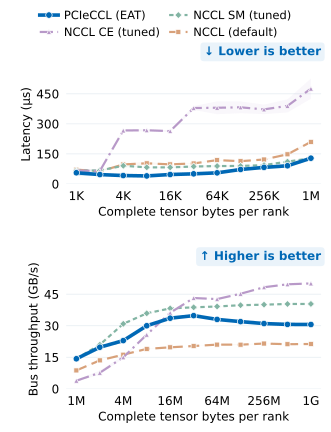

# Eight-PRO-6000 BF16 AllReduce, EAT c03

Fresh independent collective measurements on `wxz-pro6000`, 2026-11-16.
The blue curve is the exact external PCIeCCL EAT c03 implementation used by
the [serving experiment](../../README.md), with unchanged source and installed
extension. No UCCL Lite collective kernel, dispatcher or routing policy is
modified. Serving quality acceptance remains unconfirmed; these collective
checks do not supersede it.



## Hardware and software

- Eight NVIDIA RTX PRO 6000 Blackwell Server Edition GPUs, dual-socket AMD
  EPYC 9B45, four GPUs per NUMA node, no NVLink. XOR-1 peers are `PIX`,
  XOR-2 peers `NODE`, XOR-4 peers `SYS`. Full topology and identities are in
  `raw/topology.txt`, `raw/gpu-identity.txt` and `raw/cpu-identity.txt`.
- PyTorch 2.11.0+cu130, CUDA runtime 13.0, NCCL 2.28.9. Eight processes, one
  GPU per process, physical GPUs 0–7 in order, BF16 out-of-place SUM.
- c03 source SHA-256:
  `ce751fa67339d5163171721a350c09d8edc14876a2e89cb808349ba984f75175`.
  Installed extension SHA-256:
  `89ebe0c1de86d93f6d92e709fcc2dbf753b46579e5fd588c8e35ae5bd1dc243b`.
  Every process launch checks both identities before running.

## Observed results

| Complete tensor per rank | Metric | NCCL default | NCCL SM tuned | NCCL CE tuned | PCIeCCL EAT c03 |
| --- | --- | ---: | ---: | ---: | ---: |
| 1 KiB | Latency (µs) | 71.25 | 66.35 | 66.69 | 55.62 |
| 64 KiB | Latency (µs) | 118.77 | 89.22 | 380.26 | 55.30 |
| 1 MiB | Latency (µs) | 209.98 | 127.92 | 475.71 | 128.51 |
| 1 GiB | Bus throughput (GB/s) | 21.32 | 40.37 | 50.13 | 30.59 |

The recorded c03 implementation improves these small-message examples over
default NCCL, but does not beat the independently tuned references across
all sizes. At 1 MiB it is slightly slower than the selected SM reference;
at 1 GiB both tuned references have higher throughput. These losses remain
in the main figure. The forced CE family has substantial small-message
overhead; its curve is preserved rather than replaced by the SM family.

## Timing and correctness

- All 21 powers of two from 1 KiB to 1 GiB, measured as complete input/output
  tensor bytes **per rank**. Top panel: 1 KiB–1 MiB latency; bottom panel:
  1 MiB–1 GiB bus throughput, computed as `1.75 × bytes / time` for eight-rank
  AllReduce and expressed in decimal GB/s.
- Eager CUDA events on the caller stream enclose the complete out-of-place
  call, including c03's caller staging copies. Events include enqueue gaps;
  they do not isolate kernel-only time. The NCCL reference calls
  `ncclAllReduce(input, output, ...)` directly through a matching pybind11
  interface, with separate input/output buffers. No Torch copy is inserted
  into the timed NCCL path.
- Allocation, communicator setup/registration, input generation, rank barrier,
  validation and teardown are outside the timed interval. The c03 communicator
  has 1-GiB maximum tensor capacity throughout each sweep. This is eager
  collective latency, not graph replay or serving latency.
- Independent validation runs sweep sizes in ascending and descending order.
  Backend order is reversed too. Each size receives 10 warmups followed by
  three repetitions of five timed calls. Inputs change between every timed
  invocation using deterministic position/rank/generation-dependent signed
  dyadic values, exactly representable through the BF16 reduction tree.
- Every timed rank-invocation checks the complete output against the known
  eight-rank sum, the complete unchanged input, and input/output boundary
  guards. All 30,240 validation rank-invocations (3,780 collective calls)
  passed. The corpus is bounded; it is not proof for arbitrary floating-point
  inputs. Warmups are not counted as checked samples.
- Each timed sample takes the maximum of the eight rank event times. A run
  value is the median of its three repetition medians, each over five samples.
  The plotted center is the median of the two independent run values;
  shading is their observed range, not a confidence interval. Throughput is
  computed from the corresponding latency values.

## NCCL calibration and transport evidence

All jobs clear inherited `NCCL_*`/`VLLM_*` settings, then set the recorded
configuration. Common settings are `NCCL_IB_DISABLE=1`, `NCCL_NET=Socket`,
eight visible GPUs and `OMP_NUM_THREADS=1`. All jobs hold the existing shared
`/home/wxzheng/uccl-eval.lock`; the runner checks that no GPU compute processes
are present before each stage. No clocks or system-wide settings are changed.

The default NCCL curve has no transport overrides. SM calibration considers
default, forced system-wide P2P, and P2P with 128 threads / 1-MiB buffers.
CE calibration considers P2P memcpy with two channels, or eight channels and
16-MiB buffers. Exact environment dictionaries are in
[frozen-selection.json](raw/frozen-selection.json).

Calibration is a separate ascending sweep per candidate, with four warmups
and 2×3 checked timed calls per size. Each reference family selects its fastest
calibration candidate **per size**, then freezes that schedule before any
validation run. Both orders validate every complete fixed configuration.
Final curves use the frozen candidate's independent validation values,
including regressions; they do not select the best final run or final variant.
The c03 blue curve uses one fixed implementation and its original size policy:
LL through 64 KiB, PUT above that, CE from 4 MiB in eager execution.

The purple curve measures NCCL's P2P CUDA memcpy transport, verified by
`P2P/CUMEM/CE` channel logs on all eight ranks. It is not a claim that every
phase of the collective executes on copy engines. The green curve uses
kernel transports; its default candidate may include SHM. Default NCCL,
forced P2P and CE configurations each retain their actual channel logs.

## Files and reproduction

- [cases.csv](cases.csv): all plotted forward/reverse latency values and
  selected SM/CE configuration names, generated from raw records.
- `raw/`: calibration/validation per-rank samples, command lines, environment
  metadata, startup transport logs, frozen policy, pre-validation plan,
  completion record and hardware identities. Probe records are excluded from
  the plotted measurements.
- [provenance.json](provenance.json): SHA-256 hashes of packaged measurement
  records and the benchmark/reference source identities.
- [collective_bench.py](../../collective_bench.py),
  [nccl_reference.cpp](../../nccl_reference.cpp),
  [run_collectives.py](../../run_collectives.py): reproducible harness and
  isolated calibration/validation runner. The existing c03 extension is
  required; the runner neither rebuilds nor replaces it.

From `experimental/lite`, with Python and Matplotlib installed:

```bash
make vllm-pcie-collective-figures
```

This verifies archive hashes, all rank samples, the frozen calibration
selection and transport logs before generating the SVG plus `build/figures/`
PNG/PDF previews. An alternate environment can be selected with
`PYTHON=/path/to/venv/bin/python`.

For fresh GPU measurement, first build `make vllm-pcie-nccl-reference` with
`PYTHON`, `CXX`, `CUDA_HOME` and `NCCL_HOME` pointing at the pinned environment.
Then run `run_collectives.py calibration --experiment /path/to/experiment`
and `run_collectives.py validation --experiment /path/to/experiment` using
that environment's Python. Outputs remain under `build/measurements/`.
The original hardware and frozen source/binary identities are required to
reproduce this specific record.
