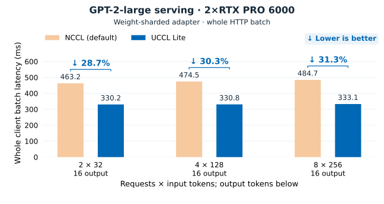
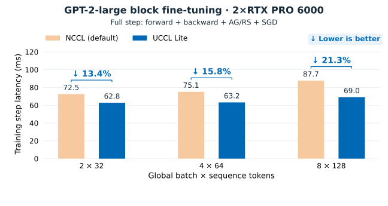

# Parameter-sharded serving and training on two RTX PRO 6000 GPUs

Fresh measurements on `aws-pro6000`, 2026-11-15. Both workloads use the
pretrained **GPT-2-large (774M)** checkpoint with BF16 parameters and computation.
The experimental adapter explicitly selects either UCCL Lite's existing prepared
peer executor or default NCCL; no collective kernel or automatic routing policy
is changed.





The final paired comparison gives **28.7–31.3% lower whole HTTP-batch latency**
(**1.40–1.46× throughput**) and **13.4–21.3% lower full fine-tuning-step latency**
(**1.15–1.27× throughput**) than fresh default NCCL controls.

| Serving: requests × input × output | NCCL (ms) | UCCL Lite (ms) | Latency reduction | Throughput ratio |
| --- | ---: | ---: | ---: | ---: |
| 2 × 32 × 16 | 463.16 | 330.15 | 28.7% | 1.403× |
| 4 × 128 × 16 | 474.55 | 330.82 | 30.3% | 1.434× |
| 8 × 256 × 16 | 484.73 | 333.09 | 31.3% | 1.455× |

| Training: global batch × sequence | NCCL (ms) | UCCL Lite (ms) | Latency reduction | Throughput ratio |
| --- | ---: | ---: | ---: | ---: |
| 2 × 32 | 72.51 | 62.78 | 13.4% | 1.155× |
| 4 × 64 | 75.09 | 63.23 | 15.8% | 1.187× |
| 8 × 128 | 87.71 | 69.03 | 21.3% | 1.270× |

Independent job medians for the largest serving case are **484.725/484.740 ms**
(NCCL) and **338.542/327.644 ms** (UCCL Lite); for the largest training case,
**88.756/86.655 ms** and **68.989/69.081 ms**, respectively. The serving peer
jobs vary by about 3.3%, substantially less than the measured benefit; both
independent peer jobs beat both NCCL controls. These ranges are not confidence
intervals. [summary.json](data/pro6000_20261115/summary.json) retains every case
and both job medians, with no per-case best-run selection.


## Choose the workload from measured communication time

The model has 36 blocks, width 1,280, 20 attention heads, FFN width 5,120 and
vocabulary 50,257. Each block contains 19,677,440 trainable parameters:
**39,354,880 bytes = 37.5317 MiB** in BF16. Each GPU owns half of every block's
weights. Every block forward gathers its complete weights on both GPUs;
training backward scatters the sum of the two gradients back to the owners.
All application AG/RS calls therefore fall within **4–64 MiB of complete AG
output / complete RS input per GPU**. A rank contributes/receives 18.7659 MiB.
This size convention matches the standalone collective figures, rather than
calling a contribution of 37.5 MiB a 37.5-MiB AllGather.

Before the final repetitions, a separate diagnostic measured communication
intervals around actual forward/decode and backward execution. Each diagnostic
uses three warmups, three uninstrumented calls, then three calls with CUDA
events around each AG/RS and the full operation, independently on both caller
streams. The following percentages are medians of the three diagnostic calls:

| Workload | Backend | GPU 0 communication / total stream time | GPU 1 communication / total stream time |
| --- | --- | ---: | ---: |
| Serving, 2 × 32 input × 16 output | NCCL | 92.24% | 92.13% |
| Serving, 2 × 32 input × 16 output | UCCL Lite | 71.00% | 69.84% |
| Training, batch 2 × sequence 32 | NCCL | 83.69% | 83.28% |
| Training, batch 2 × sequence 32 | UCCL Lite | 51.83% | 56.50% |

A separate follow-up checks the largest cases shown in the figures, after the
formal repetitions. It uses the same event protocol; NCCL INFO logging is
enabled only in this diagnostic, and its timings are excluded from the figures.
The [NCCL log](https://github.com/zhongjiechen/uccl-zhongjie-dev/blob/cea1faf6473fc76b5bd192db025f5291169d3b58/lite/integration/peer_e2e/data/pro6000_20261115/profile_best_nccl.log) verifies
`P2P/direct pointer` channels and RING/SIMPLE AG/RS, channels 0–3.

| Workload | Backend | GPU 0 communication / total stream time | GPU 1 communication / total stream time |
| --- | --- | ---: | ---: |
| Serving, 8 × 256 × 16 | NCCL | 88.49% | 88.36% |
| Training, 8 × 128 | NCCL | 73.92% | 73.76% |
| Serving, 8 × 256 × 16 | UCCL Lite | 73.93% | 72.89% |
| Training, 8 × 128 | UCCL Lite | 58.66% | 59.38% |

These are **caller-stream intervals in communication**, including producer
readiness, peer waits, host submission gaps and completion dependencies. They
are not pure NCCL kernel utilization, PCIe counters, or a compute/communication
overlap attribution. Intervals on a single caller stream do not overlap in this
adapter. The remaining stream time includes compute and its submission gaps;
it should not be called pure GEMM time. Per-rank events avoid summing concurrent
work across two GPUs.

Instrumentation changes timing, especially for the faster peer path. For
example, the uninstrumented diagnostic serving medians are 463.19 ms (NCCL)
and 340.81 ms (peer); the peer event-instrumented calls take 362–368 ms.
**No instrumented or pilot sample enters either figure.** The fractions select
a communication-heavy workload; the fresh uninstrumented comparison below
measures its actual benefit. The two
[diagnostic JSON files](https://github.com/zhongjiechen/uccl-zhongjie-dev/blob/cea1faf6473fc76b5bd192db025f5291169d3b58/lite/integration/peer_e2e/data/pro6000_20261115/profile_large_correct_nccl.json)
([peer](https://github.com/zhongjiechen/uccl-zhongjie-dev/blob/cea1faf6473fc76b5bd192db025f5291169d3b58/lite/integration/peer_e2e/data/pro6000_20261115/profile_large_correct_peer.json)) retain AG/RS
components, per-rank totals, all repetitions and instrumentation controls.

## Adapter and timing scope

One Python process owns GPUs 0 and 1. Each GPU serves/trains a different half
of the global batch. Block parameters are sharded; token/position embeddings
and the final norm are frozen replicas. This leaves **708,387,840 trainable
parameters**. The language-model head shares the frozen token embedding.
Both modes use the same checkpoint, placement, buffers, SDPA attention,
GELU implementation, per-layer weight gathering, eager execution and SGD.
Dropout is disabled. Neither mode prefetches or overlaps the next layer's
collective with compute. No best implementation is selected per batch size.

The bridge calls `PeerCollectives::prepare` with idle streams for each exact
extent before the first enqueue. It validates two-rank P2P capability, device
placement, BF16, out-of-place layout and prepared sizes; graph capture is
rejected. The NCCL baseline calls the installed library's `ncclAllGather` and
`ncclReduceScatter(ncclSum)` in a two-rank group. It does not construct a peer
executor or initialize CPU-router workers/buffers. No NCCL algorithm, protocol,
channel, transport or copy-engine override is supplied. Both paths load the
same single real NCCL library, verified in process mappings.

**Serving** measures a complete loopback HTTP POST: JSON request submission,
input upload, prefill, KV-cached greedy decoding, output download, JSON token-ID
response and complete response reception. The client sends one batch of the
stated number of requests; this is a batched token-ID endpoint, not independent
concurrent connections or a streaming server. Tokenization of the fixed text
prompts is outside timing, as are checkpoint loading and initialization. EOS
is ignored to return exactly 16 generated tokens per prompt. The 16 forward
passes comprise one prefill and 15 KV decode passes: **576 AG calls per batch**.
The response contains token IDs; detokenization is outside this endpoint.

**Training** measures a full block-fine-tuning step: gradient clearing, forward,
FP32 cross-entropy, backward, AG/RS, SGD (`lr=0.001`, `foreach=True`), host
submission gaps and completion on both GPUs. Four fixed generated token
batches rotate identically in all trials; these timings do not evaluate
convergence or fine-tuning quality. Gradients are averaged over the global
batch by weighting each rank's loss by 1/2 before the RS sum. There are
**36 AG and 36 RS calls per step**. Batch construction, optimizer construction,
preparation, parameter copying between cases and verification are outside timing.

This is an experimental parameter-sharded adapter, **not stock FSDP, SGLang,
or the existing eight-rank NCCL proxy**. Autograd retains gathered weights needed
for backward; it does not implement FSDP's post-forward resharding, prefetching,
or overlap. GPT-2-large fits on one of these GPUs; imposing sharding here
provides a controlled communication-heavy application comparison, not evidence
that this is its best deployment layout. The results should not be assigned to
an ordinary replicated serving configuration.

## Hardware, software and repetition protocol

- Two NVIDIA RTX PRO 6000 Blackwell Server Edition GPUs, 97,887 MiB reported
  memory each; PCIe Gen5 x16, same switch (`PIX`), peer access in both directions,
  no NVLink. Driver 595.91.07, normal dynamic clocks.
- Intel Xeon Platinum 8559C, one NUMA node, 24 cores / 48 logical CPUs. The
  launcher is pinned to logical CPU 23; Torch/OpenMP/MKL use one host thread.
  The existing shared `eval.lock` serializes access with other benchmark jobs.
- CUDA compiler **13.0.88**, target `sm_120`; PyTorch **2.14.1+cu130**,
  Transformers **5.18.0**; runtime **NCCL 2.30.7**, explicitly preloaded for
  both backends. This differs from the older standalone NCCL 2.29.7 results;
  those figures are not controls for this application experiment.
- Checkpoint:
  `openai-community/gpt2-large@32b71b12589c2f8d625668d2335a01cac3249519`.
  Source, checkpoint, NCCL and bridge SHA-256 hashes are in the manifest.

Final order is **NCCL → UCCL → UCCL → NCCL**, with fresh processes for each
serving/training job; serving/training order reverses at each phase. Each job
uses five full-shape warmups followed by **20 measured calls per case**. A
reported cell is the median of two independent job medians: 40 measurements
per backend/case, **240 serving batches and 240 training steps** in total.
Reported job ranges describe independent job medians, not confidence intervals.
Shapes stay fixed across backends; these are default-NCCL comparisons, not a
sweep of tuned NCCL variants. All three measured serving and training cases
appear in the figures.

## Correctness and retained experiments

Every final process first checks complete BF16 AG/RS outputs at 4, 8, 16, 32,
and 64 MiB plus the exact 37.5317-MiB application size. AG preserves all bits;
RS uses signed, destination-dependent inputs and a complete FP32-sum/BF16-round
oracle. These checks are outside performance intervals. A separate reference
check compares every logit of a 2 × 16-token forward and a four-token KV decode
against the unsharded Transformers checkpoint, one matching microbatch at a
time. The recorded eager results have **zero logit difference** and matching
greedy tokens.

The summary additionally requires identical generated token hashes for every
serving repeat and backend, identical complete training loss histories, and
identical SHA-256 hashes of **all trainable parameters** after all 25 SGD steps.
This checks numerical execution across the compared backends, not model quality.

A smaller **GPT-2 (124M)** control uses the final, reference-checked adapter
with 13.5190-MiB block messages, five warmups and ten measured calls in one
fresh job per backend. At 2 × 32 × 16, HTTP serving is **106.59 ms NCCL versus
112.02 ms UCCL Lite (5.1% slower)**. Training batch 2 × 32 is **20.596 versus
20.656 ms (0.3% slower)**. Generated tokens, losses and complete trained
parameters match across backends. These single-job negative controls are
retained in [small_control/](https://github.com/zhongjiechen/uccl-zhongjie-dev/tree/cea1faf6473fc76b5bd192db025f5291169d3b58/lite/integration/peer_e2e/data/pro6000_20261115/small_control), not mixed
with the two-job GPT-2-large figures. Message size in the target range alone
does not guarantee an application benefit. Its separate
[NCCL communication diagnostic](https://github.com/zhongjiechen/uccl-zhongjie-dev/blob/cea1faf6473fc76b5bd192db025f5291169d3b58/lite/integration/peer_e2e/data/pro6000_20261115/profile_small_nccl.json)
measures only **54.2%/53.2%** of serving stream time and
**39.2%/38.8%** of training stream time inside AG/RS,
well below the larger model's fractions.

`large_screen/` retains the preliminary five-repeat GPT-2-large comparison;
it contributes no formal sample. Development attempts and the smaller-model
negative control are retained separately with their status recorded in the
[data index](https://github.com/zhongjiechen/uccl-zhongjie-dev/blob/cea1faf6473fc76b5bd192db025f5291169d3b58/lite/integration/peer_e2e/data/pro6000_20261115/experiments.json). Early prototype timings
preceding the Transformers reference checks are not valid GPT-2 results:
that prototype packed unused causal-mask buffers and used different BF16
GELU/bias rounding. Reference-check failures are preserved. The final adapter
excludes those buffers and matches the pretrained implementation.

The existing peer kernel source and routing policy are unchanged. Validation
covers the rebuilt CUDA bridge, eager two-GPU collectives, pretrained inference
and full training steps. No four-GPU kernel regression, graph support,
multi-node execution or production serving integration is claimed by this
benchmark addition.

## Reproduce

From the Lite root, with local environment paths adjusted:

```bash
uccl_python=/home/xinze/dev/FreeToken-dev/.venv/bin/python
uccl_nccl=/home/xinze/dev/FreeToken-dev/.venv/lib/python3.12/site-packages/nvidia/nccl
uccl_checkpoint=/home/xinze/.cache/huggingface/hub/models--openai-community--gpt2-large/snapshots/32b71b12589c2f8d625668d2335a01cac3249519

make -C integration/peer_e2e -j4 \
  CUDA_HOME=/opt/pytorch/cuda CUDA_LIB=/opt/pytorch/cuda/lib \
  CUDA_ARCH=sm_120 NCCL_HOME="$uccl_nccl" \
  CUTLASS_HOME=/home/xinze/dev/FreeToken-dev/.venv/lib/python3.12/site-packages/flashinfer/data/cutlass

PYTHONDONTWRITEBYTECODE=1 taskset -c 23 "$uccl_python" integration/peer_e2e/run.py \
  --out build/peer_e2e_reproduce --checkpoint "$uccl_checkpoint" -- \
  --warmup 5 --repeats 20
```

The checkpoint and Python environment are external dependencies. The bridge
build uses the existing CPU-router archive for the `CollectiveCall::workload`
helper; this does not enable or initialize a router in either measured path.
Build products are under `build/peer_e2e/` and `build/cpu_router/`.

Run the communication diagnostic separately, under the same lock/CPU affinity:

```bash
flock -n "$HOME/dev/uccl-eat-pro6000/eval.lock" \
  env PYTHONDONTWRITEBYTECODE=1 taskset -c 23 "$uccl_python" \
  integration/peer_e2e/profile_communication.py \
  --checkpoint "$uccl_checkpoint" --backend nccl --out build/peer_e2e_profile.json
```

Use `--backend peer` and a fresh output filename for the peer diagnostic.
Rebuild the summary and figures without CUDA or Torch:

```bash
uccl_data=integration/peer_e2e/data/pro6000_20261115
python3 integration/peer_e2e/summarize.py \
  --data "$uccl_data/final_abba" --out build/peer_e2e_summary.json
PYTHONDONTWRITEBYTECODE=1 python3 integration/peer_e2e/plot.py \
  --summary build/peer_e2e_summary.json --preview
```

The [manifest](https://github.com/zhongjiechen/uccl-zhongjie-dev/blob/cea1faf6473fc76b5bd192db025f5291169d3b58/lite/integration/peer_e2e/data/pro6000_20261115/final_abba/manifest.json), hardware/software
records and raw JSON/log files retain every sample. The offline summarizer
rejects incomplete or mislabeled trials, changed configurations, missing AG/RS
evidence and mismatched numerical results. `checksums.json` covers the retained
dataset; `provenance.json` records the measured sources and build commands.

The current bridge prepares separate exact AG and RS plans for each extent.
Peer algorithm selection uses the common topology/resource planner. Preparation
automatically fills missing GPU-resource data and qualifies candidates using
private buffers at the exact workload. Enqueue uses cached plans; prior
machine-specific size thresholds are no longer used. Historical timings above
remain measurements of their recorded source versions.

Local bridge correctness (without loading a model):

```bash
python3 tests/collectives/peer_integration_check.py \
  build/peer_e2e/libuccl_lite_peer_e2e.so --ranks 2
```

Run this command from the UCCL Lite root after building the integration.

The peer branch now links the [standalone peer runtime](../../docs/peer-runtime.md)
rather than the CPU-router archive. NCCL remains a dependency of this benchmark
bridge only for its separately selected native reference branch.
