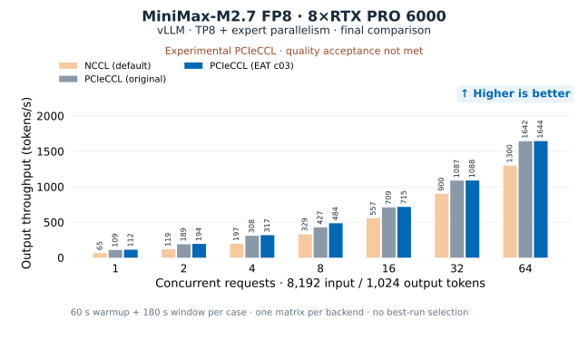
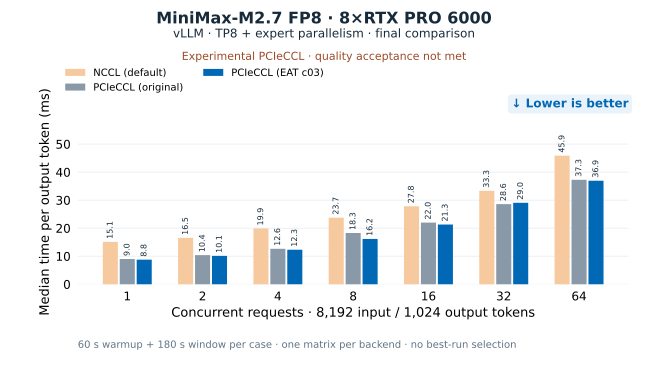
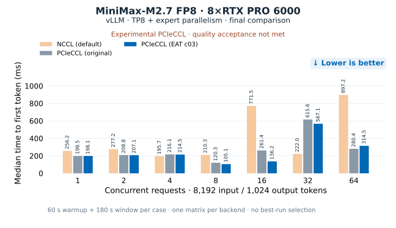
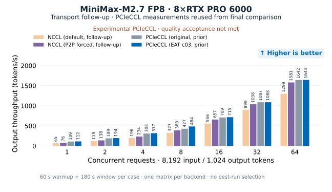

# MiniMax-M2.7 serving on eight RTX PRO 6000 GPUs

Historical external PCIeCCL experiment on `wxz-pro6000`, measured 2026-11-15.
The EAT c03 candidate increases throughput, but **quality acceptance was not
met**. These measurements do not validate the current UCCL Lite runtime or
establish a quality-preserving serving improvement. PCIeCCL is the recorded
external implementation name; this archive does not install its vLLM hook.

A separate [2026-11-16 BF16 AllReduce measurement](data/pro6000_8gpu_allreduce_20261116/README.md)
benchmarks the exact frozen c03 extension over 1 KiB–1 GiB, with independently
calibrated NCCL SM/CE references and the main README's collective figure style.

<table>
  <tr><th>Throughput</th><th>Decode latency</th></tr>
  <tr>
    <td width="50%"></td>
    <td width="50%"></td>
  </tr>
</table>

## Measurement protocol

- Hardware: all eight NVIDIA RTX PRO 6000 Blackwell GPUs on `wxz-pro6000`,
  four GPUs per NUMA node, NUMA nodes 0 and 1. This is separate from the
  two-GPU AWS PRO 6000 testbed in the main README.
- Model/software: MiniMax-M2.7 FP8; collective diagnostics use BF16/FP32;
  vLLM 0.26.0, NCCL 2.28.9, TP8 with expert parallelism. Requested `naive`
  All-to-All maps to `allgather_reducescatter` in this pinned vLLM version.
- Workload: fixed 8,192 input / 1,024 output tokens; concurrent requests
  1, 2, 4, 8, 16, 32, 64. Concurrency is not a fixed token batch. The 70%
  constructed shared prefix is not a measured prefix-cache hit rate.
- Timing: 60 s warmup followed by a 180 s measurement window for each case.
  Throughput is output tokens observed inside that window divided by 180 s,
  including tokens from requests still in flight. TPOT and TTFT are the
  archived request-latency p50 metrics. Startup, diagnostics and quality
  evaluation are outside these timing windows.
- Baseline: upstream experiment NCCL configuration; vLLM custom and
  symmetric-memory AllReduce disabled, AllReduce/RMS fusion disabled,
  transport selection unforced. This is not a comparison against every
  stock vLLM optimization.
- Repetitions: one final matrix for each of NCCL, original PCIeCCL and c03;
  21 complete cases, zero recorded request errors. No confidence intervals,
  per-case best-run selection or best-variant envelope. The c03 implementation
  is fixed across all cases, selected earlier by a separate screening policy.
  Equal-weight geometric means use all seven concurrency cases.

## Final comparison

| Concurrency | NCCL tok/s | Original PCIeCCL tok/s | EAT c03 tok/s | c03 / original |
| ---: | ---: | ---: | ---: | ---: |
| 1 | 65.07 | 108.82 | 111.89 | 1.028× |
| 2 | 119.12 | 189.23 | 194.23 | 1.026× |
| 4 | 196.76 | 307.89 | 316.73 | 1.029× |
| 8 | 329.21 | 427.37 | 484.46 | 1.134× |
| 16 | 557.22 | 709.27 | 715.33 | 1.009× |
| 32 | 900.50 | 1087.39 | 1088.23 | 1.001× |
| 64 | 1300.00 | 1642.47 | 1643.90 | 1.001× |

Geometric-mean throughput: original / NCCL **1.399×**, c03 / NCCL **1.443×**,
c03 / original **1.032×**. At concurrency 32, median TPOT worsens from
28.59 to 29.05 ms; at concurrency 64, TTFT worsens from 280.43 to 314.53 ms.
Throughput gains do not imply improvement in every latency metric.



The ten source configurations and eighteen scored screening/confirmation
evaluations remain in [trials.csv](data/pro6000_8gpu_20261115/results/eat/trials.csv).
Only c03 passed the fixed screening retention rule. It splits LL transmit and
receive loops, extends LL from 32 to 64 KiB, and fuses LL caller staging
copies; it retains the six-phase GPU reduction tree and larger PUT/CE paths.
Recursive doubling, hybrid, indexing, launch geometry and PUT fusion variants
did not pass the declared threshold. Screening results do not replace the
final measurements or quality acceptance.

## NCCL transport follow-up



One fresh NCCL matrix per transport, fixed order forced P2P then default, uses
the same timing/workload protocol. The PCIeCCL columns **reuse the prior final
measurements**. No additional PCIeCCL or quality run was performed.
NCCL P2P uses `NCCL_P2P_DISABLE=0`, `NCCL_P2P_LEVEL=SYS`,
`NCCL_SHM_DISABLE=1`; logged channels use `P2P/CUMEM` on all eight ranks.
Fresh default channels mix P2P/CUMEM and SHM/direct/direct. Forcing transport
affects all NCCL communication in the process, beyond AllReduce alone.

The geometric-mean forced-P2P / fresh-default throughput is **1.181×**;
fresh-default / prior-default is **0.998×**. Reusing the prior PCIeCCL values
gives original / P2P **1.187×** and c03 / P2P **1.225×**. These cross-run
ratios have no confidence interval. [Transport reports and logs](data/pro6000_8gpu_20261115/forced-p2p/)
retain both controls and the audit result.

## Quality and numerical limits

GSM8K: 1,319 questions, five shots, temperature 0, seed 42, maximum 256
output tokens, concurrency 64. Original correct counts are
**[1222, 1213, 1219]**, candidate **[1210, 1213, 1222]**; descriptive medians
are 1219 and 1213. Original invalid counts are [0, 1, 0], candidate [0, 0, 0].
The first original repeat failed the invalid-answer gate, and its post-run
fingerprint was not executed. It remains a failed gate with unverified post-run
provenance. Subsequent predeclared runs did not replace it. The lower candidate
median and failed gate preclude a confirmed quality-preserving improvement;
they do not establish a statistically significant regression or its cause.
See the [complete quality summary](data/pro6000_8gpu_20261115/results/final/quality-summary.json).

A separate finite-input diagnostic compared 1,792 paired BF16/FP32 outputs
across sizes, alignments, eager execution and changing-input graph replay with
no observed bit differences, guard failures or rank disagreements. This
finite corpus does not override the quality result. Raw diagnostic outputs and
the [comparison](data/pro6000_8gpu_20261115/results/final/finite-bitwise.json)
are retained. No fresh GPU validation was performed while organizing this archive.

## Archive and reproduction

The [data archive](data/pro6000_8gpu_20261115/README.md) keeps the original
directory structure, raw case metrics, summaries, review patches, quality
records and experiment scripts. Numeric records preserve the original bytes
(noise records are losslessly gzip-compressed); the new figures use the shared
[figure style](../../scripts/figure_style.py).

From `lite`, with Python and Matplotlib installed:

```bash
make vllm-pcie-figures
```

Use `make vllm-pcie-figures PYTHON=/path/to/venv/bin/python` when Matplotlib
is installed in a separate environment.

This verifies archived file hashes and all 35 raw serving cases against plotted
CSV values, then writes SVGs under `docs/assets/` and PNG/PDF previews under
`build/figures/`. It does not launch a serving benchmark. The archived TOMLs
and scripts preserve historical absolute paths and require the original pinned
environment for an actual rerun.
